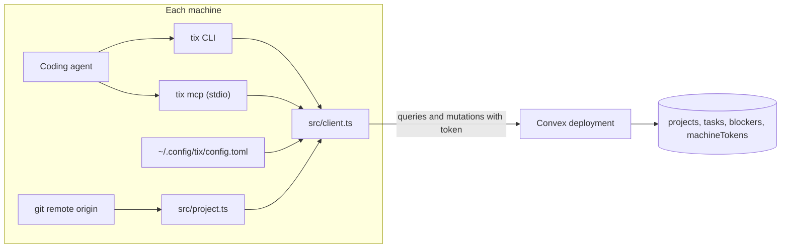

# tix Design

## Purpose

`tix` tracks internal code tasks for agent coding. The tasks are private. They do not go to ClickUp or GitHub Issues.

`tix` uses Convex as the backend. Convex gives one source of truth for many repositories and many machines.

## Requirements

- `tix` must track code tasks only. It does not track general personal tasks.
- `tix` must keep tasks private. It must not write files into work repositories.
- `tix` must track tasks across many repositories.
- `tix` must show the same data on all machines.
- A task must have two states only: open and closed.
- `tix` must have a CLI and an MCP server.

## Out of Scope

- Offline mode, local cache, and write queues.
- Tags, due dates, recurrence, and custom status values.
- Multiple users and browser login.
- Web or mobile UI.
- Sync with GitHub, Shortcut, or other trackers.
- An archive. Closed tasks stay in the `tasks` table.

## Decisions

| Topic | Decision |
|---|---|
| Offline behavior | Online only. A command fails if Convex is not reachable. |
| Authentication | One token for each machine. Convex stores only the SHA-256 hash. |
| Project detection | Normalized `origin` remote URL. The `--project` flag overrides it. |
| Client transport | `ConvexHttpClient` calls typed public queries and mutations. |
| MCP transport | Local stdio process. It shares the client module with the CLI. |
| Repository | New standalone repository at `/home/dev/tix`. |

## Architecture



## Data Model

### `projects`

| Field | Type | Notes |
|---|---|---|
| `key` | string | Normalized remote, for example `github.com/acme/api`. |

- Index: `by_key` on `key`. The key must be unique.
- The first task write for a key creates the project row.

### `tasks`

| Field | Type | Notes |
|---|---|---|
| `projectId` | `Id<"projects">` | Required. |
| `parentId` | `Id<"tasks">` | Optional. |
| `shortId` | string | 8 characters, base36 (`0-9a-z`). The server creates it. |
| `name` | string | Required. 1 to 50,000 characters. |
| `description` | string | Default `""`. 50,000 characters at most. |
| `priority` | number | Integer from 0 to 100. Default `1`. Lower numbers come first. |
| `completed` | boolean | Default `false`. |
| `result` | string | Optional. 50,000 characters at most. |
| `startedAt` | number | Optional. Milliseconds since epoch. |
| `completedAt` | number | Optional. Milliseconds since epoch. |
| `commit` | object | Optional. `{ sha: string, branch?: string, message?: string }`. |

- The create time comes from `_creationTime`.
- Indexes:
  - `by_shortId` on `shortId`.
  - `by_parent` on `parentId`.
  - `by_project_completed_priority` on `projectId`, `completed`, `priority`.
  - `by_completed_priority` on `completed`, `priority`. This index serves `--all-projects`.

### `blockers`

| Field | Type | Notes |
|---|---|---|
| `blockerId` | `Id<"tasks">` | The task that blocks. |
| `blockedId` | `Id<"tasks">` | The task that waits. |

- Indexes: `by_blocker` on `blockerId`. `by_blocked` on `blockedId`.
- Each relationship exists in one row only. The server calculates both directions when it reads.

### `machineTokens`

| Field | Type | Notes |
|---|---|---|
| `name` | string | Machine name, for example `laptop`. Must be unique among active tokens. |
| `tokenHash` | string | Hex SHA-256 of the raw token. |
| `createdAt` | number | Milliseconds since epoch. |
| `revokedAt` | number | Optional. |

- Index: `by_hash` on `tokenHash`.
- Index: `by_name` on `name`.

## Server Rules

The server must enforce these rules in every mutation:

1. A subtask tree must be 3 levels deep at most: epic, task, and subtask.
2. A parent must be in the same project as its child.
3. A task cannot become its own ancestor.
4. A task must not close while it has open children. Other mutations can put an open task under a closed parent. For example, `reopen` does not reopen the parent.
5. A blocker must be in the same project as the blocked task.
6. A task must not block itself.
7. A new blocker must not create a cycle.
8. A delete must remove the task, all its descendants, and all blocker rows that refer to them.
9. `reopen` must clear `completedAt`. It must keep `result` and `commit`.

A task is "ready" when these conditions are true:

- The task is open.
- No open task blocks it.

## Authentication

- Every public query and mutation must take a `token: string` argument.
- `convex/auth.ts` must export `requireMachine(ctx, token)`.
  - It hashes the token with SHA-256 through Web Crypto.
  - It finds the row through `by_hash`.
  - It throws `UNAUTHORIZED` if the row is missing or has `revokedAt`.
- `convex/tokens.ts` must export internal functions only:
  - `create({ name })` is an internal action, because Convex seeds random values in mutations. It makes a raw token `tix_` followed by 32 random bytes in base64url. It stores the hash through an internal mutation and returns the raw token once.
  - `revoke({ name })` sets `revokedAt`.
  - `list()` returns names, `createdAt`, and `revokedAt`. It never returns hashes.
- You run the token functions with `npx convex run`.

## Convex Functions

All functions take `token`. Task references use `shortId`.

### `convex/tasks.ts`

| Function | Type | Arguments |
|---|---|---|
| `create` | mutation | `projectKey`, `name`, `description?`, `priority?`, `parent?` |
| `update` | mutation | `id`, `name?`, `description?`, `priority?`, `parent?` (`null` removes the parent) |
| `start` | mutation | `id` |
| `complete` | mutation | `id`, `result?`, `commit?` |
| `reopen` | mutation | `id` |
| `remove` | mutation | `id` |
| `get` | query | `id`. Returns the task, its project key, its children, its blockers, and the tasks it blocks. |
| `list` | query | `projectKey?`, `filter` (`open`, `closed`, `all`, `ready`), `allProjects?` |

- `list` must return tasks with their project key, `parentShortId`, and `blockedBy` short IDs. The client builds the tree.
- `list` must not return `description`. The client calls `get` for the full task.
- `list` returns an empty list for an unknown `projectKey`. The first `create` makes the project row.
- If `allProjects` is false, `projectKey` is required.

### `convex/blockers.ts`

| Function | Type | Arguments |
|---|---|---|
| `add` | mutation | `blocked`, `blocker` |
| `remove` | mutation | `blocked`, `blocker` |

### `convex/projects.ts`

| Function | Type | Arguments |
|---|---|---|
| `list` | query | None. Returns each key with its count of open tasks. |

## Errors

The server must throw `ConvexError` with data `{ code, message }`.

| Code | Cause |
|---|---|
| `UNAUTHORIZED` | The token is missing, unknown, or revoked. |
| `NOT_FOUND` | The task does not exist, or the project of a task does not exist. |
| `INVALID_INPUT` | A field is out of range. |
| `MAX_DEPTH` | The subtask tree would exceed 3 levels. |
| `PARENT_CYCLE` | The task would become its own ancestor. |
| `CROSS_PROJECT` | The parent or blocker is in a different project. |
| `BLOCKER_CYCLE` | The blocker would create a cycle, or a task would block itself. |
| `OPEN_CHILDREN` | A task with open children cannot close. |

The CLI must use these exit codes:

| Exit code | Meaning |
|---|---|
| `0` | Success. |
| `1` | User error. This includes all server codes except `UNAUTHORIZED`. |
| `2` | Configuration or authentication error. |
| `3` | Network error. The message is "Cannot reach Convex at <url>". |

The CLI must not retry. The CLI must not cache data.

## Local Configuration

- The default path is `~/.config/tix/config.toml`. `TIX_CONFIG` overrides the path.
- The file has two keys: `convex_url` and `token`.
- `TIX_CONVEX_URL` and `TIX_TOKEN` override the values in the file.
- `tix login --url <url> --token <token>` writes the file with mode `0600`.

## Project Detection

`src/project.ts` must find the project key in this order:

1. The `--project <key>` flag. For MCP, the `project` tool argument.
2. The output of `git remote get-url origin` in the current directory, normalized.
3. If neither exists, the command fails with exit code `1`. The message tells you to use `--project`.

Normalization:

| Remote | Key |
|---|---|
| `git@github.com:acme/api.git` | `github.com/acme/api` |
| `https://github.com/acme/api.git` | `github.com/acme/api` |
| `https://user@gitlab.com/acme/sub/api` | `gitlab.com/acme/sub/api` |
| `ssh://git@github.com:22/acme/api.git` | `github.com/acme/api` |

- The key must be lowercase.
- The key must not include user names, ports, or the `.git` suffix.

## CLI

Every command accepts `--json` and `--project <key>`. Argument parsing uses `node:util` `parseArgs`.

| Command | Purpose |
|---|---|
| `tix` or `tix list` | Show open tasks of the current project as a tree. |
| `tix list --closed`, `--all`, `--ready` | Change the filter. |
| `tix list --all-projects` | Show tasks of all projects, grouped by project. |
| `tix create <name> [-d desc] [-p prio] [--parent id]` | Create a task. Prints the short ID. |
| `tix show <id>` | Show all fields, subtasks, and blockers. |
| `tix edit <id> [--name n] [-d desc] [-p prio] [--parent id\|--no-parent]` | Change fields. |
| `tix start <id>` | Record `startedAt`. |
| `tix done <id> [-r result] [--commit sha]` | Close a task. With `--commit`, the CLI reads the branch and message from git. |
| `tix reopen <id>` | Open a closed task again. |
| `tix delete <id>` | Delete the task and its subtasks. |
| `tix block <id> --by <id>` | Add a blocker. |
| `tix unblock <id> --by <id>` | Remove a blocker. |
| `tix plan <file.md>` | Create one task from a plan document. |
| `tix projects` | List projects with open task counts. |
| `tix login --url <url> --token <token>` | Write the local configuration. |
| `tix mcp` | Start the MCP server on stdio. |
| `tix help [command]` | Show help. |

### Plan Import

`tix plan <file.md>` must work like this:

- The name is the first `# ` heading. If the file has no heading, the name is the file name without `.md`.
- The CLI removes a `Plan: ` prefix from the name. The match ignores case.
- The description is the full file content.
- An empty file is an error.

The `tix-plan` skill tells the agent to create subtasks with `tix create --parent`.

## MCP Server

`tix mcp` starts a stdio server with `@modelcontextprotocol/sdk`. It finds the project from its working directory.

| Tool | Purpose |
|---|---|
| `create_task` | Create a task. Accepts an optional `project`. |
| `list_tasks` | List tasks without descriptions. It has the same filters as `tix list`, and an optional `project`. |
| `show_task` | Show one task with its description, subtasks, and blockers. |
| `update_task` | Edit, start, complete, reopen, or delete a task through an `action` field. |
| `manage_blockers` | Add or remove a blocker through an `action` field. |

- The `commit` argument of `update_task` is a git ref. The server reads the SHA, branch, and message from git.
- `update_task` rejects fields that do not belong to the action.
- Tool errors must return `isError: true` with the message.
- An error must not stop the server process.

## Agent Skills

- The Claude Code plugin is in `plugins/tix/`. `.claude-plugin/marketplace.json` lists it, so Claude Code can install it from the checkout.
- `plugins/tix/skills/tix/SKILL.md` teaches the agent to track work with tix.
- `plugins/tix/skills/tix-plan/SKILL.md` teaches the agent to turn a plan document into tasks.
- `plugins/tix/.mcp.json` starts `tix mcp`.
- Both skills must use `tix` commands only.

## Project Layout

```
/home/dev/tix/
├── convex/
│   ├── schema.ts
│   ├── auth.ts          # requireMachine
│   ├── errors.ts        # ConvexError helpers and codes
│   ├── tokens.ts        # Internal: create, revoke, list
│   ├── tasks.ts
│   ├── blockers.ts
│   └── projects.ts
├── src/
│   ├── index.ts         # Entry point
│   ├── errors.ts        # TixError and exit codes
│   ├── client.ts        # ConvexHttpClient, token, error mapping
│   ├── config.ts
│   ├── project.ts
│   ├── git.ts           # Remote URL and commit data
│   ├── format.ts        # Tree and detail output
│   ├── plan.ts
│   ├── test.setup.ts    # Test fixtures and runCli
│   ├── cli/
│   │   ├── command.ts   # Command type and option helpers
│   │   ├── help.ts
│   │   ├── main.ts      # Argument parsing and exit codes
│   │   ├── commands.ts  # Command list and the help command
│   │   ├── mcp.ts       # tix mcp
│   │   └── <command>.ts # One file for each command
│   └── mcp/server.ts    # 5 MCP tools
├── .claude-plugin/marketplace.json
├── plugins/tix/
│   ├── .claude-plugin/plugin.json
│   ├── .mcp.json        # Starts tix mcp
│   └── skills/
│       ├── tix/SKILL.md
│       └── tix-plan/SKILL.md
├── justfile             # Backend and machine setup
├── install.sh           # curl | bash install
├── docs/specs/
├── README.md
└── package.json         # bin: tix
```

## Stack

- Node 24, TypeScript, pnpm.
- Runtime dependencies: `convex`, `@modelcontextprotocol/sdk`, `zod`, `smol-toml`.
- Development dependencies: `typescript`, `vitest`, `convex-test`, `@edge-runtime/vm`, `@types/node`.
- Node 24 runs `src/index.ts` directly with type stripping. There is no build step and no `dist/`.
- `tsc` only checks types (`pnpm typecheck`).

## Testing

Tests must sit next to their source files (`foo.ts` and `foo.test.ts`).

1. **Backend (`convex-test`):** test each server rule, the ready filter, cascade delete, `--all-projects` listing, and token checks. Token checks include unknown and revoked tokens.
2. **Pure modules:** test project-key normalization for all rows in the normalization table, plan parsing, configuration precedence, and tree formatting.
3. **CLI and MCP:** test argument parsing, exit codes, and tool handlers. These tests use a fake client interface. They must not use network mocks.

## Machine Setup

The Convex project `tix` belongs to the team in `TIX_TEAM`.

Backend, once:

1. Put `TIX_TEAM=<team slug>` in `.env`. Git ignores this file.
2. Log in to Convex with the account that owns the team: `pnpm exec convex login`.
3. Run `just setup`. It checks the login and the team, links the project, deploys, and prints the production URL.

Each machine:

1. Run `curl -fsSL https://raw.githubusercontent.com/gstark/tix/main/install.sh | bash`.
   - The script clones the repository into `~/.local/share/tix`, or updates it.
   - It links `src/index.ts` into `~/.local/bin/tix`.
   - If Claude Code is installed, it installs the plugin with the skills and the MCP server.
2. In a checkout with Convex access, run `just token <machine>`. Convex shows the token once.
3. Run `tix login --url <production URL> --token <token>`.

The repository must be public, so the script and the clone work without a GitHub login. The machine tokens protect the backend.

In a development checkout, `just install` and `just agent` do the same steps from that checkout.

Run `just` to list all recipes.
