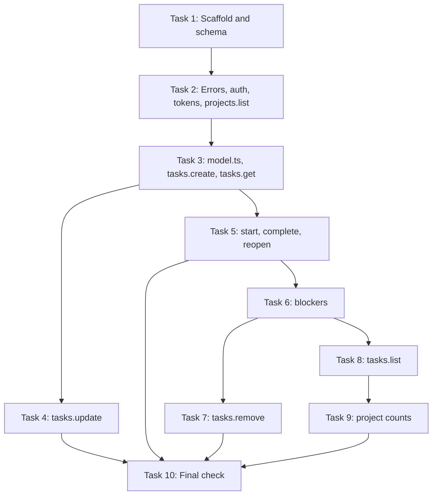

# tix Convex Backend Implementation Plan

> **For agentic workers:** REQUIRED SUB-SKILL: Use superpowers:subagent-driven-development (recommended) or superpowers:executing-plans to implement this plan task-by-task. Steps use checkbox (`- [ ]`) syntax for tracking.

**Goal:** Build the Convex backend for `tix`: schema, machine-token authentication, task, blocker, and project functions, with all server rules from the spec.

**Architecture:** All rules live in Convex mutations. `convex/model.ts` holds the shared lookups and rule checks. `convex/tasks.ts`, `convex/blockers.ts`, and `convex/projects.ts` hold the public functions. Every public function calls `requireMachine` first. Tests use `convex-test` and sit next to the source files.

**Tech Stack:** Node 24, TypeScript, pnpm, Convex, vitest, convex-test, @edge-runtime/vm.

**Spec:** `docs/specs/2026-10-29-tix-design.md`

---

## Plan Series

The spec has three subsystems. Each subsystem has its own plan:

1. **This plan:** the Convex backend.
2. **Plan 2:** the CLI (`src/config.ts`, `src/project.ts`, `src/client.ts`, `src/format.ts`, `src/plan.ts`, `src/cli/`).
3. **Plan 3:** the MCP server, the agent skills, and the machine setup.

## Deviations From the Spec

- The repository root is `/home/dev/dev/tix`. The spec says `/home/dev/tix`.
- `tokens:list` is an internal query, not an internal mutation. It only reads data. `npx convex run tokens:list` works the same way.
- `convex/model.ts` is a new file. It holds helpers that `tasks.ts` and `blockers.ts` share.
- `convex/test.setup.ts` is a new test helper file. Convex does not deploy files with more than one dot in the name.

## Behavior Notes

These rules are not explicit in the spec. The plan uses them:

- `list` for an unknown project key returns `[]`. It does not throw `NOT_FOUND`. A new repository has no project row yet.
- `complete` checks all descendants, not only direct children. A reopened grandchild under a closed child must block the close.
- `start` on a closed task throws `INVALID_INPUT`.
- `start` on a started task keeps the first `startedAt`.
- `complete` on a closed task keeps the first `completedAt`. It can change `result` and `commit`.
- `blockers.add` for a pair that already exists does nothing.
- `blockers.remove` for a pair that does not exist throws `NOT_FOUND`.
- `blockedBy` in a task view lists only open blockers. `get` also returns `blockers` and `blocks` with all rows and their `completed` value.
- A move under a new parent must keep the full subtree within 3 levels.

## File Structure

| File | Responsibility |
|---|---|
| `package.json` | Scripts and dependencies. |
| `.gitignore` | Ignore `node_modules`, `dist`, `.env.local`. |
| `vitest.config.ts` | Vitest projects. This plan adds the `convex` project. |
| `convex/tsconfig.json` | TypeScript settings for the Convex functions and tests. |
| `convex/schema.ts` | Tables, indexes, and the shared `commitValidator`. |
| `convex/errors.ts` | `ErrorCode` type and `fail()`. |
| `convex/auth.ts` | `sha256Hex()` and `requireMachine()`. |
| `convex/tokens.ts` | Internal `create`, `revoke`, `list`. |
| `convex/model.ts` | Lookups, validation, tree rules, short IDs, task views. |
| `convex/tasks.ts` | Public task queries and mutations. |
| `convex/blockers.ts` | Public `add` and `remove`. |
| `convex/projects.ts` | Public `list`. |
| `convex/test.setup.ts` | `setup()`, `expectCode()`, `PROJECT`. |
| `convex/*.test.ts` | Tests for each module. |

## Task Order



---

### Task 1: Scaffold and Schema

**Files:**
- Create: `package.json`
- Create: `.gitignore`
- Create: `vitest.config.ts`
- Create: `convex/tsconfig.json`
- Create: `convex/schema.ts`
- Generated: `convex/_generated/*`, `.env.local`, `pnpm-lock.yaml`

- [ ] **Step 1: Install pnpm**

Run: `corepack enable pnpm && pnpm --version`
Expected: a version number. If corepack fails with a permission error, run `npm install -g pnpm` and then `pnpm --version`.

- [ ] **Step 2: Write `package.json`**

```json
{
  "name": "tix",
  "version": "0.1.0",
  "private": true,
  "type": "module",
  "scripts": {
    "codegen": "convex dev --once --typecheck disable",
    "typecheck": "tsc --noEmit -p convex",
    "test": "vitest run"
  }
}
```

- [ ] **Step 3: Install dependencies**

Run: `pnpm add convex && pnpm add -D typescript vitest vite convex-test @edge-runtime/vm`
Expected: `pnpm-lock.yaml` exists. A warning about ignored build scripts is acceptable.

`vite` is a direct dependency because `convex/tsconfig.json` uses the `vite/client` types for `import.meta.glob`.

- [ ] **Step 4: Write `.gitignore`**

```
node_modules/
dist/
.env.local
```

- [ ] **Step 5: Write `vitest.config.ts`**

```ts
import { defineConfig } from "vitest/config";

export default defineConfig({
  test: {
    projects: [
      {
        test: {
          name: "convex",
          include: ["convex/**/*.test.ts"],
          environment: "edge-runtime",
          server: { deps: { inline: ["convex-test"] } },
        },
      },
    ],
  },
});
```

- [ ] **Step 6: Write `convex/tsconfig.json`**

```json
{
  "compilerOptions": {
    "strict": true,
    "target": "ESNext",
    "module": "ESNext",
    "moduleResolution": "Bundler",
    "lib": ["ES2023", "DOM"],
    "types": ["vite/client"],
    "isolatedModules": true,
    "skipLibCheck": true,
    "forceConsistentCasingInFileNames": true,
    "noEmit": true
  },
  "include": ["./**/*"],
  "exclude": ["./_generated"]
}
```

- [ ] **Step 7: Write `convex/schema.ts`**

```ts
import { defineSchema, defineTable } from "convex/server";
import { v } from "convex/values";

export const commitValidator = v.object({
  sha: v.string(),
  branch: v.optional(v.string()),
  message: v.optional(v.string()),
});

export default defineSchema({
  projects: defineTable({
    key: v.string(),
  }).index("by_key", ["key"]),

  tasks: defineTable({
    projectId: v.id("projects"),
    parentId: v.optional(v.id("tasks")),
    shortId: v.string(),
    name: v.string(),
    description: v.string(),
    priority: v.number(),
    completed: v.boolean(),
    result: v.optional(v.string()),
    startedAt: v.optional(v.number()),
    completedAt: v.optional(v.number()),
    commit: v.optional(commitValidator),
  })
    .index("by_shortId", ["shortId"])
    .index("by_parent", ["parentId"])
    .index("by_project_completed_priority", ["projectId", "completed", "priority"])
    .index("by_completed_priority", ["completed", "priority"]),

  blockers: defineTable({
    blockerId: v.id("tasks"),
    blockedId: v.id("tasks"),
  })
    .index("by_blocker", ["blockerId"])
    .index("by_blocked", ["blockedId"]),

  machineTokens: defineTable({
    name: v.string(),
    tokenHash: v.string(),
    createdAt: v.number(),
    revokedAt: v.optional(v.number()),
  })
    .index("by_hash", ["tokenHash"])
    .index("by_name", ["name"]),
});
```

- [ ] **Step 8: Create a local development deployment and generate types**

Run: `CONVEX_AGENT_MODE=anonymous pnpm exec convex dev --once --typecheck disable`
Expected: the command ends with a success message. `convex/_generated/` and `.env.local` exist.

After this step, `pnpm codegen` regenerates `convex/_generated/`.

- [ ] **Step 9: Typecheck**

Run: `pnpm typecheck`
Expected: no output, exit code 0. If TypeScript 7 fails on the Convex packages, run `pnpm add -D typescript@5` and run the typecheck again.

- [ ] **Step 10: Commit**

```bash
git add package.json pnpm-lock.yaml .gitignore vitest.config.ts convex/
git commit -m "chore: scaffold Convex backend and schema"
```

---

### Task 2: Errors, Authentication, Tokens, and `projects.list`

`projects.list` is the simplest public function. The authentication tests use it.

**Files:**
- Create: `convex/errors.ts`
- Create: `convex/auth.ts`
- Create: `convex/tokens.ts`
- Create: `convex/projects.ts`
- Create: `convex/test.setup.ts`
- Test: `convex/auth.test.ts`

- [ ] **Step 1: Write `convex/test.setup.ts`**

```ts
import { convexTest } from "convex-test";
import { expect } from "vitest";
import { internal } from "./_generated/api";
import schema from "./schema";

export const PROJECT = "github.com/acme/api";

// Vite 8 does not support extglob, so the exclusion is a negated pattern.
const modules = import.meta.glob(["./**/*.*s", "!./**/*.*.*s"]);

export async function setup() {
  const t = convexTest(schema, modules);
  const token = await t.mutation(internal.tokens.create, { name: "test" });
  return { t, token };
}

export async function expectCode(promise: Promise<unknown>, code: string) {
  await expect(promise).rejects.toMatchObject({ data: { code } });
}
```

- [ ] **Step 2: Write the failing test `convex/auth.test.ts`**

```ts
import { describe, expect, it } from "vitest";
import { api, internal } from "./_generated/api";
import { expectCode, setup } from "./test.setup";

describe("machine tokens", () => {
  it("returns a raw token with the tix_ prefix", async () => {
    const { token } = await setup();
    expect(token).toMatch(/^tix_[A-Za-z0-9_-]{43}$/);
  });

  it("stores only the SHA-256 hash", async () => {
    const { t, token } = await setup();
    const rows = await t.run((ctx) => ctx.db.query("machineTokens").collect());
    expect(rows).toHaveLength(1);
    expect(rows[0].tokenHash).toMatch(/^[0-9a-f]{64}$/);
    expect(JSON.stringify(rows)).not.toContain(token);
  });

  it("lists tokens without hashes", async () => {
    const { t } = await setup();
    const list = await t.query(internal.tokens.list, {});
    expect(list).toEqual([{ name: "test", createdAt: expect.any(Number) }]);
  });

  it("rejects a second active token with the same name", async () => {
    const { t } = await setup();
    await expectCode(t.mutation(internal.tokens.create, { name: "test" }), "INVALID_INPUT");
  });

  it("allows a new token after a revoke", async () => {
    const { t } = await setup();
    await t.mutation(internal.tokens.revoke, { name: "test" });
    const token = await t.mutation(internal.tokens.create, { name: "test" });
    expect(await t.query(api.projects.list, { token })).toEqual([]);
  });

  it("throws NOT_FOUND when it revokes an unknown name", async () => {
    const { t } = await setup();
    await expectCode(t.mutation(internal.tokens.revoke, { name: "nope" }), "NOT_FOUND");
  });
});

describe("requireMachine", () => {
  it("accepts an active token", async () => {
    const { t, token } = await setup();
    expect(await t.query(api.projects.list, { token })).toEqual([]);
  });

  it("rejects an unknown token", async () => {
    const { t } = await setup();
    await expectCode(t.query(api.projects.list, { token: "tix_unknown" }), "UNAUTHORIZED");
  });

  it("rejects an empty token", async () => {
    const { t } = await setup();
    await expectCode(t.query(api.projects.list, { token: "" }), "UNAUTHORIZED");
  });

  it("rejects a revoked token", async () => {
    const { t, token } = await setup();
    await t.mutation(internal.tokens.revoke, { name: "test" });
    await expectCode(t.query(api.projects.list, { token }), "UNAUTHORIZED");
  });
});
```

- [ ] **Step 3: Run the test to verify it fails**

Run: `pnpm test convex/auth.test.ts`
Expected: FAIL. The error says that the `tokens` module or function cannot be found.

- [ ] **Step 4: Write `convex/errors.ts`**

```ts
import { ConvexError } from "convex/values";

export type ErrorCode =
  | "UNAUTHORIZED"
  | "NOT_FOUND"
  | "INVALID_INPUT"
  | "MAX_DEPTH"
  | "PARENT_CYCLE"
  | "CROSS_PROJECT"
  | "BLOCKER_CYCLE"
  | "OPEN_CHILDREN";

export function fail(code: ErrorCode, message: string): never {
  throw new ConvexError({ code, message });
}
```

- [ ] **Step 5: Write `convex/auth.ts`**

```ts
import type { Doc } from "./_generated/dataModel";
import type { QueryCtx } from "./_generated/server";
import { fail } from "./errors";

export async function sha256Hex(value: string): Promise<string> {
  const digest = await crypto.subtle.digest("SHA-256", new TextEncoder().encode(value));
  return Array.from(new Uint8Array(digest), (byte) => byte.toString(16).padStart(2, "0")).join("");
}

export async function requireMachine(ctx: QueryCtx, token: string): Promise<Doc<"machineTokens">> {
  const tokenHash = await sha256Hex(token);
  const machine = await ctx.db
    .query("machineTokens")
    .withIndex("by_hash", (q) => q.eq("tokenHash", tokenHash))
    .unique();
  if (!machine || machine.revokedAt !== undefined) {
    fail("UNAUTHORIZED", "The token is missing, unknown, or revoked");
  }
  return machine;
}
```

- [ ] **Step 6: Write `convex/tokens.ts`**

```ts
import { v } from "convex/values";
import type { QueryCtx } from "./_generated/server";
import { internalMutation, internalQuery } from "./_generated/server";
import { sha256Hex } from "./auth";
import { fail } from "./errors";

function randomToken(): string {
  const bytes = crypto.getRandomValues(new Uint8Array(32));
  const base64 = btoa(String.fromCharCode(...bytes));
  return `tix_${base64.replace(/\+/g, "-").replace(/\//g, "_").replace(/=+$/, "")}`;
}

async function activeTokens(ctx: QueryCtx, name: string) {
  const rows = await ctx.db
    .query("machineTokens")
    .withIndex("by_name", (q) => q.eq("name", name))
    .collect();
  return rows.filter((row) => row.revokedAt === undefined);
}

export const create = internalMutation({
  args: { name: v.string() },
  handler: async (ctx, { name }) => {
    if ((await activeTokens(ctx, name)).length > 0) {
      fail("INVALID_INPUT", `An active token for "${name}" already exists`);
    }
    const token = randomToken();
    await ctx.db.insert("machineTokens", {
      name,
      tokenHash: await sha256Hex(token),
      createdAt: Date.now(),
    });
    return token;
  },
});

export const revoke = internalMutation({
  args: { name: v.string() },
  handler: async (ctx, { name }) => {
    const active = await activeTokens(ctx, name);
    if (active.length === 0) fail("NOT_FOUND", `No active token for "${name}"`);
    for (const row of active) await ctx.db.patch(row._id, { revokedAt: Date.now() });
  },
});

export const list = internalQuery({
  args: {},
  handler: async (ctx) => {
    const rows = await ctx.db.query("machineTokens").collect();
    return rows.map(({ name, createdAt, revokedAt }) => ({ name, createdAt, revokedAt }));
  },
});
```

- [ ] **Step 7: Write `convex/projects.ts`**

This version returns keys with a count of `0`. Task 9 adds the real count.

```ts
import { v } from "convex/values";
import { query } from "./_generated/server";
import { requireMachine } from "./auth";

export const list = query({
  args: { token: v.string() },
  handler: async (ctx, { token }) => {
    await requireMachine(ctx, token);
    const projects = await ctx.db.query("projects").withIndex("by_key").collect();
    return projects.map((project) => ({ key: project.key, openCount: 0 }));
  },
});
```

- [ ] **Step 8: Regenerate types**

Run: `pnpm codegen`
Expected: success. `convex/_generated/api.d.ts` now names `auth`, `errors`, `projects`, and `tokens`.

- [ ] **Step 9: Run the test to verify it passes**

Run: `pnpm test convex/auth.test.ts`
Expected: PASS, 10 tests.

- [ ] **Step 10: Typecheck**

Run: `pnpm typecheck`
Expected: exit code 0.

- [ ] **Step 11: Commit**

```bash
git add convex/
git commit -m "feat: add machine token auth and projects.list"
```

---

### Task 3: `model.ts`, `tasks.create`, and `tasks.get`

**Files:**
- Create: `convex/model.ts`
- Create: `convex/tasks.ts`
- Modify: `convex/test.setup.ts`
- Test: `convex/tasks.test.ts`

- [ ] **Step 1: Add a `create` helper to `convex/test.setup.ts`**

Replace the whole file with this content:

```ts
import { convexTest } from "convex-test";
import { expect } from "vitest";
import { api, internal } from "./_generated/api";
import type { ErrorCode } from "./errors";
import schema from "./schema";

export const PROJECT = "github.com/acme/api";
export const OTHER_PROJECT = "github.com/acme/web";

// Vite 8 does not support extglob, so the exclusion is a negated pattern.
const modules = import.meta.glob(["./**/*.*s", "!./**/*.*.*s"]);

type CreateOptions = {
  parent?: string;
  priority?: number;
  description?: string;
  projectKey?: string;
};

export async function setup() {
  const t = convexTest(schema, modules);
  const token = await t.mutation(internal.tokens.create, { name: "test" });
  const create = (name: string, options: CreateOptions = {}) =>
    t.mutation(api.tasks.create, { token, projectKey: PROJECT, name, ...options });
  return { t, token, create };
}

export async function expectCode(promise: Promise<unknown>, code: ErrorCode) {
  await expect(promise).rejects.toMatchObject({ data: { code } });
}
```

- [ ] **Step 2: Write the failing test `convex/tasks.test.ts`**

```ts
import { describe, expect, it } from "vitest";
import { api } from "./_generated/api";
import { OTHER_PROJECT, PROJECT, expectCode, setup } from "./test.setup";

describe("tasks.create", () => {
  it("creates a task with default values", async () => {
    const { create } = await setup();
    const task = await create("Write parser");
    expect(task).toMatchObject({
      projectKey: PROJECT,
      parentShortId: null,
      name: "Write parser",
      description: "",
      priority: 1,
      completed: false,
      result: null,
      startedAt: null,
      completedAt: null,
      commit: null,
      blockedBy: [],
    });
    expect(task.shortId).toMatch(/^[0-9a-z]{8}$/);
    expect(task.createdAt).toEqual(expect.any(Number));
  });

  it("creates the project row on the first write only", async () => {
    const { t, create } = await setup();
    await create("A");
    await create("B");
    const projects = await t.run((ctx) => ctx.db.query("projects").collect());
    expect(projects.map((project) => project.key)).toEqual([PROJECT]);
  });

  it("requires a valid token", async () => {
    const { t } = await setup();
    await expectCode(
      t.mutation(api.tasks.create, { token: "bad", projectKey: PROJECT, name: "A" }),
      "UNAUTHORIZED",
    );
  });

  it("rejects out-of-range fields", async () => {
    const { create } = await setup();
    await expectCode(create(""), "INVALID_INPUT");
    await expectCode(create("x".repeat(50_001)), "INVALID_INPUT");
    await expectCode(create("A", { description: "x".repeat(50_001) }), "INVALID_INPUT");
    await expectCode(create("A", { priority: -1 }), "INVALID_INPUT");
    await expectCode(create("A", { priority: 101 }), "INVALID_INPUT");
    await expectCode(create("A", { priority: 1.5 }), "INVALID_INPUT");
    await expectCode(create("A", { projectKey: "" }), "INVALID_INPUT");
  });

  it("accepts the range limits", async () => {
    const { create } = await setup();
    await expect(create("x".repeat(50_000), { priority: 0 })).resolves.toBeDefined();
    await expect(create("A", { priority: 100 })).resolves.toBeDefined();
  });

  it("throws NOT_FOUND for an unknown parent", async () => {
    const { create } = await setup();
    await expectCode(create("A", { parent: "zzzzzzzz" }), "NOT_FOUND");
  });

  it("allows 3 levels and rejects a fourth level", async () => {
    const { create } = await setup();
    const epic = await create("Epic");
    const task = await create("Task", { parent: epic.shortId });
    const subtask = await create("Subtask", { parent: task.shortId });
    expect(subtask.parentShortId).toBe(task.shortId);
    await expectCode(create("Too deep", { parent: subtask.shortId }), "MAX_DEPTH");
  });

  it("rejects a parent in a different project", async () => {
    const { create } = await setup();
    const parent = await create("Parent", { projectKey: OTHER_PROJECT });
    await expectCode(create("Child", { parent: parent.shortId }), "CROSS_PROJECT");
  });
});

describe("tasks.get", () => {
  it("returns the task with its children", async () => {
    const { t, token, create } = await setup();
    const epic = await create("Epic");
    const child = await create("Child", { parent: epic.shortId });
    const result = await t.query(api.tasks.get, { token, id: epic.shortId });
    expect(result.name).toBe("Epic");
    expect(result.projectKey).toBe(PROJECT);
    expect(result.children.map((task) => task.shortId)).toEqual([child.shortId]);
    expect(result.blockers).toEqual([]);
    expect(result.blocks).toEqual([]);
  });

  it("throws NOT_FOUND for an unknown task", async () => {
    const { t, token } = await setup();
    await expectCode(t.query(api.tasks.get, { token, id: "zzzzzzzz" }), "NOT_FOUND");
  });
});
```

- [ ] **Step 3: Run the test to verify it fails**

Run: `pnpm test convex/tasks.test.ts`
Expected: FAIL. The error says that the `tasks` module cannot be found.

- [ ] **Step 4: Write `convex/model.ts`**

```ts
import type { Doc, Id } from "./_generated/dataModel";
import type { MutationCtx, QueryCtx } from "./_generated/server";
import { fail } from "./errors";

const MAX_TEXT = 50_000;
// Depth of the lowest allowed level: epic 0, task 1, subtask 2.
const MAX_DEPTH = 2;
const SHORT_ID_ALPHABET = "0123456789abcdefghijklmnopqrstuvwxyz";

export type TaskView = {
  shortId: string;
  projectKey: string;
  parentShortId: string | null;
  name: string;
  description: string;
  priority: number;
  completed: boolean;
  result: string | null;
  startedAt: number | null;
  completedAt: number | null;
  commit: Doc<"tasks">["commit"] | null;
  createdAt: number;
  blockedBy: string[];
};

export type TaskSummary = { shortId: string; name: string; completed: boolean };

export function checkText(field: string, value: string, min: number): void {
  if (value.length < min || value.length > MAX_TEXT) {
    fail("INVALID_INPUT", `${field} must have ${min} to ${MAX_TEXT} characters`);
  }
}

export function checkPriority(priority: number): void {
  if (!Number.isInteger(priority) || priority < 0 || priority > 100) {
    fail("INVALID_INPUT", "priority must be an integer from 0 to 100");
  }
}

export async function findTask(ctx: QueryCtx, shortId: string): Promise<Doc<"tasks">> {
  const task = await ctx.db
    .query("tasks")
    .withIndex("by_shortId", (q) => q.eq("shortId", shortId))
    .unique();
  if (!task) fail("NOT_FOUND", `Task ${shortId} not found`);
  return task;
}

export async function findProject(ctx: QueryCtx, key: string): Promise<Doc<"projects"> | null> {
  return ctx.db
    .query("projects")
    .withIndex("by_key", (q) => q.eq("key", key))
    .unique();
}

export async function childrenOf(ctx: QueryCtx, taskId: Id<"tasks">): Promise<Doc<"tasks">[]> {
  return ctx.db
    .query("tasks")
    .withIndex("by_parent", (q) => q.eq("parentId", taskId))
    .collect();
}

export async function descendantsOf(ctx: QueryCtx, taskId: Id<"tasks">): Promise<Doc<"tasks">[]> {
  const result: Doc<"tasks">[] = [];
  for (const child of await childrenOf(ctx, taskId)) {
    result.push(child, ...(await descendantsOf(ctx, child._id)));
  }
  return result;
}

async function depthOf(ctx: QueryCtx, task: Doc<"tasks">): Promise<number> {
  let depth = 0;
  let parentId = task.parentId;
  while (parentId) {
    const parent = await ctx.db.get(parentId);
    if (!parent) break;
    depth++;
    parentId = parent.parentId;
  }
  return depth;
}

async function heightOf(ctx: QueryCtx, taskId: Id<"tasks">): Promise<number> {
  let height = 0;
  for (const child of await childrenOf(ctx, taskId)) {
    height = Math.max(height, 1 + (await heightOf(ctx, child._id)));
  }
  return height;
}

async function isInSubtree(ctx: QueryCtx, node: Doc<"tasks">, rootId: Id<"tasks">): Promise<boolean> {
  let current: Doc<"tasks"> | null = node;
  while (current) {
    if (current._id === rootId) return true;
    current = current.parentId ? await ctx.db.get(current.parentId) : null;
  }
  return false;
}

/**
 * Checks server rules 1 to 3 before a task goes under `parent`.
 * `taskId` is undefined for a new task.
 */
export async function checkParent(
  ctx: QueryCtx,
  projectId: Id<"projects">,
  parent: Doc<"tasks">,
  taskId?: Id<"tasks">,
): Promise<void> {
  if (parent.projectId !== projectId) {
    fail("CROSS_PROJECT", `Parent ${parent.shortId} is in a different project`);
  }
  if (taskId && (await isInSubtree(ctx, parent, taskId))) {
    fail("PARENT_CYCLE", "A task cannot become its own ancestor");
  }
  const height = taskId ? await heightOf(ctx, taskId) : 0;
  if ((await depthOf(ctx, parent)) + 1 + height > MAX_DEPTH) {
    fail("MAX_DEPTH", "The subtask tree must be 3 levels deep at most");
  }
}

export async function newShortId(ctx: MutationCtx): Promise<string> {
  for (;;) {
    const bytes = crypto.getRandomValues(new Uint8Array(8));
    const shortId = Array.from(bytes, (byte) => SHORT_ID_ALPHABET[byte % 36]).join("");
    const clash = await ctx.db
      .query("tasks")
      .withIndex("by_shortId", (q) => q.eq("shortId", shortId))
      .first();
    if (!clash) return shortId;
  }
}

async function openBlockerShortIds(ctx: QueryCtx, taskId: Id<"tasks">): Promise<string[]> {
  const rows = await ctx.db
    .query("blockers")
    .withIndex("by_blocked", (q) => q.eq("blockedId", taskId))
    .collect();
  const shortIds: string[] = [];
  for (const row of rows) {
    const blocker = await ctx.db.get(row.blockerId);
    if (blocker && !blocker.completed) shortIds.push(blocker.shortId);
  }
  return shortIds;
}

export async function toView(ctx: QueryCtx, task: Doc<"tasks">, projectKey: string): Promise<TaskView> {
  const parent = task.parentId ? await ctx.db.get(task.parentId) : null;
  return {
    shortId: task.shortId,
    projectKey,
    parentShortId: parent?.shortId ?? null,
    name: task.name,
    description: task.description,
    priority: task.priority,
    completed: task.completed,
    result: task.result ?? null,
    startedAt: task.startedAt ?? null,
    completedAt: task.completedAt ?? null,
    commit: task.commit ?? null,
    createdAt: task._creationTime,
    blockedBy: await openBlockerShortIds(ctx, task._id),
  };
}

export async function viewOf(ctx: QueryCtx, task: Doc<"tasks">): Promise<TaskView> {
  const project = await ctx.db.get(task.projectId);
  if (!project) fail("NOT_FOUND", `The project of task ${task.shortId} does not exist`);
  return toView(ctx, task, project.key);
}

export async function summaryOf(ctx: QueryCtx, taskId: Id<"tasks">): Promise<TaskSummary | null> {
  const task = await ctx.db.get(taskId);
  return task && { shortId: task.shortId, name: task.name, completed: task.completed };
}
```

- [ ] **Step 5: Write `convex/tasks.ts`**

```ts
import { v } from "convex/values";
import { mutation, query } from "./_generated/server";
import { requireMachine } from "./auth";
import type { TaskSummary } from "./model";
import {
  checkParent,
  checkPriority,
  checkText,
  childrenOf,
  findProject,
  findTask,
  newShortId,
  summaryOf,
  toView,
  viewOf,
} from "./model";

export const create = mutation({
  args: {
    token: v.string(),
    projectKey: v.string(),
    name: v.string(),
    description: v.optional(v.string()),
    priority: v.optional(v.number()),
    parent: v.optional(v.string()),
  },
  handler: async (ctx, args) => {
    await requireMachine(ctx, args.token);
    checkText("projectKey", args.projectKey, 1);
    checkText("name", args.name, 1);
    const description = args.description ?? "";
    checkText("description", description, 0);
    const priority = args.priority ?? 1;
    checkPriority(priority);

    // A failed check later in this mutation rolls back this insert.
    const projectId =
      (await findProject(ctx, args.projectKey))?._id ??
      (await ctx.db.insert("projects", { key: args.projectKey }));
    const parent = args.parent === undefined ? null : await findTask(ctx, args.parent);
    if (parent) await checkParent(ctx, projectId, parent);

    const id = await ctx.db.insert("tasks", {
      projectId,
      parentId: parent?._id,
      shortId: await newShortId(ctx),
      name: args.name,
      description,
      priority,
      completed: false,
    });
    return toView(ctx, (await ctx.db.get(id))!, args.projectKey);
  },
});

export const get = query({
  args: { token: v.string(), id: v.string() },
  handler: async (ctx, { token, id }) => {
    await requireMachine(ctx, token);
    const task = await findTask(ctx, id);
    const view = await viewOf(ctx, task);
    const children = await Promise.all(
      (await childrenOf(ctx, task._id)).map((child) => toView(ctx, child, view.projectKey)),
    );
    const blockerRows = await ctx.db
      .query("blockers")
      .withIndex("by_blocked", (q) => q.eq("blockedId", task._id))
      .collect();
    const blocksRows = await ctx.db
      .query("blockers")
      .withIndex("by_blocker", (q) => q.eq("blockerId", task._id))
      .collect();
    const isSummary = (summary: TaskSummary | null): summary is TaskSummary => summary !== null;
    const blockers = (await Promise.all(blockerRows.map((row) => summaryOf(ctx, row.blockerId)))).filter(isSummary);
    const blocks = (await Promise.all(blocksRows.map((row) => summaryOf(ctx, row.blockedId)))).filter(isSummary);
    return { ...view, children, blockers, blocks };
  },
});
```

- [ ] **Step 6: Regenerate types**

Run: `pnpm codegen`
Expected: success.

- [ ] **Step 7: Run the tests to verify they pass**

Run: `pnpm test`
Expected: PASS. `auth.test.ts` has 10 tests. `tasks.test.ts` has 10 tests.

- [ ] **Step 8: Typecheck**

Run: `pnpm typecheck`
Expected: exit code 0.

- [ ] **Step 9: Commit**

```bash
git add convex/
git commit -m "feat: add tasks.create and tasks.get with tree rules"
```

---

### Task 4: `tasks.update`

**Files:**
- Modify: `convex/tasks.ts`
- Test: `convex/update.test.ts`

- [ ] **Step 1: Write the failing test `convex/update.test.ts`**

```ts
import { describe, expect, it } from "vitest";
import { api } from "./_generated/api";
import { OTHER_PROJECT, expectCode, setup } from "./test.setup";

describe("tasks.update", () => {
  it("changes the name, description, and priority", async () => {
    const { t, token, create } = await setup();
    const task = await create("Old", { description: "old text", priority: 5 });
    const updated = await t.mutation(api.tasks.update, {
      token,
      id: task.shortId,
      name: "New",
      description: "new text",
      priority: 0,
    });
    expect(updated).toMatchObject({ name: "New", description: "new text", priority: 0 });
  });

  it("keeps fields that the call does not include", async () => {
    const { t, token, create } = await setup();
    const task = await create("Keep", { description: "text", priority: 7 });
    const updated = await t.mutation(api.tasks.update, { token, id: task.shortId, name: "Renamed" });
    expect(updated).toMatchObject({ name: "Renamed", description: "text", priority: 7 });
  });

  it("rejects out-of-range fields", async () => {
    const { t, token, create } = await setup();
    const task = await create("A");
    await expectCode(t.mutation(api.tasks.update, { token, id: task.shortId, name: "" }), "INVALID_INPUT");
    await expectCode(t.mutation(api.tasks.update, { token, id: task.shortId, priority: 101 }), "INVALID_INPUT");
  });

  it("sets and removes the parent", async () => {
    const { t, token, create } = await setup();
    const epic = await create("Epic");
    const task = await create("Task");
    const moved = await t.mutation(api.tasks.update, { token, id: task.shortId, parent: epic.shortId });
    expect(moved.parentShortId).toBe(epic.shortId);
    const detached = await t.mutation(api.tasks.update, { token, id: task.shortId, parent: null });
    expect(detached.parentShortId).toBeNull();
  });

  it("rejects the task as its own parent", async () => {
    const { t, token, create } = await setup();
    const task = await create("A");
    await expectCode(t.mutation(api.tasks.update, { token, id: task.shortId, parent: task.shortId }), "PARENT_CYCLE");
  });

  it("rejects a descendant as the parent", async () => {
    const { t, token, create } = await setup();
    const epic = await create("Epic");
    const child = await create("Child", { parent: epic.shortId });
    await expectCode(t.mutation(api.tasks.update, { token, id: epic.shortId, parent: child.shortId }), "PARENT_CYCLE");
  });

  it("rejects a move that makes the subtree too deep", async () => {
    const { t, token, create } = await setup();
    const a = await create("A");
    await create("A1", { parent: a.shortId });
    const b = await create("B");
    const b1 = await create("B1", { parent: b.shortId });
    await expectCode(t.mutation(api.tasks.update, { token, id: a.shortId, parent: b1.shortId }), "MAX_DEPTH");
    const moved = await t.mutation(api.tasks.update, { token, id: a.shortId, parent: b.shortId });
    expect(moved.parentShortId).toBe(b.shortId);
  });

  it("rejects a parent in a different project", async () => {
    const { t, token, create } = await setup();
    const task = await create("A");
    const other = await create("B", { projectKey: OTHER_PROJECT });
    await expectCode(t.mutation(api.tasks.update, { token, id: task.shortId, parent: other.shortId }), "CROSS_PROJECT");
  });

  it("throws NOT_FOUND for an unknown task", async () => {
    const { t, token } = await setup();
    await expectCode(t.mutation(api.tasks.update, { token, id: "zzzzzzzz", name: "A" }), "NOT_FOUND");
  });
});
```

- [ ] **Step 2: Run the test to verify it fails**

Run: `pnpm test convex/update.test.ts`
Expected: FAIL. The error says that `tasks:update` cannot be found.

- [ ] **Step 3: Add `update` to `convex/tasks.ts`**

Add this import at the top of the file:

```ts
import type { Doc } from "./_generated/dataModel";
```

Add this function at the end of the file:

```ts
export const update = mutation({
  args: {
    token: v.string(),
    id: v.string(),
    name: v.optional(v.string()),
    description: v.optional(v.string()),
    priority: v.optional(v.number()),
    parent: v.optional(v.union(v.string(), v.null())),
  },
  handler: async (ctx, args) => {
    await requireMachine(ctx, args.token);
    const task = await findTask(ctx, args.id);
    const patch: Partial<Doc<"tasks">> = {};

    if (args.name !== undefined) {
      checkText("name", args.name, 1);
      patch.name = args.name;
    }
    if (args.description !== undefined) {
      checkText("description", args.description, 0);
      patch.description = args.description;
    }
    if (args.priority !== undefined) {
      checkPriority(args.priority);
      patch.priority = args.priority;
    }
    if (args.parent === null) {
      patch.parentId = undefined;
    } else if (args.parent !== undefined) {
      const parent = await findTask(ctx, args.parent);
      await checkParent(ctx, task.projectId, parent, task._id);
      patch.parentId = parent._id;
    }

    await ctx.db.patch(task._id, patch);
    return viewOf(ctx, { ...task, ...patch });
  },
});
```

- [ ] **Step 4: Run the tests to verify they pass**

Run: `pnpm test`
Expected: PASS. `update.test.ts` has 9 tests.

- [ ] **Step 5: Typecheck**

Run: `pnpm codegen && pnpm typecheck`
Expected: exit code 0.

- [ ] **Step 6: Commit**

```bash
git add convex/
git commit -m "feat: add tasks.update with parent rules"
```

---

### Task 5: `tasks.start`, `tasks.complete`, and `tasks.reopen`

**Files:**
- Modify: `convex/tasks.ts`
- Test: `convex/lifecycle.test.ts`

- [ ] **Step 1: Write the failing test `convex/lifecycle.test.ts`**

```ts
import { describe, expect, it } from "vitest";
import { api } from "./_generated/api";
import { expectCode, setup } from "./test.setup";

const COMMIT = { sha: "abc1234", branch: "main", message: "fix: parser" };

describe("tasks.start", () => {
  it("records startedAt", async () => {
    const { t, token, create } = await setup();
    const task = await create("A");
    const started = await t.mutation(api.tasks.start, { token, id: task.shortId });
    expect(started.startedAt).toEqual(expect.any(Number));
    expect(started.completed).toBe(false);
  });

  it("rejects a closed task", async () => {
    const { t, token, create } = await setup();
    const task = await create("A");
    await t.mutation(api.tasks.complete, { token, id: task.shortId });
    await expectCode(t.mutation(api.tasks.start, { token, id: task.shortId }), "INVALID_INPUT");
  });
});

describe("tasks.complete", () => {
  it("closes the task with a result and a commit", async () => {
    const { t, token, create } = await setup();
    const task = await create("A");
    const done = await t.mutation(api.tasks.complete, {
      token,
      id: task.shortId,
      result: "Parser done",
      commit: COMMIT,
    });
    expect(done).toMatchObject({ completed: true, result: "Parser done", commit: COMMIT });
    expect(done.completedAt).toEqual(expect.any(Number));
  });

  it("rejects a result that is too long", async () => {
    const { t, token, create } = await setup();
    const task = await create("A");
    await expectCode(
      t.mutation(api.tasks.complete, { token, id: task.shortId, result: "x".repeat(50_001) }),
      "INVALID_INPUT",
    );
  });

  it("rejects a task with open children", async () => {
    const { t, token, create } = await setup();
    const epic = await create("Epic");
    const child = await create("Child", { parent: epic.shortId });
    await expectCode(t.mutation(api.tasks.complete, { token, id: epic.shortId }), "OPEN_CHILDREN");
    await t.mutation(api.tasks.complete, { token, id: child.shortId });
    const done = await t.mutation(api.tasks.complete, { token, id: epic.shortId });
    expect(done.completed).toBe(true);
  });

  it("rejects a task with an open grandchild under a closed child", async () => {
    const { t, token, create } = await setup();
    const epic = await create("Epic");
    const child = await create("Child", { parent: epic.shortId });
    const grandchild = await create("Grandchild", { parent: child.shortId });
    await t.mutation(api.tasks.complete, { token, id: grandchild.shortId });
    await t.mutation(api.tasks.complete, { token, id: child.shortId });
    await t.mutation(api.tasks.reopen, { token, id: grandchild.shortId });
    await expectCode(t.mutation(api.tasks.complete, { token, id: epic.shortId }), "OPEN_CHILDREN");
  });
});

describe("tasks.reopen", () => {
  it("clears completedAt and keeps result and commit", async () => {
    const { t, token, create } = await setup();
    const task = await create("A");
    await t.mutation(api.tasks.complete, { token, id: task.shortId, result: "Done", commit: COMMIT });
    const reopened = await t.mutation(api.tasks.reopen, { token, id: task.shortId });
    expect(reopened).toMatchObject({ completed: false, completedAt: null, result: "Done", commit: COMMIT });
  });
});
```

- [ ] **Step 2: Run the test to verify it fails**

Run: `pnpm test convex/lifecycle.test.ts`
Expected: FAIL. The error says that `tasks:start` cannot be found.

- [ ] **Step 3: Add the lifecycle mutations to `convex/tasks.ts`**

Change the `./model` import so that it also includes `descendantsOf`:

```ts
import {
  checkParent,
  checkPriority,
  checkText,
  childrenOf,
  descendantsOf,
  findProject,
  findTask,
  newShortId,
  summaryOf,
  toView,
  viewOf,
} from "./model";
```

Add this import at the top of the file:

```ts
import { fail } from "./errors";
import { commitValidator } from "./schema";
```

Add these functions at the end of the file:

```ts
export const start = mutation({
  args: { token: v.string(), id: v.string() },
  handler: async (ctx, { token, id }) => {
    await requireMachine(ctx, token);
    const task = await findTask(ctx, id);
    if (task.completed) fail("INVALID_INPUT", `Task ${task.shortId} is closed. Reopen it first`);
    const patch = { startedAt: Date.now() };
    await ctx.db.patch(task._id, patch);
    return viewOf(ctx, { ...task, ...patch });
  },
});

export const complete = mutation({
  args: {
    token: v.string(),
    id: v.string(),
    result: v.optional(v.string()),
    commit: v.optional(commitValidator),
  },
  handler: async (ctx, args) => {
    await requireMachine(ctx, args.token);
    const task = await findTask(ctx, args.id);
    if (args.result !== undefined) checkText("result", args.result, 0);
    const open = (await descendantsOf(ctx, task._id)).filter((child) => !child.completed);
    if (open.length > 0) {
      fail("OPEN_CHILDREN", `Task ${task.shortId} has ${open.length} open subtask(s)`);
    }
    const patch: Partial<Doc<"tasks">> = { completed: true, completedAt: Date.now() };
    if (args.result !== undefined) patch.result = args.result;
    if (args.commit !== undefined) patch.commit = args.commit;
    await ctx.db.patch(task._id, patch);
    return viewOf(ctx, { ...task, ...patch });
  },
});

export const reopen = mutation({
  args: { token: v.string(), id: v.string() },
  handler: async (ctx, { token, id }) => {
    await requireMachine(ctx, token);
    const task = await findTask(ctx, id);
    const patch = { completed: false, completedAt: undefined };
    await ctx.db.patch(task._id, patch);
    return viewOf(ctx, { ...task, ...patch });
  },
});
```

- [ ] **Step 4: Run the tests to verify they pass**

Run: `pnpm test`
Expected: PASS. `lifecycle.test.ts` has 7 tests.

- [ ] **Step 5: Typecheck**

Run: `pnpm codegen && pnpm typecheck`
Expected: exit code 0.

- [ ] **Step 6: Commit**

```bash
git add convex/
git commit -m "feat: add tasks.start, complete, and reopen"
```

---

### Task 6: `blockers.add` and `blockers.remove`

**Files:**
- Create: `convex/blockers.ts`
- Test: `convex/blockers.test.ts`

In this module, "`a` blocks `b`" means `add({ blocked: b, blocker: a })`.

- [ ] **Step 1: Write the failing test `convex/blockers.test.ts`**

```ts
import { describe, expect, it } from "vitest";
import { api } from "./_generated/api";
import { OTHER_PROJECT, expectCode, setup } from "./test.setup";

describe("blockers.add", () => {
  it("records the blocker in both directions", async () => {
    const { t, token, create } = await setup();
    const a = await create("A");
    const b = await create("B");
    const blocked = await t.mutation(api.blockers.add, { token, blocked: b.shortId, blocker: a.shortId });
    expect(blocked.blockedBy).toEqual([a.shortId]);

    const viewB = await t.query(api.tasks.get, { token, id: b.shortId });
    expect(viewB.blockers).toEqual([{ shortId: a.shortId, name: "A", completed: false }]);
    const viewA = await t.query(api.tasks.get, { token, id: a.shortId });
    expect(viewA.blocks).toEqual([{ shortId: b.shortId, name: "B", completed: false }]);
  });

  it("stores one row when it adds the same pair twice", async () => {
    const { t, token, create } = await setup();
    const a = await create("A");
    const b = await create("B");
    await t.mutation(api.blockers.add, { token, blocked: b.shortId, blocker: a.shortId });
    await t.mutation(api.blockers.add, { token, blocked: b.shortId, blocker: a.shortId });
    const rows = await t.run((ctx) => ctx.db.query("blockers").collect());
    expect(rows).toHaveLength(1);
  });

  it("drops a closed blocker from blockedBy", async () => {
    const { t, token, create } = await setup();
    const a = await create("A");
    const b = await create("B");
    await t.mutation(api.blockers.add, { token, blocked: b.shortId, blocker: a.shortId });
    await t.mutation(api.tasks.complete, { token, id: a.shortId });
    const viewB = await t.query(api.tasks.get, { token, id: b.shortId });
    expect(viewB.blockedBy).toEqual([]);
    expect(viewB.blockers).toEqual([{ shortId: a.shortId, name: "A", completed: true }]);
  });

  it("rejects a task that blocks itself", async () => {
    const { t, token, create } = await setup();
    const a = await create("A");
    await expectCode(t.mutation(api.blockers.add, { token, blocked: a.shortId, blocker: a.shortId }), "BLOCKER_CYCLE");
  });

  it("rejects a direct cycle", async () => {
    const { t, token, create } = await setup();
    const a = await create("A");
    const b = await create("B");
    await t.mutation(api.blockers.add, { token, blocked: b.shortId, blocker: a.shortId });
    await expectCode(t.mutation(api.blockers.add, { token, blocked: a.shortId, blocker: b.shortId }), "BLOCKER_CYCLE");
  });

  it("rejects an indirect cycle", async () => {
    const { t, token, create } = await setup();
    const a = await create("A");
    const b = await create("B");
    const c = await create("C");
    await t.mutation(api.blockers.add, { token, blocked: b.shortId, blocker: a.shortId });
    await t.mutation(api.blockers.add, { token, blocked: c.shortId, blocker: b.shortId });
    await expectCode(t.mutation(api.blockers.add, { token, blocked: a.shortId, blocker: c.shortId }), "BLOCKER_CYCLE");
  });

  it("rejects a blocker in a different project", async () => {
    const { t, token, create } = await setup();
    const a = await create("A");
    const other = await create("B", { projectKey: OTHER_PROJECT });
    await expectCode(t.mutation(api.blockers.add, { token, blocked: a.shortId, blocker: other.shortId }), "CROSS_PROJECT");
  });

  it("throws NOT_FOUND for an unknown task", async () => {
    const { t, token, create } = await setup();
    const a = await create("A");
    await expectCode(t.mutation(api.blockers.add, { token, blocked: a.shortId, blocker: "zzzzzzzz" }), "NOT_FOUND");
  });
});

describe("blockers.remove", () => {
  it("removes the row", async () => {
    const { t, token, create } = await setup();
    const a = await create("A");
    const b = await create("B");
    await t.mutation(api.blockers.add, { token, blocked: b.shortId, blocker: a.shortId });
    const unblocked = await t.mutation(api.blockers.remove, { token, blocked: b.shortId, blocker: a.shortId });
    expect(unblocked.blockedBy).toEqual([]);
    const rows = await t.run((ctx) => ctx.db.query("blockers").collect());
    expect(rows).toHaveLength(0);
  });

  it("throws NOT_FOUND when the pair does not exist", async () => {
    const { t, token, create } = await setup();
    const a = await create("A");
    const b = await create("B");
    await expectCode(t.mutation(api.blockers.remove, { token, blocked: b.shortId, blocker: a.shortId }), "NOT_FOUND");
  });
});
```

- [ ] **Step 2: Run the test to verify it fails**

Run: `pnpm test convex/blockers.test.ts`
Expected: FAIL. The error says that the `blockers` module cannot be found.

- [ ] **Step 3: Write `convex/blockers.ts`**

```ts
import { v } from "convex/values";
import type { Id } from "./_generated/dataModel";
import type { QueryCtx } from "./_generated/server";
import { mutation } from "./_generated/server";
import { requireMachine } from "./auth";
import { fail } from "./errors";
import { findTask, viewOf } from "./model";

async function findRow(ctx: QueryCtx, blockedId: Id<"tasks">, blockerId: Id<"tasks">) {
  return ctx.db
    .query("blockers")
    .withIndex("by_blocked", (q) => q.eq("blockedId", blockedId))
    .filter((q) => q.eq(q.field("blockerId"), blockerId))
    .first();
}

/** True if `start` already waits on `target` through a chain of blockers. */
async function waitsOn(ctx: QueryCtx, start: Id<"tasks">, target: Id<"tasks">): Promise<boolean> {
  const seen = new Set<Id<"tasks">>();
  const stack = [start];
  while (stack.length > 0) {
    const current = stack.pop()!;
    if (current === target) return true;
    if (seen.has(current)) continue;
    seen.add(current);
    const rows = await ctx.db
      .query("blockers")
      .withIndex("by_blocked", (q) => q.eq("blockedId", current))
      .collect();
    stack.push(...rows.map((row) => row.blockerId));
  }
  return false;
}

const pairArgs = { token: v.string(), blocked: v.string(), blocker: v.string() };

export const add = mutation({
  args: pairArgs,
  handler: async (ctx, args) => {
    await requireMachine(ctx, args.token);
    const blocked = await findTask(ctx, args.blocked);
    const blocker = await findTask(ctx, args.blocker);
    if (blocked._id === blocker._id) fail("BLOCKER_CYCLE", "A task cannot block itself");
    if (blocked.projectId !== blocker.projectId) {
      fail("CROSS_PROJECT", `Blocker ${blocker.shortId} is in a different project`);
    }
    if (!(await findRow(ctx, blocked._id, blocker._id))) {
      if (await waitsOn(ctx, blocker._id, blocked._id)) {
        fail("BLOCKER_CYCLE", `Task ${blocker.shortId} already waits on ${blocked.shortId}`);
      }
      await ctx.db.insert("blockers", { blockedId: blocked._id, blockerId: blocker._id });
    }
    return viewOf(ctx, blocked);
  },
});

export const remove = mutation({
  args: pairArgs,
  handler: async (ctx, args) => {
    await requireMachine(ctx, args.token);
    const blocked = await findTask(ctx, args.blocked);
    const blocker = await findTask(ctx, args.blocker);
    const row = await findRow(ctx, blocked._id, blocker._id);
    if (!row) fail("NOT_FOUND", `Task ${blocker.shortId} does not block ${blocked.shortId}`);
    await ctx.db.delete(row._id);
    return viewOf(ctx, blocked);
  },
});
```

- [ ] **Step 4: Regenerate types**

Run: `pnpm codegen`
Expected: success.

- [ ] **Step 5: Run the tests to verify they pass**

Run: `pnpm test`
Expected: PASS. `blockers.test.ts` has 10 tests.

- [ ] **Step 6: Typecheck**

Run: `pnpm typecheck`
Expected: exit code 0.

- [ ] **Step 7: Commit**

```bash
git add convex/
git commit -m "feat: add blockers.add and blockers.remove"
```

---

### Task 7: `tasks.remove`

**Files:**
- Modify: `convex/tasks.ts`
- Test: `convex/remove.test.ts`

- [ ] **Step 1: Write the failing test `convex/remove.test.ts`**

```ts
import { describe, expect, it } from "vitest";
import { api } from "./_generated/api";
import { expectCode, setup } from "./test.setup";

describe("tasks.remove", () => {
  it("deletes the task, its descendants, and their blocker rows", async () => {
    const { t, token, create } = await setup();
    const epic = await create("Epic");
    const child = await create("Child", { parent: epic.shortId });
    const grandchild = await create("Grandchild", { parent: child.shortId });
    const other = await create("Other");
    const outside = await create("Outside");
    await t.mutation(api.blockers.add, { token, blocked: other.shortId, blocker: grandchild.shortId });
    await t.mutation(api.blockers.add, { token, blocked: child.shortId, blocker: outside.shortId });
    await t.mutation(api.blockers.add, { token, blocked: outside.shortId, blocker: other.shortId });

    const deleted = await t.mutation(api.tasks.remove, { token, id: epic.shortId });
    expect(deleted.sort()).toEqual([epic.shortId, child.shortId, grandchild.shortId].sort());

    const tasks = await t.run((ctx) => ctx.db.query("tasks").collect());
    expect(tasks.map((task) => task.shortId).sort()).toEqual([other.shortId, outside.shortId].sort());
    const rows = await t.run((ctx) => ctx.db.query("blockers").collect());
    expect(rows).toHaveLength(1);
    await expectCode(t.query(api.tasks.get, { token, id: child.shortId }), "NOT_FOUND");
  });

  it("deletes a blocker row only once when both ends are deleted", async () => {
    const { t, token, create } = await setup();
    const epic = await create("Epic");
    const a = await create("A", { parent: epic.shortId });
    const b = await create("B", { parent: epic.shortId });
    await t.mutation(api.blockers.add, { token, blocked: b.shortId, blocker: a.shortId });
    await t.mutation(api.tasks.remove, { token, id: epic.shortId });
    const rows = await t.run((ctx) => ctx.db.query("blockers").collect());
    expect(rows).toHaveLength(0);
  });

  it("throws NOT_FOUND for an unknown task", async () => {
    const { t, token } = await setup();
    await expectCode(t.mutation(api.tasks.remove, { token, id: "zzzzzzzz" }), "NOT_FOUND");
  });
});
```

- [ ] **Step 2: Run the test to verify it fails**

Run: `pnpm test convex/remove.test.ts`
Expected: FAIL. The error says that `tasks:remove` cannot be found.

- [ ] **Step 3: Add `remove` to `convex/tasks.ts`**

Change the `./_generated/dataModel` import to:

```ts
import type { Doc, Id } from "./_generated/dataModel";
```

Add this function at the end of the file:

```ts
export const remove = mutation({
  args: { token: v.string(), id: v.string() },
  handler: async (ctx, { token, id }) => {
    await requireMachine(ctx, token);
    const task = await findTask(ctx, id);
    const doomed = [task, ...(await descendantsOf(ctx, task._id))];

    // A Set because one row can link two deleted tasks.
    const rowIds = new Set<Id<"blockers">>();
    for (const { _id } of doomed) {
      const asBlocker = await ctx.db
        .query("blockers")
        .withIndex("by_blocker", (q) => q.eq("blockerId", _id))
        .collect();
      const asBlocked = await ctx.db
        .query("blockers")
        .withIndex("by_blocked", (q) => q.eq("blockedId", _id))
        .collect();
      for (const row of [...asBlocker, ...asBlocked]) rowIds.add(row._id);
    }

    for (const rowId of rowIds) await ctx.db.delete(rowId);
    for (const { _id } of doomed) await ctx.db.delete(_id);
    return doomed.map((doomedTask) => doomedTask.shortId);
  },
});
```

- [ ] **Step 4: Run the tests to verify they pass**

Run: `pnpm test`
Expected: PASS. `remove.test.ts` has 3 tests.

- [ ] **Step 5: Typecheck**

Run: `pnpm codegen && pnpm typecheck`
Expected: exit code 0.

- [ ] **Step 6: Commit**

```bash
git add convex/
git commit -m "feat: add tasks.remove with cascade delete"
```

---

### Task 8: `tasks.list`

**Files:**
- Modify: `convex/tasks.ts`
- Test: `convex/list.test.ts`

- [ ] **Step 1: Write the failing test `convex/list.test.ts`**

```ts
import { describe, expect, it } from "vitest";
import { api } from "./_generated/api";
import { OTHER_PROJECT, PROJECT, expectCode, setup } from "./test.setup";

describe("tasks.list", () => {
  it("returns open tasks in priority order", async () => {
    const { t, token, create } = await setup();
    await create("Three", { priority: 3 });
    await create("One", { priority: 1 });
    await create("Two", { priority: 2 });
    const tasks = await t.query(api.tasks.list, { token, projectKey: PROJECT, filter: "open" });
    expect(tasks.map((task) => task.name)).toEqual(["One", "Two", "Three"]);
  });

  it("filters by closed and all", async () => {
    const { t, token, create } = await setup();
    const done = await create("Done");
    await create("Open");
    await t.mutation(api.tasks.complete, { token, id: done.shortId });
    const closed = await t.query(api.tasks.list, { token, projectKey: PROJECT, filter: "closed" });
    expect(closed.map((task) => task.name)).toEqual(["Done"]);
    const all = await t.query(api.tasks.list, { token, projectKey: PROJECT, filter: "all" });
    expect(all.map((task) => task.name).sort()).toEqual(["Done", "Open"]);
  });

  it("returns ready tasks: open and not blocked by an open task", async () => {
    const { t, token, create } = await setup();
    const blocker = await create("Blocker");
    const waiting = await create("Waiting");
    await t.mutation(api.blockers.add, { token, blocked: waiting.shortId, blocker: blocker.shortId });

    const before = await t.query(api.tasks.list, { token, projectKey: PROJECT, filter: "ready" });
    expect(before.map((task) => task.name)).toEqual(["Blocker"]);

    await t.mutation(api.tasks.complete, { token, id: blocker.shortId });
    const after = await t.query(api.tasks.list, { token, projectKey: PROJECT, filter: "ready" });
    expect(after.map((task) => task.name)).toEqual(["Waiting"]);
  });

  it("includes parentShortId and blockedBy", async () => {
    const { t, token, create } = await setup();
    const epic = await create("Epic");
    const child = await create("Child", { parent: epic.shortId });
    await t.mutation(api.blockers.add, { token, blocked: child.shortId, blocker: epic.shortId });
    const tasks = await t.query(api.tasks.list, { token, projectKey: PROJECT, filter: "open" });
    const listedChild = tasks.find((task) => task.shortId === child.shortId);
    expect(listedChild).toMatchObject({ parentShortId: epic.shortId, blockedBy: [epic.shortId] });
  });

  it("returns only tasks of the given project", async () => {
    const { t, token, create } = await setup();
    await create("Mine");
    await create("Theirs", { projectKey: OTHER_PROJECT });
    const tasks = await t.query(api.tasks.list, { token, projectKey: PROJECT, filter: "open" });
    expect(tasks.map((task) => task.name)).toEqual(["Mine"]);
  });

  it("returns an empty list for an unknown project", async () => {
    const { t, token } = await setup();
    const tasks = await t.query(api.tasks.list, { token, projectKey: "github.com/acme/none", filter: "open" });
    expect(tasks).toEqual([]);
  });

  it("returns tasks of all projects with their project keys", async () => {
    const { t, token, create } = await setup();
    await create("Mine");
    await create("Theirs", { projectKey: OTHER_PROJECT });
    const tasks = await t.query(api.tasks.list, { token, filter: "open", allProjects: true });
    expect(tasks.map((task) => [task.name, task.projectKey]).sort()).toEqual([
      ["Mine", PROJECT],
      ["Theirs", OTHER_PROJECT],
    ]);
  });

  it("requires projectKey when allProjects is false", async () => {
    const { t, token } = await setup();
    await expectCode(t.query(api.tasks.list, { token, filter: "open" }), "INVALID_INPUT");
  });
});
```

- [ ] **Step 2: Run the test to verify it fails**

Run: `pnpm test convex/list.test.ts`
Expected: FAIL. The error says that `tasks:list` cannot be found.

- [ ] **Step 3: Add `list` to `convex/tasks.ts`**

Change the `./_generated/server` import to:

```ts
import type { QueryCtx } from "./_generated/server";
import { mutation, query } from "./_generated/server";
```

Change the `./model` type import to:

```ts
import type { TaskSummary, TaskView } from "./model";
```

Add this code at the end of the file:

```ts
const filterValidator = v.union(v.literal("open"), v.literal("closed"), v.literal("all"), v.literal("ready"));

type Filter = "open" | "closed" | "all" | "ready";

/** Reads tasks for one project, or for all projects when `projectId` is null. */
async function tasksFor(ctx: QueryCtx, projectId: Id<"projects"> | null, filter: Filter) {
  const completed = filter === "closed";
  const any = filter === "all";
  if (projectId === null) {
    return ctx.db
      .query("tasks")
      .withIndex("by_completed_priority", (q) => (any ? q : q.eq("completed", completed)))
      .collect();
  }
  return ctx.db
    .query("tasks")
    .withIndex("by_project_completed_priority", (q) =>
      any ? q.eq("projectId", projectId) : q.eq("projectId", projectId).eq("completed", completed),
    )
    .collect();
}

export const list = query({
  args: {
    token: v.string(),
    projectKey: v.optional(v.string()),
    filter: filterValidator,
    allProjects: v.optional(v.boolean()),
  },
  handler: async (ctx, args): Promise<TaskView[]> => {
    await requireMachine(ctx, args.token);
    let projectId: Id<"projects"> | null = null;
    if (!args.allProjects) {
      if (args.projectKey === undefined) fail("INVALID_INPUT", "projectKey is required without allProjects");
      const project = await findProject(ctx, args.projectKey);
      if (!project) return [];
      projectId = project._id;
    }

    const keys = new Map<Id<"projects">, string>();
    const views: TaskView[] = [];
    for (const task of await tasksFor(ctx, projectId, args.filter)) {
      let key = keys.get(task.projectId);
      if (key === undefined) {
        key = (await ctx.db.get(task.projectId))?.key ?? "";
        keys.set(task.projectId, key);
      }
      views.push(await toView(ctx, task, key));
    }
    return args.filter === "ready" ? views.filter((view) => view.blockedBy.length === 0) : views;
  },
});
```

- [ ] **Step 4: Run the tests to verify they pass**

Run: `pnpm test`
Expected: PASS. `list.test.ts` has 8 tests.

- [ ] **Step 5: Typecheck**

Run: `pnpm codegen && pnpm typecheck`
Expected: exit code 0. If TypeScript rejects the conditional index range in `tasksFor`, split each branch into its own `if` statement with its own query.

- [ ] **Step 6: Commit**

```bash
git add convex/
git commit -m "feat: add tasks.list with filters and all-projects mode"
```

---

### Task 9: Open Task Counts in `projects.list`

**Files:**
- Modify: `convex/projects.ts`
- Test: `convex/projects.test.ts`

- [ ] **Step 1: Write the failing test `convex/projects.test.ts`**

```ts
import { describe, expect, it } from "vitest";
import { api } from "./_generated/api";
import { OTHER_PROJECT, PROJECT, setup } from "./test.setup";

describe("projects.list", () => {
  it("returns each key with its count of open tasks, sorted by key", async () => {
    const { t, token, create } = await setup();
    await create("Open");
    const done = await create("Done");
    await t.mutation(api.tasks.complete, { token, id: done.shortId });
    await create("Other", { projectKey: OTHER_PROJECT });
    await create("Other 2", { projectKey: OTHER_PROJECT });

    const projects = await t.query(api.projects.list, { token });
    expect(projects).toEqual([
      { key: PROJECT, openCount: 1 },
      { key: OTHER_PROJECT, openCount: 2 },
    ]);
  });
});
```

- [ ] **Step 2: Run the test to verify it fails**

Run: `pnpm test convex/projects.test.ts`
Expected: FAIL. Both `openCount` values are `0`.

- [ ] **Step 3: Replace `convex/projects.ts`**

```ts
import { v } from "convex/values";
import { query } from "./_generated/server";
import { requireMachine } from "./auth";

export const list = query({
  args: { token: v.string() },
  handler: async (ctx, { token }) => {
    await requireMachine(ctx, token);
    const projects = await ctx.db.query("projects").withIndex("by_key").collect();
    return Promise.all(
      projects.map(async (project) => {
        const open = await ctx.db
          .query("tasks")
          .withIndex("by_project_completed_priority", (q) =>
            q.eq("projectId", project._id).eq("completed", false),
          )
          .collect();
        return { key: project.key, openCount: open.length };
      }),
    );
  },
});
```

- [ ] **Step 4: Run the tests to verify they pass**

Run: `pnpm test`
Expected: PASS. All test files pass.

- [ ] **Step 5: Typecheck**

Run: `pnpm typecheck`
Expected: exit code 0.

- [ ] **Step 6: Commit**

```bash
git add convex/
git commit -m "feat: count open tasks in projects.list"
```

---

### Task 10: Final Check

**Files:** none.

- [ ] **Step 1: Run the full test suite**

Run: `pnpm test`
Expected: PASS. 8 test files, 78 tests.

- [ ] **Step 2: Typecheck**

Run: `pnpm codegen && pnpm typecheck`
Expected: exit code 0.

- [ ] **Step 3: Push the functions to the local deployment with the Convex typecheck on**

Run: `pnpm exec convex dev --once`
Expected: success. This step proves that Convex accepts the schema and the functions.

- [ ] **Step 4: Run a token command through the Convex CLI**

Run: `pnpm exec convex run tokens:create '{"name":"smoke"}'`
Expected: a string that starts with `tix_`.

Run: `pnpm exec convex run tokens:list`
Expected: a list that contains `smoke`. The list has no `tokenHash` field.

- [ ] **Step 5: Check the spec coverage**

Read the "Server Rules", "Authentication", "Convex Functions", and "Errors" sections of `docs/specs/2026-10-29-tix-design.md`. Find one test for each rule and each error code. If a rule has no test, add the test before you continue.

| Spec item | Test file |
|---|---|
| Rule 1: 3 levels at most | `tasks.test.ts`, `update.test.ts` |
| Rule 2: parent in the same project | `tasks.test.ts`, `update.test.ts` |
| Rule 3: no ancestor cycle | `update.test.ts` |
| Rule 4: no close with open children | `lifecycle.test.ts` |
| Rule 5: blocker in the same project | `blockers.test.ts` |
| Rule 6: no self block | `blockers.test.ts` |
| Rule 7: no blocker cycle | `blockers.test.ts` |
| Rule 8: cascade delete | `remove.test.ts` |
| Rule 9: reopen keeps result and commit | `lifecycle.test.ts` |
| Ready filter | `list.test.ts` |
| All-projects listing | `list.test.ts` |
| Unknown and revoked tokens | `auth.test.ts` |
