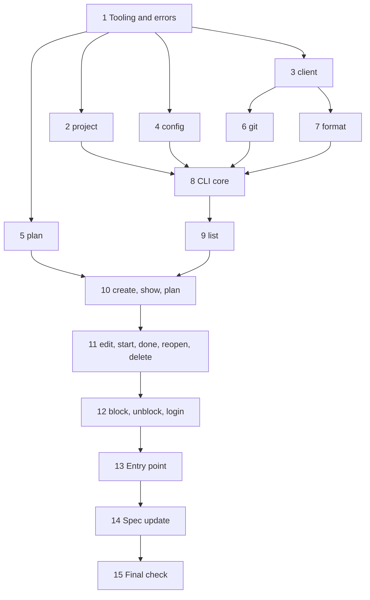
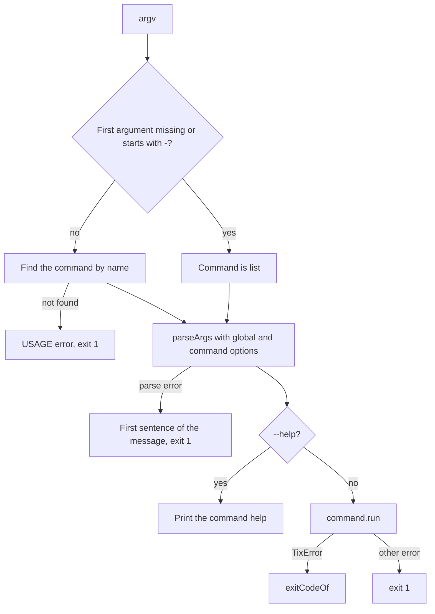

# tix CLI Implementation Plan

> **For agentic workers:** REQUIRED SUB-SKILL: Use superpowers:subagent-driven-development (recommended) or superpowers:executing-plans to implement this plan task-by-task. Steps use checkbox (`- [ ]`) syntax for tracking.

**Goal:** Build the `tix` command-line client. It finds the project from git, calls the Convex backend, and prints tasks as trees and details.

**Architecture:** Pure modules (`project`, `plan`, `config`, `format`) have no I/O dependencies on Convex. `src/client.ts` wraps `ConvexHttpClient` behind a `TixClient` interface and maps errors to `TixError`. `src/cli/main.ts` parses arguments with `node:util` `parseArgs`, runs one command, and returns an exit code. The commands get a `Context` with the client, git, and output functions, so the tests use fakes and no network. Node 24 runs `src/index.ts` directly. There is no build step.

**Tech Stack:** Node 24 (type stripping), TypeScript 7 (typecheck only), pnpm, Convex `ConvexHttpClient`, `smol-toml`, vitest.

**Spec:** `docs/specs/2026-10-29-tix-design.md`

---

## Plan Series

1. **Plan 1 (done):** the Convex backend.
2. **This plan:** the CLI.
3. **Plan 3:** the MCP server (`tix mcp`), the agent skills, and the machine setup with a justfile.

## Deviations From the Spec

- Node runs the TypeScript source directly. There is no `dist/` and no `pnpm build`. `tsc` only checks types. Task 14 updates the spec.
- New files that the spec does not name:
  - `src/errors.ts`: `TixError` and the map from error code to exit code.
  - `src/git.ts`: reads the remote and commit data from git.
  - `src/test.setup.ts`: test fixtures and `runCli`.
  - `src/cli/command.ts`, `src/cli/help.ts`, `src/cli/main.ts`, `src/cli/commands.ts`: the command framework.
- The `help` command lives in `src/cli/commands.ts`. It needs the full command list, so a separate file would make an import cycle.
- `src/cli/delete.ts` exports `remove`, because `delete` is a reserved word.
- `tix mcp` is not in this plan. Plan 3 adds it.

## Rules For The Implementer

- Work in a git worktree on the branch `tix-cli`. Do not push.
- Use pnpm. Never use yarn.
- Never use `any`.
- Imports in `src/` must use explicit `.ts` or `.js` extensions. Node runs the files directly and does not guess extensions.
- Do not use TypeScript syntax that Node cannot strip: no `enum`, no `namespace`, no constructor parameter properties. `erasableSyntaxOnly` in `tsconfig.json` enforces this.
- Use `import type` for type-only imports. `verbatimModuleSyntax` enforces this.
- Run `pnpm typecheck` and `pnpm test` before each commit.

## Exit Codes

| Code | Cause |
|---|---|
| `0` | Success. |
| `1` | Usage error, or a server error other than `UNAUTHORIZED`. |
| `2` | `UNAUTHORIZED`, or a configuration error. |
| `3` | Network error: "Cannot reach Convex at <url>". |

## File Structure

```
src/
├── index.ts            # Entry point: makes the real Context and runs main
├── errors.ts           # TixError, exitCodeOf
├── client.ts           # TixClient interface, convexClient, toTixError
├── config.ts           # configPath, loadConfig, saveConfig
├── project.ts          # normalizeRemote, resolveProject
├── git.ts              # Git interface, systemGit
├── plan.ts             # parsePlan
├── format.ts           # formatLine, formatTree, formatGroups, formatDetail, formatProjects
├── test.setup.ts       # Fixtures, fakeClient, runCli
└── cli/
    ├── command.ts      # Context, Input, Command, option helpers
    ├── help.ts         # helpLines
    ├── main.ts         # Argument parsing, dispatch, error to exit code
    ├── commands.ts     # The command list and the help command
    ├── list.ts  create.ts  show.ts  edit.ts  start.ts  done.ts  reopen.ts
    ├── delete.ts  block.ts  unblock.ts  plan.ts  projects.ts  login.ts
    └── *.test.ts
```



---

### Task 1: Tooling and errors

**Files:**
- Modify: `package.json`, `vitest.config.ts`
- Create: `tsconfig.json`, `src/errors.ts`, `src/errors.test.ts`

- [ ] **Step 1: Add the dependencies**

Run:

```bash
pnpm add smol-toml@^1.9.1
pnpm add -D @types/node@^24.19.2
```

- [ ] **Step 2: Add the typecheck script**

In `package.json`, set the `typecheck` script:

```json
"typecheck": "tsc --noEmit -p convex && tsc --noEmit -p ."
```

- [ ] **Step 3: Create `tsconfig.json`**

The root config checks `src/`. It uses Bundler resolution, because `convex/_generated/api.d.ts` pulls in the convex files, and those use imports with no extension.

```json
{
  "compilerOptions": {
    "strict": true,
    "target": "ES2024",
    "module": "ESNext",
    "moduleResolution": "Bundler",
    "lib": ["ES2024"],
    "types": ["node"],
    "allowImportingTsExtensions": true,
    "erasableSyntaxOnly": true,
    "verbatimModuleSyntax": true,
    "isolatedModules": true,
    "skipLibCheck": true,
    "forceConsistentCasingInFileNames": true,
    "noEmit": true
  },
  "include": ["src"]
}
```

- [ ] **Step 4: Add the `cli` test project**

Replace `vitest.config.ts`:

```ts
import { defineConfig } from "vitest/config";

export default defineConfig({
  test: {
    projects: [
      {
        test: {
          name: "convex",
          include: ["convex/**/*.test.ts"],
          environment: "edge-runtime",
          server: { deps: { inline: ["convex-test"] } },
        },
      },
      {
        test: {
          name: "cli",
          include: ["src/**/*.test.ts"],
          environment: "node",
        },
      },
    ],
  },
});
```

- [ ] **Step 5: Write the failing test**

`src/errors.test.ts`:

```ts
import { describe, expect, it } from "vitest";
import { exitCodeOf } from "./errors.ts";

describe("exitCodeOf", () => {
  it.each([
    ["NOT_FOUND", 1],
    ["MAX_DEPTH", 1],
    ["USAGE", 1],
    ["UNAUTHORIZED", 2],
    ["CONFIG", 2],
    ["NETWORK", 3],
  ] as const)("maps %s to %i", (code, exit) => {
    expect(exitCodeOf(code)).toBe(exit);
  });
});
```

- [ ] **Step 6: Run the test to make sure it fails**

Run: `pnpm exec vitest run src/errors.test.ts`
Expected: FAIL. The import of `./errors.ts` cannot be resolved.

- [ ] **Step 7: Write `src/errors.ts`**

```ts
import type { ErrorCode } from "../convex/errors.ts";

/** Server codes, plus the codes that only the client makes. */
export type TixErrorCode = ErrorCode | "USAGE" | "CONFIG" | "NETWORK";

export class TixError extends Error {
  readonly code: TixErrorCode;

  constructor(code: TixErrorCode, message: string) {
    super(message);
    this.name = "TixError";
    this.code = code;
  }
}

/** Maps an error code to the CLI exit code in the spec. */
export function exitCodeOf(code: TixErrorCode): 1 | 2 | 3 {
  if (code === "UNAUTHORIZED" || code === "CONFIG") return 2;
  if (code === "NETWORK") return 3;
  return 1;
}
```

- [ ] **Step 8: Run the checks**

Run: `pnpm exec vitest run src/errors.test.ts && pnpm typecheck`
Expected: PASS, and tsc exits with 0.

- [ ] **Step 9: Commit**

```bash
git add package.json pnpm-lock.yaml tsconfig.json vitest.config.ts src/errors.ts src/errors.test.ts
git commit -m "feat: add the CLI tooling and the error codes"
```

---

### Task 2: Project detection

Reference: `/home/dev/dex/src/core/project-key.ts`.

**Files:**
- Create: `src/project.ts`, `src/project.test.ts`

- [ ] **Step 1: Write the failing test**

The first 4 rows are the normalization table in the spec. A local path is not a remote with a host, so it returns null.

```ts
import { describe, expect, it } from "vitest";
import { normalizeRemote, resolveProject } from "./project.ts";

describe("normalizeRemote", () => {
  it.each([
    ["git@github.com:acme/api.git", "github.com/acme/api"],
    ["https://github.com/acme/api.git", "github.com/acme/api"],
    ["https://user@gitlab.com/acme/sub/api", "gitlab.com/acme/sub/api"],
    ["ssh://git@github.com:22/acme/api.git", "github.com/acme/api"],
    ["https://GitHub.com/Acme/API.git", "github.com/acme/api"],
    ["https://github.com/acme/api/", "github.com/acme/api"],
    ["github.com:acme/api.git\n", "github.com/acme/api"],
  ])("normalizes %s", (remote: string, key: string) => {
    expect(normalizeRemote(remote)).toBe(key);
  });

  it.each(["/srv/git/api.git", "file:///srv/git/api.git", "not a url", ""])(
    "returns null for %j",
    (remote: string) => {
      expect(normalizeRemote(remote)).toBeNull();
    },
  );
});

describe("resolveProject", () => {
  it("uses the flag and does not read the remote", async () => {
    const key = await resolveProject("github.com/acme/web", () => {
      throw new Error("must not read the remote");
    });
    expect(key).toBe("github.com/acme/web");
  });

  it("uses the normalized origin remote", async () => {
    expect(await resolveProject(undefined, async () => "git@github.com:acme/api.git")).toBe("github.com/acme/api");
  });

  it("fails with USAGE when there is no remote", async () => {
    await expect(resolveProject(undefined, async () => null)).rejects.toMatchObject({
      code: "USAGE",
      message: expect.stringContaining("--project"),
    });
  });

  it("fails with USAGE when the remote has no host", async () => {
    await expect(resolveProject(undefined, async () => "/srv/git/api.git")).rejects.toMatchObject({ code: "USAGE" });
  });
});
```

- [ ] **Step 2: Run the test to make sure it fails**

Run: `pnpm exec vitest run src/project.test.ts`
Expected: FAIL. The import of `./project.ts` cannot be resolved.

- [ ] **Step 3: Write `src/project.ts`**

```ts
import { TixError } from "./errors.ts";

/**
 * Turns a git remote URL into a project key: lowercase host and path, with no
 * user name, port, or `.git` suffix. Returns null for a remote with no host.
 */
export function normalizeRemote(remote: string): string | null {
  const trimmed = remote.trim();
  let host: string;
  let path: string;
  if (trimmed.includes("://")) {
    let url: URL;
    try {
      url = new URL(trimmed);
    } catch {
      return null;
    }
    host = url.hostname;
    path = url.pathname;
  } else {
    // scp-like syntax: [user@]host:path
    const match = /^(?:[^@/]+@)?([^:/]+):(.+)$/.exec(trimmed);
    if (!match) return null;
    [, host, path] = match;
  }
  path = path.replace(/^\/+|\/+$/g, "").replace(/\.git$/, "");
  if (!host || !path) return null;
  return `${host}/${path}`.toLowerCase();
}

/** Finds the project key: the flag first, then the origin remote. */
export async function resolveProject(
  flag: string | undefined,
  readRemote: () => Promise<string | null>,
): Promise<string> {
  if (flag !== undefined) return flag;
  const remote = await readRemote();
  if (remote === null) {
    throw new TixError("USAGE", "No git remote origin in this directory. Use --project <key>");
  }
  const key = normalizeRemote(remote);
  if (key === null) {
    throw new TixError("USAGE", `Cannot make a project key from remote ${remote}. Use --project <key>`);
  }
  return key;
}
```

- [ ] **Step 4: Run the test to make sure it passes**

Run: `pnpm exec vitest run src/project.test.ts && pnpm typecheck`
Expected: PASS.

- [ ] **Step 5: Commit**

```bash
git add src/project.ts src/project.test.ts
git commit -m "feat: make project keys from git remotes"
```

---

### Task 3: Convex client

**Files:**
- Create: `src/client.ts`, `src/client.test.ts`

The types come from the Convex function references, so they follow the backend. `TixClient` is the interface that the commands use. The tests give a fake `TixClient`. Only `toTixError` has unit tests here. Task 15 checks `convexClient` against a real deployment.

- [ ] **Step 1: Write the failing test**

```ts
import { ConvexError } from "convex/values";
import { describe, expect, it } from "vitest";
import { toTixError } from "./client.ts";
import { TixError } from "./errors.ts";

const URL = "https://a.convex.cloud";

describe("toTixError", () => {
  it("keeps the code and message of a server error", () => {
    const error = toTixError(new ConvexError({ code: "MAX_DEPTH", message: "Too deep" }), URL);
    expect(error).toBeInstanceOf(TixError);
    expect(error).toMatchObject({ code: "MAX_DEPTH", message: "Too deep" });
  });

  it("turns a fetch failure into NETWORK with the URL", () => {
    expect(toTixError(new TypeError("fetch failed"), URL)).toMatchObject({
      code: "NETWORK",
      message: `Cannot reach Convex at ${URL}`,
    });
  });

  it("passes other errors through", () => {
    const error = new Error("Server Error");
    expect(toTixError(error, URL)).toBe(error);
    const unshaped = new ConvexError("plain");
    expect(toTixError(unshaped, URL)).toBe(unshaped);
  });
});
```

- [ ] **Step 2: Run the test to make sure it fails**

Run: `pnpm exec vitest run src/client.test.ts`
Expected: FAIL. The import of `./client.ts` cannot be resolved.

- [ ] **Step 3: Write `src/client.ts`**

The runtime import is `../convex/_generated/api.js`. That file exists in the repository, so Node can load it with no build.

```ts
import { ConvexHttpClient } from "convex/browser";
import type { FunctionArgs, FunctionReference, FunctionReturnType } from "convex/server";
import { ConvexError } from "convex/values";
import { api } from "../convex/_generated/api.js";
import type { ErrorCode } from "../convex/errors.ts";
import { TixError } from "./errors.ts";

type Args<F extends FunctionReference<"query" | "mutation">> = Omit<FunctionArgs<F>, "token">;

export type TaskView = FunctionReturnType<typeof api.tasks.create>;
export type TaskDetail = FunctionReturnType<typeof api.tasks.get>;
export type TaskListItem = FunctionReturnType<typeof api.tasks.list>[number];
export type TaskSummary = TaskDetail["blockers"][number];
export type ProjectCount = FunctionReturnType<typeof api.projects.list>[number];
export type Commit = NonNullable<TaskView["commit"]>;
export type ListFilter = Args<typeof api.tasks.list>["filter"];

/** The calls that the CLI and the MCP server make. Tests use a fake. */
export interface TixClient {
  createTask(args: Args<typeof api.tasks.create>): Promise<TaskView>;
  getTask(args: Args<typeof api.tasks.get>): Promise<TaskDetail>;
  updateTask(args: Args<typeof api.tasks.update>): Promise<TaskView>;
  startTask(args: Args<typeof api.tasks.start>): Promise<TaskView>;
  completeTask(args: Args<typeof api.tasks.complete>): Promise<TaskView>;
  reopenTask(args: Args<typeof api.tasks.reopen>): Promise<TaskView>;
  removeTask(args: Args<typeof api.tasks.remove>): Promise<string[]>;
  listTasks(args: Args<typeof api.tasks.list>): Promise<TaskListItem[]>;
  addBlocker(args: Args<typeof api.blockers.add>): Promise<TaskView>;
  removeBlocker(args: Args<typeof api.blockers.remove>): Promise<TaskView>;
  listProjects(): Promise<ProjectCount[]>;
}

type ErrorData = { code: ErrorCode; message: string };

function isErrorData(data: unknown): data is ErrorData {
  return typeof data === "object" && data !== null && "code" in data && "message" in data;
}

/** Turns a Convex or fetch error into a TixError. Other errors pass through. */
export function toTixError(error: unknown, url: string): unknown {
  if (error instanceof ConvexError && isErrorData(error.data)) {
    return new TixError(error.data.code, error.data.message);
  }
  // fetch throws a TypeError when it cannot connect.
  if (error instanceof TypeError) return new TixError("NETWORK", `Cannot reach Convex at ${url}`);
  return error;
}

export function convexClient(url: string, token: string): TixClient {
  // logger: false keeps Convex log lines off stdout, which the MCP server uses.
  const http = new ConvexHttpClient(url, { logger: false });
  async function call<T>(run: () => Promise<T>): Promise<T> {
    try {
      return await run();
    } catch (error) {
      throw toTixError(error, url);
    }
  }
  return {
    createTask: (args) => call(() => http.mutation(api.tasks.create, { ...args, token })),
    getTask: (args) => call(() => http.query(api.tasks.get, { ...args, token })),
    updateTask: (args) => call(() => http.mutation(api.tasks.update, { ...args, token })),
    startTask: (args) => call(() => http.mutation(api.tasks.start, { ...args, token })),
    completeTask: (args) => call(() => http.mutation(api.tasks.complete, { ...args, token })),
    reopenTask: (args) => call(() => http.mutation(api.tasks.reopen, { ...args, token })),
    removeTask: (args) => call(() => http.mutation(api.tasks.remove, { ...args, token })),
    listTasks: (args) => call(() => http.query(api.tasks.list, { ...args, token })),
    addBlocker: (args) => call(() => http.mutation(api.blockers.add, { ...args, token })),
    removeBlocker: (args) => call(() => http.mutation(api.blockers.remove, { ...args, token })),
    listProjects: () => call(() => http.query(api.projects.list, { token })),
  };
}
```

- [ ] **Step 4: Run the test to make sure it passes**

Run: `pnpm exec vitest run src/client.test.ts && pnpm typecheck`
Expected: PASS.

- [ ] **Step 5: Commit**

```bash
git add src/client.ts src/client.test.ts
git commit -m "feat: wrap the Convex client and map its errors"
```

---

### Task 4: Local configuration

**Files:**
- Create: `src/config.ts`, `src/config.test.ts`

- [ ] **Step 1: Write the failing test**

The mode test sets the file to `0644` before the second save. `writeFile` does not change the mode of a file that exists, so this test proves that `saveConfig` calls `chmod`.

```ts
import { chmodSync, mkdtempSync, rmSync, statSync, writeFileSync } from "node:fs";
import { tmpdir } from "node:os";
import { join } from "node:path";
import { afterEach, beforeEach, describe, expect, it } from "vitest";
import { configPath, loadConfig, saveConfig } from "./config.ts";

let dir: string;
let path: string;

beforeEach(() => {
  dir = mkdtempSync(join(tmpdir(), "tix-config-"));
  path = join(dir, "nested", "config.toml");
});

afterEach(() => {
  rmSync(dir, { recursive: true, force: true });
});

describe("configPath", () => {
  it("uses TIX_CONFIG", () => {
    expect(configPath({ TIX_CONFIG: "/x/tix.toml" })).toBe("/x/tix.toml");
  });

  it("defaults to ~/.config/tix/config.toml", () => {
    expect(configPath({})).toMatch(/\.config\/tix\/config\.toml$/);
  });
});

describe("loadConfig", () => {
  it("reads the file that saveConfig writes", async () => {
    await saveConfig({ TIX_CONFIG: path }, { convexUrl: "https://a.convex.cloud", token: "tix_a" });
    expect(await loadConfig({ TIX_CONFIG: path })).toEqual({ convexUrl: "https://a.convex.cloud", token: "tix_a" });
  });

  it("lets TIX_CONVEX_URL and TIX_TOKEN override the file", async () => {
    await saveConfig({ TIX_CONFIG: path }, { convexUrl: "https://a.convex.cloud", token: "tix_a" });
    const env = { TIX_CONFIG: path, TIX_CONVEX_URL: "https://b.convex.cloud", TIX_TOKEN: "tix_b" };
    expect(await loadConfig(env)).toEqual({ convexUrl: "https://b.convex.cloud", token: "tix_b" });
  });

  it("works with environment variables and no file", async () => {
    const env = { TIX_CONFIG: path, TIX_CONVEX_URL: "https://b.convex.cloud", TIX_TOKEN: "tix_b" };
    expect(await loadConfig(env)).toEqual({ convexUrl: "https://b.convex.cloud", token: "tix_b" });
  });

  it("fails with CONFIG when a value is missing", async () => {
    await expect(loadConfig({ TIX_CONFIG: path, TIX_TOKEN: "tix_b" })).rejects.toMatchObject({
      code: "CONFIG",
      message: expect.stringContaining("tix login"),
    });
  });

  it("fails with CONFIG when the file is not TOML", async () => {
    const bad = join(dir, "bad.toml");
    writeFileSync(bad, "convex_url = ");
    await expect(loadConfig({ TIX_CONFIG: bad })).rejects.toMatchObject({ code: "CONFIG" });
  });
});

describe("saveConfig", () => {
  it("writes the file with mode 0600, also over an existing file", async () => {
    await saveConfig({ TIX_CONFIG: path }, { convexUrl: "https://a.convex.cloud", token: "tix_a" });
    expect(statSync(path).mode & 0o777).toBe(0o600);
    chmodSync(path, 0o644);
    await saveConfig({ TIX_CONFIG: path }, { convexUrl: "https://a.convex.cloud", token: "tix_a" });
    expect(statSync(path).mode & 0o777).toBe(0o600);
  });
});
```

- [ ] **Step 2: Run the test to make sure it fails**

Run: `pnpm exec vitest run src/config.test.ts`
Expected: FAIL. The import of `./config.ts` cannot be resolved.

- [ ] **Step 3: Write `src/config.ts`**

```ts
import { chmod, mkdir, readFile, writeFile } from "node:fs/promises";
import { homedir } from "node:os";
import { dirname, join } from "node:path";
import { parse, stringify } from "smol-toml";
import { TixError } from "./errors.ts";

export type Config = { convexUrl: string; token: string };

type Env = Record<string, string | undefined>;

export function configPath(env: Env): string {
  return env.TIX_CONFIG ?? join(homedir(), ".config", "tix", "config.toml");
}

async function readTable(path: string): Promise<Record<string, unknown>> {
  let text: string;
  try {
    text = await readFile(path, "utf8");
  } catch (error) {
    if (error instanceof Error && "code" in error && error.code === "ENOENT") return {};
    throw error;
  }
  try {
    return parse(text);
  } catch {
    throw new TixError("CONFIG", `Cannot parse ${path}. It must be TOML`);
  }
}

/** Reads the file, then applies TIX_CONVEX_URL and TIX_TOKEN on top. */
export async function loadConfig(env: Env): Promise<Config> {
  const path = configPath(env);
  const table = await readTable(path);
  const convexUrl = env.TIX_CONVEX_URL ?? table.convex_url;
  const token = env.TIX_TOKEN ?? table.token;
  if (typeof convexUrl !== "string" || typeof token !== "string" || convexUrl === "" || token === "") {
    throw new TixError("CONFIG", `No Convex URL or token in ${path}. Run tix login --url <url> --token <token>`);
  }
  return { convexUrl, token };
}

/** Writes the file with mode 0600 and returns its path. */
export async function saveConfig(env: Env, config: Config): Promise<string> {
  const path = configPath(env);
  await mkdir(dirname(path), { recursive: true, mode: 0o700 });
  await writeFile(path, stringify({ convex_url: config.convexUrl, token: config.token }) + "\n", { mode: 0o600 });
  // writeFile does not change the mode of a file that already exists.
  await chmod(path, 0o600);
  return path;
}
```

- [ ] **Step 4: Run the test to make sure it passes**

Run: `pnpm exec vitest run src/config.test.ts && pnpm typecheck`
Expected: PASS.

- [ ] **Step 5: Commit**

```bash
git add src/config.ts src/config.test.ts
git commit -m "feat: load and save the local configuration"
```

---

### Task 5: Plan parsing

Reference: `/home/dev/dex/src/core/plan-parser.ts`.

**Files:**
- Create: `src/plan.ts`, `src/plan.test.ts`

- [ ] **Step 1: Write the failing test**

```ts
import { describe, expect, it } from "vitest";
import { parsePlan } from "./plan.ts";

describe("parsePlan", () => {
  it("uses the first # heading as the name and the full file as the description", () => {
    const content = "Intro\n\n# Parser rewrite\n\n## Steps\n\n# Second heading\n";
    expect(parsePlan(content, "docs/plan.md")).toEqual({ name: "Parser rewrite", description: content });
  });

  it("removes a Plan: prefix and ignores case", () => {
    expect(parsePlan("# PLAN:  Parser rewrite\n", "plan.md").name).toBe("Parser rewrite");
  });

  it("does not use a ## heading", () => {
    expect(parsePlan("## Steps\n", "docs/parser-rewrite.md").name).toBe("parser-rewrite");
  });

  it("uses the file name without .md when there is no heading", () => {
    expect(parsePlan("Some text\n", "/tmp/parser-rewrite.md").name).toBe("parser-rewrite");
  });

  it("fails with USAGE for an empty file", () => {
    expect(() => parsePlan(" \n\t\n", "plan.md")).toThrow(expect.objectContaining({ code: "USAGE" }));
  });
});
```

- [ ] **Step 2: Run the test to make sure it fails**

Run: `pnpm exec vitest run src/plan.test.ts`
Expected: FAIL. The import of `./plan.ts` cannot be resolved.

- [ ] **Step 3: Write `src/plan.ts`**

```ts
import { basename } from "node:path";
import { TixError } from "./errors.ts";

export type ParsedPlan = { name: string; description: string };

/** Reads the task name and description from a plan document, like `dex plan`. */
export function parsePlan(content: string, fileName: string): ParsedPlan {
  if (content.trim() === "") throw new TixError("USAGE", `Plan file ${fileName} is empty`);
  const heading = /^# (.+)$/m.exec(content);
  const title = heading ? heading[1].trim() : basename(fileName, ".md");
  return { name: title.replace(/^plan:\s*/i, ""), description: content };
}
```

- [ ] **Step 4: Run the test to make sure it passes**

Run: `pnpm exec vitest run src/plan.test.ts && pnpm typecheck`
Expected: PASS.

- [ ] **Step 5: Commit**

```bash
git add src/plan.ts src/plan.test.ts
git commit -m "feat: parse plan documents"
```

---

### Task 6: Git access

Reference: `/home/dev/dex/src/core/git.ts`.

This task needs Task 3. `src/git.ts` uses the `Commit` type from `src/client.ts`.

**Files:**
- Create: `src/git.ts`, `src/git.test.ts`

- [ ] **Step 1: Write the failing test**

The test makes a real repository in a temporary directory. It sets the user name and email on the command line, so it does not depend on the machine's git configuration.

```ts
import { execFileSync } from "node:child_process";
import { mkdtempSync, rmSync } from "node:fs";
import { tmpdir } from "node:os";
import { join } from "node:path";
import { afterEach, beforeEach, describe, expect, it } from "vitest";
import { systemGit } from "./git.ts";

let dir: string;

function git(...args: string[]): string {
  return execFileSync("git", args, { cwd: dir, encoding: "utf8" }).trim();
}

beforeEach(() => {
  dir = mkdtempSync(join(tmpdir(), "tix-git-"));
  git("init", "--quiet", "--initial-branch", "main");
  git("-c", "user.name=Test", "-c", "user.email=test@example.com", "commit", "--quiet", "--allow-empty", "-m", "fix: parser");
});

afterEach(() => {
  rmSync(dir, { recursive: true, force: true });
});

describe("systemGit.remoteUrl", () => {
  it("returns null when there is no origin", async () => {
    expect(await systemGit.remoteUrl(dir)).toBeNull();
  });

  it("returns the origin URL", async () => {
    git("remote", "add", "origin", "git@github.com:acme/api.git");
    expect(await systemGit.remoteUrl(dir)).toBe("git@github.com:acme/api.git");
  });
});

describe("systemGit.commit", () => {
  it("returns the full SHA, the branch, and the subject", async () => {
    const sha = git("rev-parse", "HEAD");
    expect(await systemGit.commit(dir, sha.slice(0, 7))).toEqual({ sha, branch: "main", message: "fix: parser" });
  });

  it("leaves out the branch on a detached HEAD", async () => {
    const sha = git("rev-parse", "HEAD");
    git("checkout", "--quiet", "--detach");
    expect(await systemGit.commit(dir, "HEAD")).toEqual({ sha, message: "fix: parser" });
  });

  it("returns null for a ref that is not a commit", async () => {
    expect(await systemGit.commit(dir, "nope")).toBeNull();
  });
});
```

- [ ] **Step 2: Run the test to make sure it fails**

Run: `pnpm exec vitest run src/git.test.ts`
Expected: FAIL. The import of `./git.ts` cannot be resolved.

- [ ] **Step 3: Write `src/git.ts`**

`--end-of-options` stops git from reading a ref such as `--help` as an option. A detached HEAD has no branch, so `branch` is left out.

```ts
import { execFile } from "node:child_process";
import { promisify } from "node:util";
import type { Commit } from "./client.ts";

const run = promisify(execFile);

/** The git reads that tix makes. Tests can pass a fake. */
export interface Git {
  /** The URL of the origin remote, or null if there is none. */
  remoteUrl(cwd: string): Promise<string | null>;
  /** The full SHA, current branch, and subject of a commit, or null if the ref is not a commit. */
  commit(cwd: string, ref: string): Promise<Commit | null>;
}

async function git(cwd: string, ...args: string[]): Promise<string | null> {
  try {
    const { stdout } = await run("git", args, { cwd });
    return stdout.trim();
  } catch {
    return null;
  }
}

export const systemGit: Git = {
  remoteUrl: (cwd) => git(cwd, "remote", "get-url", "origin"),
  async commit(cwd, ref) {
    const sha = await git(cwd, "rev-parse", "--verify", "--end-of-options", `${ref}^{commit}`);
    if (sha === null) return null;
    const branch = await git(cwd, "rev-parse", "--abbrev-ref", "HEAD");
    const message = await git(cwd, "show", "-s", "--format=%s", sha);
    const commit: Commit = { sha };
    // A detached HEAD prints "HEAD", which is not a branch.
    if (branch !== null && branch !== "HEAD") commit.branch = branch;
    if (message) commit.message = message;
    return commit;
  },
};
```

- [ ] **Step 4: Run the test to make sure it passes**

Run: `pnpm exec vitest run src/git.test.ts && pnpm typecheck`
Expected: PASS.

- [ ] **Step 5: Commit**

```bash
git add src/git.ts src/git.test.ts
git commit -m "feat: read the remote and commits from git"
```

---

### Task 7: Output formatting

References: `/home/dev/dex/src/cli/tree-display.ts`, `/home/dev/dex/src/cli/formatting.ts`, `/home/dev/dex/src/cli/colors.ts`.

**Files:**
- Create: `src/test.setup.ts` (fixtures only; Task 8 adds more), `src/format.ts`, `src/format.test.ts`

Line format: `[x]` closed, `[>]` started, `[ ]` open. Then the bold short ID, ` [pN]` when the priority is not 1, ` [B: id]` or ` [B: n]` when the task has open blockers, and `: name`. A task whose parent is not in the list shows as a root with a dim `(under <id>)` note. `styleText` adds no color when stdout is not a TTY. The tests remove colors with `stripVTControlCharacters`.

- [ ] **Step 1: Create the fixtures**

`src/test.setup.ts`:

```ts
import type { TaskDetail, TaskListItem, TaskView } from "./client.ts";

export const PROJECT = "github.com/acme/api";

/** A task view with defaults. A test sets only the fields that it checks. */
export function taskView(fields: Partial<TaskView> = {}): TaskView {
  return {
    shortId: "aaaa1111",
    projectKey: PROJECT,
    parentShortId: null,
    name: "Task",
    description: "",
    priority: 1,
    completed: false,
    result: null,
    startedAt: null,
    completedAt: null,
    commit: null,
    createdAt: Date.UTC(2026, 9, 29, 12, 0, 0),
    blockedBy: [],
    ...fields,
  };
}

/** A list item: a task view without the description. */
export function listItem(fields: Partial<TaskListItem> = {}): TaskListItem {
  const { description: _description, ...item } = taskView(fields);
  return item;
}

export function taskDetail(fields: Partial<TaskDetail> = {}): TaskDetail {
  return { ...taskView(fields), children: [], blockers: [], blocks: [], ...fields };
}
```

- [ ] **Step 2: Write the failing test**

`src/format.test.ts`:

```ts
import { stripVTControlCharacters } from "node:util";
import { describe, expect, it } from "vitest";
import { formatDetail, formatGroups, formatLine, formatProjects, formatTree } from "./format.ts";
import { listItem, taskDetail, taskView } from "./test.setup.ts";

/** Removes colors, so a test does not depend on the terminal. */
const plain = (lines: string[]) => lines.map((line) => stripVTControlCharacters(line));

describe("formatLine", () => {
  it("shows status, ID, and name, and leaves out priority 1", () => {
    expect(plain([formatLine(listItem({ shortId: "a1", name: "Fix" }))])).toEqual(["[ ] a1: Fix"]);
  });

  it("shows started, closed, priority, and blockers", () => {
    const lines = [
      formatLine(listItem({ shortId: "a1", startedAt: 1, priority: 3, blockedBy: ["b1"] })),
      formatLine(listItem({ shortId: "a2", completed: true, blockedBy: ["b1", "b2"] })),
    ];
    expect(plain(lines)).toEqual(["[>] a1 [p3] [B: b1]: Task", "[x] a2 [B: 2]: Task"]);
  });
});

describe("formatTree", () => {
  it("nests children under their parent and keeps the input order", () => {
    const lines = formatTree([
      listItem({ shortId: "e1", name: "Epic" }),
      listItem({ shortId: "t1", name: "First", parentShortId: "e1" }),
      listItem({ shortId: "s1", name: "Sub", parentShortId: "t1" }),
      listItem({ shortId: "t2", name: "Second", parentShortId: "e1" }),
      listItem({ shortId: "r2", name: "Other root" }),
    ]);
    expect(plain(lines)).toEqual([
      "[ ] e1: Epic",
      "├── [ ] t1: First",
      "│   └── [ ] s1: Sub",
      "└── [ ] t2: Second",
      "[ ] r2: Other root",
    ]);
  });

  it("shows a task whose parent is not listed as a root with a note", () => {
    const lines = formatTree([listItem({ shortId: "t1", parentShortId: "gone" })]);
    expect(plain(lines)).toEqual(["[ ] t1: Task (under gone)"]);
  });

  it("returns no lines for no tasks", () => {
    expect(formatTree([])).toEqual([]);
  });
});

describe("formatGroups", () => {
  it("draws one tree for each project, sorted by key", () => {
    const lines = formatGroups([
      listItem({ shortId: "w1", projectKey: "github.com/acme/web" }),
      listItem({ shortId: "a1", projectKey: "github.com/acme/api" }),
      listItem({ shortId: "a2", projectKey: "github.com/acme/api", parentShortId: "a1" }),
    ]);
    expect(plain(lines)).toEqual([
      "github.com/acme/api",
      "  [ ] a1: Task",
      "  └── [ ] a2: Task",
      "",
      "github.com/acme/web",
      "  [ ] w1: Task",
    ]);
  });
});

describe("formatDetail", () => {
  it("shows the fields, the description, subtasks, and blockers", () => {
    const lines = formatDetail(
      taskDetail({
        shortId: "t1",
        name: "Parser",
        parentShortId: "e1",
        description: "Line one\nLine two",
        completed: true,
        completedAt: Date.UTC(2026, 9, 30),
        result: "Done",
        commit: { sha: "abc1234", branch: "main", message: "fix: parser" },
        children: [taskView({ shortId: "s1", name: "Sub" })],
        blockers: [{ shortId: "b1", name: "Blocker", completed: true }],
        blocks: [{ shortId: "w1", name: "Waiting", completed: false }],
      }),
    );
    expect(plain(lines)).toEqual([
      "[x] t1: Parser",
      "Project:    github.com/acme/api",
      "Parent:     e1",
      "Created:    2026-10-29T12:00:00.000Z",
      "Completed:  2026-10-30T00:00:00.000Z",
      "Result:     Done",
      "Commit:     abc1234 (main) fix: parser",
      "",
      "Description",
      "  Line one",
      "  Line two",
      "",
      "Subtasks",
      "  [ ] s1: Sub",
      "",
      "Blocked by",
      "  [x] b1: Blocker",
      "",
      "Blocks",
      "  [ ] w1: Waiting",
    ]);
  });

  it("indents the next lines of a multi-line result", () => {
    const lines = plain(formatDetail(taskDetail({ result: "One\nTwo" })));
    expect(lines).toContain("Result:     One\n            Two");
  });

  it("leaves out empty fields and sections", () => {
    expect(plain(formatDetail(taskDetail({ shortId: "t1" })))).toEqual([
      "[ ] t1: Task",
      "Project:    github.com/acme/api",
      "Created:    2026-10-29T12:00:00.000Z",
    ]);
  });
});

describe("formatProjects", () => {
  it("aligns the counts", () => {
    expect(
      formatProjects([
        { key: "github.com/acme/api", openCount: 2 },
        { key: "gitlab.com/x/y", openCount: 0 },
      ]),
    ).toEqual(["github.com/acme/api  2 open", "gitlab.com/x/y       0 open"]);
  });
});
```

- [ ] **Step 3: Run the test to make sure it fails**

Run: `pnpm exec vitest run src/format.test.ts`
Expected: FAIL. The import of `./format.ts` cannot be resolved.

- [ ] **Step 4: Write `src/format.ts`**

```ts
import { styleText } from "node:util";
import type { ProjectCount, TaskDetail, TaskListItem, TaskSummary } from "./client.ts";

// styleText adds no color when stdout is not a terminal or NO_COLOR is set.
const dim = (text: string) => styleText("dim", text);
const bold = (text: string) => styleText("bold", text);

function icon(completed: boolean, started: boolean): string {
  if (completed) return styleText("green", "[x]");
  if (started) return styleText("blue", "[>]");
  return styleText("yellow", "[ ]");
}

/** One task on one line: status, short ID, priority if not 1, open blockers, name. */
export function formatLine(task: TaskListItem, prefix = ""): string {
  const priority = task.priority === 1 ? "" : ` ${styleText("cyan", `[p${task.priority}]`)}`;
  const count = task.blockedBy.length;
  const blocked = count === 0 ? "" : ` ${styleText("red", `[B: ${count === 1 ? task.blockedBy[0] : count}]`)}`;
  return `${prefix}${icon(task.completed, task.startedAt !== null)} ${bold(task.shortId)}${priority}${blocked}: ${task.name}`;
}

function formatSummary(task: TaskSummary): string {
  return `${icon(task.completed, false)} ${bold(task.shortId)}: ${task.name}`;
}

/**
 * Draws the list as a tree. The order of the input is kept. A task whose parent
 * is not in the list is a root, with a note that names the parent.
 */
export function formatTree(tasks: TaskListItem[]): string[] {
  const listed = new Set(tasks.map((task) => task.shortId));
  const children = new Map<string, TaskListItem[]>();
  const roots: TaskListItem[] = [];
  for (const task of tasks) {
    const parent = task.parentShortId;
    if (parent === null || !listed.has(parent)) {
      roots.push(task);
    } else {
      children.set(parent, [...(children.get(parent) ?? []), task]);
    }
  }

  const lines: string[] = [];
  const walk = (task: TaskListItem, prefix: string, childPrefix: string) => {
    const orphan = task.parentShortId !== null && !listed.has(task.parentShortId);
    lines.push(formatLine(task, prefix) + (orphan ? dim(` (under ${task.parentShortId})`) : ""));
    const kids = children.get(task.shortId) ?? [];
    kids.forEach((kid, index) => {
      const last = index === kids.length - 1;
      walk(kid, childPrefix + (last ? "└── " : "├── "), childPrefix + (last ? "    " : "│   "));
    });
  };
  for (const root of roots) walk(root, "", "");
  return lines;
}

/** One tree for each project, sorted by project key. */
export function formatGroups(tasks: TaskListItem[]): string[] {
  const groups = new Map<string, TaskListItem[]>();
  for (const task of tasks) groups.set(task.projectKey, [...(groups.get(task.projectKey) ?? []), task]);
  const lines: string[] = [];
  for (const key of [...groups.keys()].sort()) {
    if (lines.length > 0) lines.push("");
    lines.push(bold(key));
    lines.push(...formatTree(groups.get(key)!).map((line) => `  ${line}`));
  }
  return lines;
}

function field(label: string, value: string): string {
  return `${dim(`${label}:`.padEnd(12))}${value.replace(/\n/g, `\n${" ".repeat(12)}`)}`;
}

function time(ms: number): string {
  return new Date(ms).toISOString();
}

/** All fields of one task, then its subtasks and blockers. */
export function formatDetail(task: TaskDetail): string[] {
  const lines = [formatLine(task), field("Project", task.projectKey)];
  if (task.parentShortId !== null) lines.push(field("Parent", task.parentShortId));
  lines.push(field("Created", time(task.createdAt)));
  if (task.startedAt !== null) lines.push(field("Started", time(task.startedAt)));
  if (task.completedAt !== null) lines.push(field("Completed", time(task.completedAt)));
  if (task.result !== null) lines.push(field("Result", task.result));
  if (task.commit !== null) {
    const { sha, branch, message } = task.commit;
    lines.push(field("Commit", [sha, branch && `(${branch})`, message].filter(Boolean).join(" ")));
  }
  if (task.description !== "") {
    lines.push("", bold("Description"), ...task.description.split("\n").map((line) => `  ${line}`));
  }
  const sections: [string, string[]][] = [
    ["Subtasks", task.children.map((child) => formatLine(child))],
    ["Blocked by", task.blockers.map(formatSummary)],
    ["Blocks", task.blocks.map(formatSummary)],
  ];
  for (const [title, items] of sections) {
    if (items.length > 0) lines.push("", bold(title), ...items.map((item) => `  ${item}`));
  }
  return lines;
}

export function formatProjects(projects: ProjectCount[]): string[] {
  const width = Math.max(0, ...projects.map((project) => project.key.length));
  return projects.map((project) => `${project.key.padEnd(width)}  ${project.openCount} open`);
}
```

- [ ] **Step 5: Run the test to make sure it passes**

Run: `pnpm exec vitest run src/format.test.ts && pnpm typecheck`
Expected: PASS.

- [ ] **Step 6: Commit**

```bash
git add src/test.setup.ts src/format.ts src/format.test.ts
git commit -m "feat: format tasks as lines, trees, and details"
```

---

### Task 8: CLI core

Reference: `/home/dev/dex/src/cli/help.ts`.

**Files:**
- Create: `src/cli/command.ts`, `src/cli/help.ts`, `src/cli/main.ts`, `src/cli/commands.ts`, `src/cli/projects.ts`, `src/cli/main.test.ts`
- Modify: `src/test.setup.ts`

How `main` runs a command:



`Context.client` is a function. `main` calls it only when a command needs the server, so `help` and `login` work with no configuration.

- [ ] **Step 1: Add `fakeClient` and `runCli` to the test setup**

Replace `src/test.setup.ts`:

```ts
import { stripVTControlCharacters } from "node:util";
import type { Env } from "./cli/command.ts";
import { main } from "./cli/main.ts";
import type { TaskDetail, TaskListItem, TaskView, TixClient } from "./client.ts";
import type { Git } from "./git.ts";

export const PROJECT = "github.com/acme/api";

/** A task view with defaults. A test sets only the fields that it checks. */
export function taskView(fields: Partial<TaskView> = {}): TaskView {
  return {
    shortId: "aaaa1111",
    projectKey: PROJECT,
    parentShortId: null,
    name: "Task",
    description: "",
    priority: 1,
    completed: false,
    result: null,
    startedAt: null,
    completedAt: null,
    commit: null,
    createdAt: Date.UTC(2026, 9, 29, 12, 0, 0),
    blockedBy: [],
    ...fields,
  };
}

/** A list item: a task view without the description. */
export function listItem(fields: Partial<TaskListItem> = {}): TaskListItem {
  const { description: _description, ...item } = taskView(fields);
  return item;
}

export function taskDetail(fields: Partial<TaskDetail> = {}): TaskDetail {
  return { ...taskView(fields), children: [], blockers: [], blocks: [], ...fields };
}

/**
 * A client where each method fails unless the test gives it.
 * A test passes vi.fn() methods to check the arguments.
 */
export function fakeClient(methods: Partial<TixClient> = {}): TixClient {
  const unexpected = (name: string) => () => Promise.reject(new Error(`Unexpected client call: ${name}`));
  return {
    createTask: unexpected("createTask"),
    getTask: unexpected("getTask"),
    updateTask: unexpected("updateTask"),
    startTask: unexpected("startTask"),
    completeTask: unexpected("completeTask"),
    reopenTask: unexpected("reopenTask"),
    removeTask: unexpected("removeTask"),
    listTasks: unexpected("listTasks"),
    addBlocker: unexpected("addBlocker"),
    removeBlocker: unexpected("removeBlocker"),
    listProjects: unexpected("listProjects"),
    ...methods,
  };
}

type RunOptions = { client?: TixClient; git?: Partial<Git>; cwd?: string; env?: Env };

/** Runs the CLI with fakes. `out` and `err` have no colors. */
export async function runCli(argv: string[], options: RunOptions = {}) {
  const out: string[] = [];
  const err: string[] = [];
  const code = await main(argv, {
    cwd: options.cwd ?? "/work/api",
    env: options.env ?? {},
    git: {
      remoteUrl: async () => "git@github.com:acme/api.git",
      commit: async () => null,
      ...options.git,
    },
    client: async () => options.client ?? fakeClient(),
    out: (text) => out.push(stripVTControlCharacters(text)),
    err: (text) => err.push(stripVTControlCharacters(text)),
  });
  return { code, out: out.join("\n"), err: err.join("\n") };
}
```

- [ ] **Step 2: Write the failing test**

`src/cli/main.test.ts`:

```ts
import { describe, expect, it, vi } from "vitest";
import { TixError } from "../errors.ts";
import { fakeClient, runCli } from "../test.setup.ts";

describe("main", () => {
  it("runs a command and returns 0", async () => {
    const client = fakeClient({ listProjects: async () => [{ key: "github.com/acme/api", openCount: 2 }] });
    expect(await runCli(["projects"], { client })).toEqual({ code: 0, out: "github.com/acme/api  2 open", err: "" });
  });

  it("prints JSON with --json", async () => {
    const result = [{ key: "github.com/acme/api", openCount: 2 }];
    const { out } = await runCli(["projects", "--json"], { client: fakeClient({ listProjects: async () => result }) });
    expect(JSON.parse(out)).toEqual(result);
  });

  it("returns 1 for an unknown command", async () => {
    expect(await runCli(["nope"])).toMatchObject({ code: 1, err: "Error: Unknown command nope. Run tix help" });
  });

  it("returns 1 for an unknown option and names the command help", async () => {
    const { code, err } = await runCli(["projects", "--nope"]);
    expect(code).toBe(1);
    expect(err).toContain("Unknown option '--nope'. Run tix help projects");
  });

  it("returns 1 for an unexpected argument", async () => {
    expect(await runCli(["projects", "extra"])).toMatchObject({ code: 1, err: "Error: Unexpected argument extra" });
  });

  it.each([
    ["NOT_FOUND", 1],
    ["UNAUTHORIZED", 2],
    ["CONFIG", 2],
    ["NETWORK", 3],
  ] as const)("maps a %s error to exit code %i", async (code, exit) => {
    const client = fakeClient({ listProjects: () => Promise.reject(new TixError(code, "Broken")) });
    expect(await runCli(["projects"], { client })).toMatchObject({ code: exit, err: "Error: Broken" });
  });

  it("returns 1 for an error that is not a TixError", async () => {
    const client = fakeClient({ listProjects: () => Promise.reject(new Error("Server Error")) });
    expect(await runCli(["projects"], { client })).toMatchObject({ code: 1, err: "Error: Server Error" });
  });

  it("does not make the client for help", async () => {
    const listProjects = vi.fn();
    const { code, out } = await runCli(["help"], { client: fakeClient({ listProjects }) });
    expect(code).toBe(0);
    expect(out).toContain("Usage: tix <command> [options]");
    expect(out).toContain("projects");
    expect(listProjects).not.toHaveBeenCalled();
  });

  it("shows help for one command with help <command> and with --help", async () => {
    const viaHelp = await runCli(["help", "projects"]);
    const viaFlag = await runCli(["projects", "--help"]);
    expect(viaHelp.out).toContain("Usage: tix projects");
    expect(viaFlag).toEqual(viaHelp);
  });

  it("returns 1 for help on an unknown command", async () => {
    expect(await runCli(["help", "nope"])).toMatchObject({ code: 1 });
  });
});
```

- [ ] **Step 3: Run the test to make sure it fails**

Run: `pnpm exec vitest run src/cli/main.test.ts`
Expected: FAIL. The import of `./cli/main.ts` cannot be resolved.

- [ ] **Step 4: Write `src/cli/command.ts`**

```ts
import type { ParseArgsOptionsConfig } from "node:util";
import type { TixClient } from "../client.ts";
import { TixError } from "../errors.ts";
import type { Git } from "../git.ts";
import { resolveProject } from "../project.ts";

export type Env = Record<string, string | undefined>;

/** Everything a command can use. Tests pass fakes for the client and git. */
export type Context = {
  cwd: string;
  env: Env;
  git: Git;
  /** Makes the client on first use, so `login` and `help` work with no configuration. */
  client: () => Promise<TixClient>;
  out: (text: string) => void;
  err: (text: string) => void;
};

export type Input = {
  /** No option sets `multiple`, so arrays do not occur. parseArgs types allow them. */
  values: Record<string, string | boolean | (string | boolean)[] | undefined>;
  positionals: string[];
  json: boolean;
  project: string | undefined;
};

export type Command = {
  name: string;
  usage: string;
  summary: string;
  /** More help lines for `tix help <command>`. */
  notes?: string[];
  options?: ParseArgsOptionsConfig;
  run: (ctx: Context, input: Input) => Promise<void>;
};

/** Prints JSON with --json, otherwise the text lines. */
export function print(ctx: Context, input: Input, json: unknown, lines: () => string[]): void {
  if (input.json) {
    ctx.out(JSON.stringify(json, null, 2));
  } else {
    for (const line of lines()) ctx.out(line);
  }
}

export function noPositionals(input: Input): void {
  if (input.positionals.length > 0) {
    throw new TixError("USAGE", `Unexpected argument ${input.positionals[0]}`);
  }
}

/** The one positional argument of the command, for example `<id>`. */
export function onePositional(input: Input, label: string): string {
  if (input.positionals.length !== 1) throw new TixError("USAGE", `Expected one <${label}> argument`);
  return input.positionals[0];
}

export function stringOption(input: Input, name: string): string | undefined {
  const value = input.values[name];
  return typeof value === "string" ? value : undefined;
}

export function requiredOption(input: Input, name: string): string {
  const value = stringOption(input, name);
  if (value === undefined) throw new TixError("USAGE", `--${name} is required`);
  return value;
}

/** Reads `-p, --priority` as an integer. The server checks the range. */
export function priorityOption(input: Input): number | undefined {
  const value = stringOption(input, "priority");
  if (value === undefined) return undefined;
  if (!/^-?\d+$/.test(value)) throw new TixError("USAGE", `--priority must be an integer, not ${value}`);
  return Number(value);
}

export function projectKey(ctx: Context, input: Input): Promise<string> {
  return resolveProject(input.project, () => ctx.git.remoteUrl(ctx.cwd));
}
```

- [ ] **Step 5: Write `src/cli/help.ts`**

```ts
import { TixError } from "../errors.ts";
import type { Command } from "./command.ts";

const GLOBAL_OPTIONS = [
  "Global options:",
  "  --json             Print JSON",
  "  --project <key>    Use this project key, not the git remote",
  "  -h, --help         Show help",
];

/** Help for all commands, or for one command. */
export function helpLines(commands: Command[], name?: string): string[] {
  if (name === undefined) {
    const width = Math.max(...commands.map((command) => command.usage.length));
    return [
      "Usage: tix <command> [options]",
      "",
      "Commands:",
      ...commands.map((command) => `  ${command.usage.padEnd(width)}  ${command.summary}`),
      "",
      ...GLOBAL_OPTIONS,
    ];
  }
  const command = commands.find((candidate) => candidate.name === name);
  if (!command) throw new TixError("USAGE", `Unknown command ${name}. Run tix help`);
  return [`Usage: tix ${command.usage}`, "", command.summary, ...(command.notes ?? []), "", ...GLOBAL_OPTIONS];
}
```

- [ ] **Step 6: Write `src/cli/main.ts`**

```ts
import { parseArgs } from "node:util";
import type { ParseArgsOptionsConfig } from "node:util";
import { TixError, exitCodeOf } from "../errors.ts";
import type { Command, Context } from "./command.ts";
import { commands } from "./commands.ts";
import { helpLines } from "./help.ts";

const GLOBAL_OPTIONS: ParseArgsOptionsConfig = {
  json: { type: "boolean" },
  project: { type: "string" },
  help: { type: "boolean", short: "h" },
};

function isParseArgsError(error: unknown): error is Error {
  return error instanceof TypeError && "code" in error && String(error.code).startsWith("ERR_PARSE_ARGS");
}

function find(name: string): Command {
  const command = commands.find((candidate) => candidate.name === name);
  if (!command) throw new TixError("USAGE", `Unknown command ${name}. Run tix help`);
  return command;
}

/** Runs one CLI command and returns the exit code. */
export async function main(argv: string[], ctx: Context): Promise<number> {
  // `tix` and `tix --ready` run `list`.
  const implicit = argv.length === 0 || argv[0].startsWith("-");
  const name = implicit ? "list" : argv[0];
  const args = implicit ? argv : argv.slice(1);
  try {
    const command = find(name);
    const { values, positionals } = parseArgs({
      args,
      options: { ...GLOBAL_OPTIONS, ...command.options },
      allowPositionals: true,
      strict: true,
    });
    if (values.help === true) {
      for (const line of helpLines(commands, command.name)) ctx.out(line);
      return 0;
    }
    await command.run(ctx, {
      values,
      positionals,
      json: values.json === true,
      project: typeof values.project === "string" ? values.project : undefined,
    });
    return 0;
  } catch (error) {
    if (error instanceof TixError) {
      ctx.err(`Error: ${error.message}`);
      return exitCodeOf(error.code);
    }
    if (isParseArgsError(error)) {
      // Node adds a long hint after the first sentence. Keep only the first sentence.
      ctx.err(`Error: ${error.message.split(". ")[0]}. Run tix help ${name}`);
      return 1;
    }
    ctx.err(`Error: ${error instanceof Error ? error.message : String(error)}`);
    return 1;
  }
}
```

- [ ] **Step 7: Write `src/cli/projects.ts`**

```ts
import { formatProjects } from "../format.ts";
import { noPositionals, print } from "./command.ts";
import type { Command } from "./command.ts";

export const projects: Command = {
  name: "projects",
  usage: "projects",
  summary: "List projects with open task counts.",
  async run(ctx, input) {
    noPositionals(input);
    const result = await (await ctx.client()).listProjects();
    print(ctx, input, result, () => (result.length === 0 ? ["No projects"] : formatProjects(result)));
  },
};
```

- [ ] **Step 8: Write `src/cli/commands.ts`**

This version has only `projects` and `help`. Tasks 9 to 12 add the other commands.

```ts
import { TixError } from "../errors.ts";
import type { Command } from "./command.ts";
import { helpLines } from "./help.ts";
import { projects } from "./projects.ts";

const help: Command = {
  name: "help",
  usage: "help [command]",
  summary: "Show help.",
  async run(ctx, input) {
    if (input.positionals.length > 1) throw new TixError("USAGE", "Expected at most one command name");
    for (const line of helpLines(commands, input.positionals[0])) ctx.out(line);
  },
};

/** All commands, in the order that `tix help` shows them. */
export const commands: Command[] = [projects, help];
```

- [ ] **Step 9: Run the tests to make sure they pass**

Run: `pnpm test && pnpm typecheck`
Expected: PASS.

- [ ] **Step 10: Commit**

```bash
git add src/test.setup.ts src/cli
git commit -m "feat: add the CLI framework, help, and tix projects"
```

---

### Task 9: `tix list`

**Files:**
- Create: `src/cli/list.ts`, `src/cli/list.test.ts`
- Modify: `src/cli/commands.ts`

`tix` with no arguments, and `tix --ready` with no command name, run `list`. With `--all-projects`, the command does not read git.

- [ ] **Step 1: Write the failing test**

```ts
import { describe, expect, it, vi } from "vitest";
import type { TixClient } from "../client.ts";
import { PROJECT, fakeClient, listItem, runCli } from "../test.setup.ts";

function listing(items = [listItem({ shortId: "a1", name: "Fix" })]) {
  const listTasks = vi.fn<TixClient["listTasks"]>(async () => items);
  return { listTasks, client: fakeClient({ listTasks }) };
}

describe("tix list", () => {
  it("lists open tasks of the git remote project as a tree", async () => {
    const { listTasks, client } = listing();
    expect(await runCli([], { client })).toEqual({ code: 0, out: "[ ] a1: Fix", err: "" });
    expect(listTasks).toHaveBeenCalledWith({ filter: "open", projectKey: PROJECT, allProjects: false });
  });

  it.each([
    ["--closed", "closed"],
    ["--all", "all"],
    ["--ready", "ready"],
  ])("passes %s as the filter, also with no command name", async (flag, filter) => {
    const { listTasks, client } = listing();
    await runCli(["list", flag], { client });
    await runCli([flag], { client });
    expect(listTasks).toHaveBeenNthCalledWith(1, expect.objectContaining({ filter }));
    expect(listTasks).toHaveBeenNthCalledWith(2, expect.objectContaining({ filter }));
  });

  it("rejects two filters", async () => {
    expect(await runCli(["list", "--closed", "--ready"])).toMatchObject({ code: 1 });
  });

  it("uses --project and does not read git", async () => {
    const { listTasks, client } = listing();
    const remoteUrl = vi.fn(async () => null);
    await runCli(["list", "--project", "github.com/acme/web"], { client, git: { remoteUrl } });
    expect(listTasks).toHaveBeenCalledWith(expect.objectContaining({ projectKey: "github.com/acme/web" }));
    expect(remoteUrl).not.toHaveBeenCalled();
  });

  it("fails with exit code 1 and names --project when there is no remote", async () => {
    const { code, err } = await runCli(["list"], { git: { remoteUrl: async () => null } });
    expect(code).toBe(1);
    expect(err).toContain("--project");
  });

  it("groups by project with --all-projects and does not read git", async () => {
    const { listTasks, client } = listing([
      listItem({ shortId: "w1", projectKey: "github.com/acme/web" }),
      listItem({ shortId: "a1" }),
    ]);
    const remoteUrl = vi.fn(async () => null);
    const { out } = await runCli(["list", "--all-projects"], { client, git: { remoteUrl } });
    expect(out).toBe("github.com/acme/api\n  [ ] a1: Task\n\ngithub.com/acme/web\n  [ ] w1: Task");
    expect(listTasks).toHaveBeenCalledWith({ filter: "open", projectKey: undefined, allProjects: true });
    expect(remoteUrl).not.toHaveBeenCalled();
  });

  it("prints No tasks for an empty list", async () => {
    expect((await runCli([], { client: listing([]).client })).out).toBe("No tasks");
  });

  it("prints the list as JSON", async () => {
    const items = [listItem({ shortId: "a1" })];
    expect(JSON.parse((await runCli(["--json"], { client: listing(items).client })).out)).toEqual(items);
  });
});
```

- [ ] **Step 2: Run the test to make sure it fails**

Run: `pnpm exec vitest run src/cli/list.test.ts`
Expected: FAIL. `Error: Unknown command list. Run tix help`.

- [ ] **Step 3: Write `src/cli/list.ts`**

```ts
import type { ListFilter } from "../client.ts";
import { TixError } from "../errors.ts";
import { formatGroups, formatTree } from "../format.ts";
import { noPositionals, print, projectKey } from "./command.ts";
import type { Command } from "./command.ts";

const FILTERS = ["closed", "all", "ready"] as const;

export const list: Command = {
  name: "list",
  usage: "list [--closed | --all | --ready] [--all-projects]",
  summary: "Show open tasks of the current project as a tree.",
  notes: [
    "",
    "  --closed          Show closed tasks",
    "  --all             Show open and closed tasks",
    "  --ready           Show open tasks that no open task blocks",
    "  --all-projects    Show tasks of all projects, grouped by project",
    "",
    "`tix` with no command runs `tix list`.",
  ],
  options: {
    closed: { type: "boolean" },
    all: { type: "boolean" },
    ready: { type: "boolean" },
    "all-projects": { type: "boolean" },
  },
  async run(ctx, input) {
    noPositionals(input);
    const chosen = FILTERS.filter((name) => input.values[name] === true);
    if (chosen.length > 1) throw new TixError("USAGE", "Use only one of --closed, --all, and --ready");
    const filter: ListFilter = chosen[0] ?? "open";
    const allProjects = input.values["all-projects"] === true;
    const key = allProjects ? undefined : await projectKey(ctx, input);
    const tasks = await (await ctx.client()).listTasks({ filter, projectKey: key, allProjects });
    print(ctx, input, tasks, () => {
      if (tasks.length === 0) return ["No tasks"];
      return allProjects ? formatGroups(tasks) : formatTree(tasks);
    });
  },
};
```

- [ ] **Step 4: Add `list` to `src/cli/commands.ts`**

Add the import, and put `list` first in the array:

```ts
import { list } from "./list.ts";
```

```ts
export const commands: Command[] = [list, projects, help];
```

- [ ] **Step 5: Run the tests to make sure they pass**

Run: `pnpm test && pnpm typecheck`
Expected: PASS.

- [ ] **Step 6: Commit**

```bash
git add src/cli
git commit -m "feat: add tix list"
```

---

### Task 10: `tix create`, `tix show`, and `tix plan`

**Files:**
- Create: `src/cli/create.ts`, `src/cli/show.ts`, `src/cli/plan.ts`, `src/cli/create.test.ts`
- Modify: `src/cli/commands.ts`

- [ ] **Step 1: Write the failing test**

`src/cli/create.test.ts`:

```ts
import { mkdtempSync, readFileSync, rmSync, writeFileSync } from "node:fs";
import { tmpdir } from "node:os";
import { join } from "node:path";
import { afterEach, beforeEach, describe, expect, it, vi } from "vitest";
import type { TixClient } from "../client.ts";
import { PROJECT, fakeClient, runCli, taskDetail, taskView } from "../test.setup.ts";

function creating() {
  const createTask = vi.fn<TixClient["createTask"]>(async () => taskView({ shortId: "new11111" }));
  return { createTask, client: fakeClient({ createTask }) };
}

describe("tix create", () => {
  it("creates a task and prints the short ID", async () => {
    const { createTask, client } = creating();
    const result = await runCli(["create", "Fix parser", "-d", "Details", "-p", "2", "--parent", "e1"], { client });
    expect(result).toEqual({ code: 0, out: "new11111", err: "" });
    expect(createTask).toHaveBeenCalledWith({
      projectKey: PROJECT,
      name: "Fix parser",
      description: "Details",
      priority: 2,
      parent: "e1",
    });
  });

  it("leaves out options that are not given", async () => {
    const { createTask, client } = creating();
    await runCli(["create", "Fix parser"], { client });
    expect(createTask).toHaveBeenCalledWith({
      projectKey: PROJECT,
      name: "Fix parser",
      description: undefined,
      priority: undefined,
      parent: undefined,
    });
  });

  it("rejects a priority that is not an integer", async () => {
    expect(await runCli(["create", "Fix", "-p", "high"])).toMatchObject({ code: 1 });
  });

  it("requires exactly one name", async () => {
    expect(await runCli(["create"])).toMatchObject({ code: 1, err: "Error: Expected one <name> argument" });
    expect(await runCli(["create", "a", "b"])).toMatchObject({ code: 1 });
  });

  it("prints the full task with --json", async () => {
    const { out } = await runCli(["create", "Fix", "--json"], { client: creating().client });
    expect(JSON.parse(out)).toEqual(taskView({ shortId: "new11111" }));
  });
});

describe("tix show", () => {
  it("prints the task detail", async () => {
    const getTask = vi.fn<TixClient["getTask"]>(async () => taskDetail({ shortId: "a1", name: "Fix" }));
    const { code, out } = await runCli(["show", "a1"], { client: fakeClient({ getTask }) });
    expect(code).toBe(0);
    expect(out.split("\n")[0]).toBe("[ ] a1: Fix");
    expect(getTask).toHaveBeenCalledWith({ id: "a1" });
  });
});

describe("tix plan", () => {
  let dir: string;

  beforeEach(() => {
    dir = mkdtempSync(join(tmpdir(), "tix-plan-"));
  });

  afterEach(() => {
    rmSync(dir, { recursive: true, force: true });
  });

  it("creates one task from the file, relative to the working directory", async () => {
    const content = "# Plan: Parser rewrite\n\n## Steps\n";
    writeFileSync(join(dir, "plan.md"), content);
    const { createTask, client } = creating();
    expect(await runCli(["plan", "plan.md"], { client, cwd: dir })).toMatchObject({ code: 0, out: "new11111" });
    expect(createTask).toHaveBeenCalledWith({ projectKey: PROJECT, name: "Parser rewrite", description: content });
    expect(readFileSync(join(dir, "plan.md"), "utf8")).toBe(content);
  });

  it("fails with exit code 1 for a missing or empty file", async () => {
    writeFileSync(join(dir, "empty.md"), "\n");
    expect(await runCli(["plan", "missing.md"], { cwd: dir })).toMatchObject({ code: 1, err: "Error: Cannot read missing.md" });
    expect(await runCli(["plan", "empty.md"], { cwd: dir })).toMatchObject({ code: 1 });
  });
});
```

- [ ] **Step 2: Run the test to make sure it fails**

Run: `pnpm exec vitest run src/cli/create.test.ts`
Expected: FAIL. `Error: Unknown command create. Run tix help`.

- [ ] **Step 3: Write `src/cli/create.ts`**

```ts
import { onePositional, print, priorityOption, projectKey, stringOption } from "./command.ts";
import type { Command } from "./command.ts";

export const create: Command = {
  name: "create",
  usage: "create <name> [-d desc] [-p prio] [--parent id]",
  summary: "Create a task. Prints the short ID.",
  notes: [
    "",
    "  -d, --description <text>    Description (default: empty)",
    "  -p, --priority <n>          Priority from 0 to 100. Lower comes first (default: 1)",
    "  --parent <id>               Make the task a subtask of <id>",
  ],
  options: {
    description: { type: "string", short: "d" },
    priority: { type: "string", short: "p" },
    parent: { type: "string" },
  },
  async run(ctx, input) {
    const name = onePositional(input, "name");
    const key = await projectKey(ctx, input);
    const task = await (await ctx.client()).createTask({
      projectKey: key,
      name,
      description: stringOption(input, "description"),
      priority: priorityOption(input),
      parent: stringOption(input, "parent"),
    });
    print(ctx, input, task, () => [task.shortId]);
  },
};
```

- [ ] **Step 4: Write `src/cli/show.ts`**

```ts
import { formatDetail } from "../format.ts";
import { onePositional, print } from "./command.ts";
import type { Command } from "./command.ts";

export const show: Command = {
  name: "show",
  usage: "show <id>",
  summary: "Show all fields, subtasks, and blockers.",
  async run(ctx, input) {
    const id = onePositional(input, "id");
    const task = await (await ctx.client()).getTask({ id });
    print(ctx, input, task, () => formatDetail(task));
  },
};
```

- [ ] **Step 5: Write `src/cli/plan.ts`**

```ts
import { readFile } from "node:fs/promises";
import { resolve } from "node:path";
import { TixError } from "../errors.ts";
import { parsePlan } from "../plan.ts";
import { onePositional, print, projectKey } from "./command.ts";
import type { Command } from "./command.ts";

export const plan: Command = {
  name: "plan",
  usage: "plan <file.md>",
  summary: "Create one task from a plan document.",
  notes: [
    "",
    "The name is the first `# ` heading without a `Plan: ` prefix, or the file name.",
    "The description is the full file. Prints the short ID.",
  ],
  async run(ctx, input) {
    const file = onePositional(input, "file.md");
    let content: string;
    try {
      content = await readFile(resolve(ctx.cwd, file), "utf8");
    } catch {
      throw new TixError("USAGE", `Cannot read ${file}`);
    }
    const parsed = parsePlan(content, file);
    const key = await projectKey(ctx, input);
    const task = await (await ctx.client()).createTask({ projectKey: key, ...parsed });
    print(ctx, input, task, () => [task.shortId]);
  },
};
```

- [ ] **Step 6: Add the commands to `src/cli/commands.ts`**

Add the imports:

```ts
import { create } from "./create.ts";
import { plan } from "./plan.ts";
import { show } from "./show.ts";
```

Set the array:

```ts
export const commands: Command[] = [list, create, show, plan, projects, help];
```

- [ ] **Step 7: Run the tests to make sure they pass**

Run: `pnpm test && pnpm typecheck`
Expected: PASS.

- [ ] **Step 8: Commit**

```bash
git add src/cli
git commit -m "feat: add tix create, tix show, and tix plan"
```

---

### Task 11: `tix edit`, `start`, `done`, `reopen`, and `delete`

**Files:**
- Create: `src/cli/edit.ts`, `src/cli/start.ts`, `src/cli/done.ts`, `src/cli/reopen.ts`, `src/cli/delete.ts`, `src/cli/edit.test.ts`, `src/cli/done.test.ts`
- Modify: `src/cli/commands.ts`

- [ ] **Step 1: Write the failing tests**

`src/cli/edit.test.ts`:

```ts
import { describe, expect, it, vi } from "vitest";
import type { TixClient } from "../client.ts";
import { fakeClient, runCli, taskView } from "../test.setup.ts";

function editing() {
  const updateTask = vi.fn<TixClient["updateTask"]>(async () => taskView({ shortId: "a1", name: "New" }));
  return { updateTask, client: fakeClient({ updateTask }) };
}

describe("tix edit", () => {
  it("sends only the given fields and prints the task line", async () => {
    const { updateTask, client } = editing();
    const result = await runCli(["edit", "a1", "--name", "New", "-p", "0"], { client });
    expect(result).toEqual({ code: 0, out: "[ ] a1: New", err: "" });
    expect(updateTask).toHaveBeenCalledWith({
      id: "a1",
      name: "New",
      description: undefined,
      priority: 0,
      parent: undefined,
    });
  });

  it("sends parent null for --no-parent", async () => {
    const { updateTask, client } = editing();
    await runCli(["edit", "a1", "--no-parent"], { client });
    expect(updateTask).toHaveBeenCalledWith(expect.objectContaining({ parent: null }));
  });

  it("rejects --parent with --no-parent", async () => {
    expect(await runCli(["edit", "a1", "--parent", "e1", "--no-parent"])).toMatchObject({
      code: 1,
      err: "Error: Use --parent or --no-parent, not both",
    });
  });

  it("rejects an edit with no fields", async () => {
    expect(await runCli(["edit", "a1"])).toMatchObject({ code: 1, err: "Error: Nothing to change. Run tix help edit" });
  });
});
```

`src/cli/done.test.ts`:

```ts
import { describe, expect, it, vi } from "vitest";
import type { Commit, TixClient } from "../client.ts";
import { fakeClient, runCli, taskView } from "../test.setup.ts";

const COMMIT: Commit = { sha: "abc1234", branch: "main", message: "fix: parser" };

describe("tix start and tix reopen", () => {
  it("starts a task and prints the task line", async () => {
    const startTask = vi.fn<TixClient["startTask"]>(async () => taskView({ shortId: "a1", startedAt: 1 }));
    expect(await runCli(["start", "a1"], { client: fakeClient({ startTask }) })).toEqual({
      code: 0,
      out: "[>] a1: Task",
      err: "",
    });
    expect(startTask).toHaveBeenCalledWith({ id: "a1" });
  });

  it("reopens a task", async () => {
    const reopenTask = vi.fn<TixClient["reopenTask"]>(async () => taskView({ shortId: "a1" }));
    expect((await runCli(["reopen", "a1"], { client: fakeClient({ reopenTask }) })).out).toBe("[ ] a1: Task");
    expect(reopenTask).toHaveBeenCalledWith({ id: "a1" });
  });
});

describe("tix done", () => {
  it("closes a task with a result and the commit from git", async () => {
    const completeTask = vi.fn<TixClient["completeTask"]>(async () => taskView({ shortId: "a1", completed: true }));
    const commit = vi.fn(async () => COMMIT);
    const result = await runCli(["done", "a1", "-r", "Fixed", "--commit", "HEAD"], {
      client: fakeClient({ completeTask }),
      git: { commit },
    });
    expect(result).toEqual({ code: 0, out: "[x] a1: Task", err: "" });
    expect(commit).toHaveBeenCalledWith("/work/api", "HEAD");
    expect(completeTask).toHaveBeenCalledWith({ id: "a1", result: "Fixed", commit: COMMIT });
  });

  it("does not read git without --commit", async () => {
    const completeTask = vi.fn<TixClient["completeTask"]>(async () => taskView({ completed: true }));
    const commit = vi.fn(async () => COMMIT);
    await runCli(["done", "a1"], { client: fakeClient({ completeTask }), git: { commit } });
    expect(commit).not.toHaveBeenCalled();
    expect(completeTask).toHaveBeenCalledWith({ id: "a1", result: undefined, commit: undefined });
  });

  it("fails with exit code 1 for a ref that is not a commit", async () => {
    expect(await runCli(["done", "a1", "--commit", "nope"])).toEqual({
      code: 1,
      out: "",
      err: "Error: nope is not a commit in /work/api",
    });
  });
});

describe("tix delete", () => {
  it("prints the deleted IDs", async () => {
    const removeTask = vi.fn<TixClient["removeTask"]>(async () => ["a1", "c1"]);
    expect((await runCli(["delete", "a1"], { client: fakeClient({ removeTask }) })).out).toBe(
      "Deleted 2 task(s): a1, c1",
    );
    expect(removeTask).toHaveBeenCalledWith({ id: "a1" });
  });

  it("prints the deleted IDs as JSON", async () => {
    const removeTask = vi.fn<TixClient["removeTask"]>(async () => ["a1"]);
    expect(JSON.parse((await runCli(["delete", "a1", "--json"], { client: fakeClient({ removeTask }) })).out)).toEqual([
      "a1",
    ]);
  });
});
```

- [ ] **Step 2: Run the tests to make sure they fail**

Run: `pnpm exec vitest run src/cli/edit.test.ts src/cli/done.test.ts`
Expected: FAIL. `Error: Unknown command edit. Run tix help`, and the same for the other commands.

- [ ] **Step 3: Write `src/cli/edit.ts`**

`--no-parent` sends `parent: null`. The server reads null as "make this a root task".

```ts
import { TixError } from "../errors.ts";
import { formatLine } from "../format.ts";
import { onePositional, print, priorityOption, stringOption } from "./command.ts";
import type { Command } from "./command.ts";

export const edit: Command = {
  name: "edit",
  usage: "edit <id> [--name n] [-d desc] [-p prio] [--parent id|--no-parent]",
  summary: "Change fields.",
  notes: [
    "",
    "  --name <text>               New name",
    "  -d, --description <text>    New description",
    "  -p, --priority <n>          New priority from 0 to 100",
    "  --parent <id>               Move the task under <id>",
    "  --no-parent                 Make the task a root task",
  ],
  options: {
    name: { type: "string" },
    description: { type: "string", short: "d" },
    priority: { type: "string", short: "p" },
    parent: { type: "string" },
    "no-parent": { type: "boolean" },
  },
  async run(ctx, input) {
    const id = onePositional(input, "id");
    const noParent = input.values["no-parent"] === true;
    const parentId = stringOption(input, "parent");
    if (noParent && parentId !== undefined) throw new TixError("USAGE", "Use --parent or --no-parent, not both");
    const fields = {
      name: stringOption(input, "name"),
      description: stringOption(input, "description"),
      priority: priorityOption(input),
      parent: noParent ? null : parentId,
    };
    if (Object.values(fields).every((value) => value === undefined)) {
      throw new TixError("USAGE", "Nothing to change. Run tix help edit");
    }
    const task = await (await ctx.client()).updateTask({ id, ...fields });
    print(ctx, input, task, () => [formatLine(task)]);
  },
};
```

- [ ] **Step 4: Write `src/cli/start.ts`**

```ts
import { formatLine } from "../format.ts";
import { onePositional, print } from "./command.ts";
import type { Command } from "./command.ts";

export const start: Command = {
  name: "start",
  usage: "start <id>",
  summary: "Record startedAt.",
  async run(ctx, input) {
    const id = onePositional(input, "id");
    const task = await (await ctx.client()).startTask({ id });
    print(ctx, input, task, () => [formatLine(task)]);
  },
};
```

- [ ] **Step 5: Write `src/cli/done.ts`**

```ts
import { TixError } from "../errors.ts";
import { formatLine } from "../format.ts";
import { onePositional, print, stringOption } from "./command.ts";
import type { Command } from "./command.ts";

export const done: Command = {
  name: "done",
  usage: "done <id> [-r result] [--commit sha]",
  summary: "Close a task.",
  notes: [
    "",
    "  -r, --result <text>    What was done",
    "  --commit <sha>         Link a commit. tix reads the branch and message from git",
  ],
  options: {
    result: { type: "string", short: "r" },
    commit: { type: "string" },
  },
  async run(ctx, input) {
    const id = onePositional(input, "id");
    const ref = stringOption(input, "commit");
    const commit = ref === undefined ? undefined : await ctx.git.commit(ctx.cwd, ref);
    if (commit === null) throw new TixError("USAGE", `${ref} is not a commit in ${ctx.cwd}`);
    const task = await (await ctx.client()).completeTask({ id, result: stringOption(input, "result"), commit });
    print(ctx, input, task, () => [formatLine(task)]);
  },
};
```

- [ ] **Step 6: Write `src/cli/reopen.ts`**

```ts
import { formatLine } from "../format.ts";
import { onePositional, print } from "./command.ts";
import type { Command } from "./command.ts";

export const reopen: Command = {
  name: "reopen",
  usage: "reopen <id>",
  summary: "Open a closed task again.",
  async run(ctx, input) {
    const id = onePositional(input, "id");
    const task = await (await ctx.client()).reopenTask({ id });
    print(ctx, input, task, () => [formatLine(task)]);
  },
};
```

- [ ] **Step 7: Write `src/cli/delete.ts`**

```ts
import { onePositional, print } from "./command.ts";
import type { Command } from "./command.ts";

export const remove: Command = {
  name: "delete",
  usage: "delete <id>",
  summary: "Delete the task and its subtasks.",
  async run(ctx, input) {
    const id = onePositional(input, "id");
    const deleted = await (await ctx.client()).removeTask({ id });
    print(ctx, input, deleted, () => [`Deleted ${deleted.length} task(s): ${deleted.join(", ")}`]);
  },
};
```

- [ ] **Step 8: Add the commands to `src/cli/commands.ts`**

Add the imports:

```ts
import { remove } from "./delete.ts";
import { done } from "./done.ts";
import { edit } from "./edit.ts";
import { reopen } from "./reopen.ts";
import { start } from "./start.ts";
```

Set the array:

```ts
export const commands: Command[] = [list, create, show, edit, start, done, reopen, remove, plan, projects, help];
```

- [ ] **Step 9: Run the tests to make sure they pass**

Run: `pnpm test && pnpm typecheck`
Expected: PASS.

- [ ] **Step 10: Commit**

```bash
git add src/cli
git commit -m "feat: add tix edit, start, done, reopen, and delete"
```

---

### Task 12: `tix block`, `tix unblock`, and `tix login`

**Files:**
- Create: `src/cli/block.ts`, `src/cli/unblock.ts`, `src/cli/login.ts`, `src/cli/block.test.ts`, `src/cli/login.test.ts`
- Modify: `src/cli/commands.ts`

- [ ] **Step 1: Write the failing tests**

`src/cli/block.test.ts`:

```ts
import { describe, expect, it, vi } from "vitest";
import type { TixClient } from "../client.ts";
import { fakeClient, runCli, taskView } from "../test.setup.ts";

describe("tix block and tix unblock", () => {
  it("adds a blocker and prints the task line", async () => {
    const addBlocker = vi.fn<TixClient["addBlocker"]>(async () => taskView({ shortId: "a1", blockedBy: ["b1"] }));
    expect(await runCli(["block", "a1", "--by", "b1"], { client: fakeClient({ addBlocker }) })).toEqual({
      code: 0,
      out: "[ ] a1 [B: b1]: Task",
      err: "",
    });
    expect(addBlocker).toHaveBeenCalledWith({ blocked: "a1", blocker: "b1" });
  });

  it("removes a blocker", async () => {
    const removeBlocker = vi.fn<TixClient["removeBlocker"]>(async () => taskView({ shortId: "a1" }));
    expect((await runCli(["unblock", "a1", "--by", "b1"], { client: fakeClient({ removeBlocker }) })).out).toBe(
      "[ ] a1: Task",
    );
    expect(removeBlocker).toHaveBeenCalledWith({ blocked: "a1", blocker: "b1" });
  });

  it.each(["block", "unblock"])("%s requires --by", async (name) => {
    expect(await runCli([name, "a1"])).toMatchObject({ code: 1, err: "Error: --by is required" });
  });
});
```

`src/cli/login.test.ts`. The `runCli` fake client fails on any call, so this test also proves that `login` does not make a client.

```ts
import { mkdtempSync, rmSync } from "node:fs";
import { tmpdir } from "node:os";
import { join } from "node:path";
import { afterEach, beforeEach, describe, expect, it } from "vitest";
import { loadConfig } from "../config.ts";
import { runCli } from "../test.setup.ts";

describe("tix login", () => {
  let dir: string;

  beforeEach(() => {
    dir = mkdtempSync(join(tmpdir(), "tix-login-"));
  });

  afterEach(() => {
    rmSync(dir, { recursive: true, force: true });
  });

  it("saves the configuration without a client", async () => {
    const env = { TIX_CONFIG: join(dir, "config.toml") };
    const result = await runCli(["login", "--url", "https://x.convex.cloud", "--token", "secret"], { env });
    expect(result).toEqual({ code: 0, out: `Saved the configuration to ${env.TIX_CONFIG}`, err: "" });
    expect(await loadConfig(env)).toEqual({ convexUrl: "https://x.convex.cloud", token: "secret" });
  });

  it("requires --url and --token", async () => {
    expect(await runCli(["login", "--url", "https://x.convex.cloud"])).toMatchObject({
      code: 1,
      err: "Error: --token is required",
    });
  });
});
```

- [ ] **Step 2: Run the tests to make sure they fail**

Run: `pnpm exec vitest run src/cli/block.test.ts src/cli/login.test.ts`
Expected: FAIL. `Error: Unknown command block. Run tix help`, and the same for the other commands.

- [ ] **Step 3: Write `src/cli/block.ts`**

```ts
import { formatLine } from "../format.ts";
import { onePositional, print, requiredOption } from "./command.ts";
import type { Command } from "./command.ts";

export const block: Command = {
  name: "block",
  usage: "block <id> --by <id>",
  summary: "Add a blocker.",
  notes: ["", "  --by <id>    The task that must close first"],
  options: { by: { type: "string" } },
  async run(ctx, input) {
    const blocked = onePositional(input, "id");
    const task = await (await ctx.client()).addBlocker({ blocked, blocker: requiredOption(input, "by") });
    print(ctx, input, task, () => [formatLine(task)]);
  },
};
```

- [ ] **Step 4: Write `src/cli/unblock.ts`**

```ts
import { formatLine } from "../format.ts";
import { onePositional, print, requiredOption } from "./command.ts";
import type { Command } from "./command.ts";

export const unblock: Command = {
  name: "unblock",
  usage: "unblock <id> --by <id>",
  summary: "Remove a blocker.",
  notes: ["", "  --by <id>    The blocker to remove"],
  options: { by: { type: "string" } },
  async run(ctx, input) {
    const blocked = onePositional(input, "id");
    const task = await (await ctx.client()).removeBlocker({ blocked, blocker: requiredOption(input, "by") });
    print(ctx, input, task, () => [formatLine(task)]);
  },
};
```

- [ ] **Step 5: Write `src/cli/login.ts`**

```ts
import { saveConfig } from "../config.ts";
import { noPositionals, print, requiredOption } from "./command.ts";
import type { Command } from "./command.ts";

export const login: Command = {
  name: "login",
  usage: "login --url <url> --token <token>",
  summary: "Write the local configuration.",
  notes: ["", "The file is ~/.config/tix/config.toml, or TIX_CONFIG. It has mode 0600."],
  options: { url: { type: "string" }, token: { type: "string" } },
  async run(ctx, input) {
    noPositionals(input);
    const path = await saveConfig(ctx.env, {
      convexUrl: requiredOption(input, "url"),
      token: requiredOption(input, "token"),
    });
    print(ctx, input, { path }, () => [`Saved the configuration to ${path}`]);
  },
};
```

- [ ] **Step 6: Replace `src/cli/commands.ts`**

This is the final version:

```ts
import { TixError } from "../errors.ts";
import type { Command } from "./command.ts";
import { helpLines } from "./help.ts";
import { block } from "./block.ts";
import { create } from "./create.ts";
import { remove } from "./delete.ts";
import { done } from "./done.ts";
import { edit } from "./edit.ts";
import { list } from "./list.ts";
import { login } from "./login.ts";
import { plan } from "./plan.ts";
import { projects } from "./projects.ts";
import { reopen } from "./reopen.ts";
import { show } from "./show.ts";
import { start } from "./start.ts";
import { unblock } from "./unblock.ts";

const help: Command = {
  name: "help",
  usage: "help [command]",
  summary: "Show help.",
  async run(ctx, input) {
    if (input.positionals.length > 1) throw new TixError("USAGE", "Expected at most one command name");
    for (const line of helpLines(commands, input.positionals[0])) ctx.out(line);
  },
};

/** All commands, in the order that `tix help` shows them. */
export const commands: Command[] = [
  list,
  create,
  show,
  edit,
  start,
  done,
  reopen,
  remove,
  block,
  unblock,
  plan,
  projects,
  login,
  help,
];
```

- [ ] **Step 7: Run the tests to make sure they pass**

Run: `pnpm test && pnpm typecheck`
Expected: PASS.

- [ ] **Step 8: Commit**

```bash
git add src/cli
git commit -m "feat: add tix block, unblock, and login"
```

---

### Task 13: Entry point

**Files:**
- Create: `src/index.ts`, `src/index.test.ts`
- Modify: `package.json`

The smoke test starts a real Node process. It catches import errors that vitest does not catch, for example an import with no extension.

- [ ] **Step 1: Write the failing test**

`src/index.test.ts`:

```ts
import { execFile } from "node:child_process";
import { fileURLToPath } from "node:url";
import { promisify } from "node:util";
import { describe, expect, it } from "vitest";

const run = promisify(execFile);
const entry = fileURLToPath(new URL("./index.ts", import.meta.url));

describe("src/index.ts", () => {
  it("runs under Node with no build step", async () => {
    const { stdout, stderr } = await run(process.execPath, [entry, "help"]);
    expect(stdout).toContain("Usage: tix <command>");
    expect(stderr).toBe("");
  });

  it("exits with code 2 when there is no configuration", async () => {
    const env = { PATH: process.env.PATH, TIX_CONFIG: "/nonexistent/tix/config.toml" };
    const error = await run(process.execPath, [entry, "list", "--project", "x"], { env }).catch((e: unknown) => e);
    expect(error).toMatchObject({ code: 2, stderr: expect.stringContaining("No Convex URL or token") });
  });
});
```

- [ ] **Step 2: Run the test to make sure it fails**

Run: `pnpm exec vitest run src/index.test.ts`
Expected: FAIL. Node cannot find `src/index.ts`.

- [ ] **Step 3: Write `src/index.ts`**

```ts
#!/usr/bin/env node
import { main } from "./cli/main.ts";
import { convexClient } from "./client.ts";
import { loadConfig } from "./config.ts";
import { systemGit } from "./git.ts";

const env = process.env;
process.exitCode = await main(process.argv.slice(2), {
  cwd: process.cwd(),
  env,
  git: systemGit,
  client: async () => {
    const config = await loadConfig(env);
    return convexClient(config.convexUrl, config.token);
  },
  out: (text) => console.log(text),
  err: (text) => console.error(text),
});
```

Make it executable:

```bash
/bin/chmod +x src/index.ts
```

- [ ] **Step 4: Add the bin entry**

In `package.json`, add:

```json
"bin": {
  "tix": "src/index.ts"
}
```

- [ ] **Step 5: Run the tests to make sure they pass**

Run: `pnpm test && pnpm typecheck && node src/index.ts help`
Expected: PASS, and the help text lists all 14 commands.

- [ ] **Step 6: Commit**

```bash
git add package.json src/index.ts src/index.test.ts
git commit -m "feat: add the tix entry point"
```

---

### Task 14: Update the spec

**Files:**
- Modify: `docs/specs/2026-10-29-tix-design.md`

- [ ] **Step 1: Change the Stack section**

Replace the line `` - `tsc` builds `src/` to `dist/`. `` with:

```markdown
- Node 24 runs `src/index.ts` directly with type stripping. There is no build step and no `dist/`.
- `tsc` only checks types (`pnpm typecheck`).
```

- [ ] **Step 2: Change the Machine Setup section**

Replace step 2 with:

```markdown
2. Run `pnpm install` and `pnpm link`.
```

- [ ] **Step 3: Change the `src/` part of the Project Layout section**

Replace the `src/` tree with:

```
├── src/
│   ├── index.ts         # Entry point. Plan 3 adds the route to MCP
│   ├── errors.ts        # TixError and exit codes
│   ├── client.ts        # ConvexHttpClient, token, error mapping
│   ├── config.ts
│   ├── project.ts
│   ├── git.ts           # Remote URL and commit data
│   ├── format.ts        # Tree and detail output
│   ├── plan.ts
│   ├── test.setup.ts    # Test fixtures and runCli
│   ├── cli/
│   │   ├── command.ts   # Command type and option helpers
│   │   ├── help.ts
│   │   ├── main.ts      # Argument parsing and exit codes
│   │   ├── commands.ts  # Command list and the help command
│   │   └── <command>.ts # One file for each command
│   └── mcp/server.ts
```

- [ ] **Step 4: Commit**

```bash
git add docs/specs/2026-10-29-tix-design.md
git commit -m "docs: run the CLI from source with no build"
```

---

### Task 15: Final check

**Files:** none.

- [ ] **Step 1: Run all checks**

Run: `pnpm test && pnpm typecheck`
Expected: all tests in the `convex` and `cli` projects pass, and tsc exits with 0.

- [ ] **Step 2: Run the CLI against the local deployment**

This step needs the local Convex deployment to run. If it does not run, skip this step and report that.

The URL is `VITE_CONVEX_URL` in `.env.local`. Use a temporary configuration file, so the real `~/.config/tix/config.toml` does not change.

```bash
url=$(grep '^VITE_CONVEX_URL=' .env.local | cut -d= -f2-)
token=$(pnpm exec convex run tokens:create '{"name":"plan2-e2e"}' | tr -d '"')
export TIX_CONFIG=$(mktemp -d)/config.toml
node src/index.ts login --url "$url" --token "$token"
id=$(node src/index.ts create "E2E check" --project e2e/check -d "From plan 2")
node src/index.ts --project e2e/check
node src/index.ts show "$id"
node src/index.ts done "$id" -r "Checked" --commit HEAD
node src/index.ts list --closed --project e2e/check
node src/index.ts delete "$id"
node src/index.ts projects
TIX_TOKEN=bad node src/index.ts list --project e2e/check; echo "exit=$?"
TIX_CONVEX_URL=http://127.0.0.1:9 node src/index.ts list --project e2e/check; echo "exit=$?"
pnpm exec convex run tokens:revoke '{"name":"plan2-e2e"}'
```

Expected:
- `create` prints an 8-character short ID.
- `list` shows `[ ] <id>: E2E check`.
- `show` shows the description and the project key.
- `done` links the HEAD commit with its branch and message. `list --closed` shows `[x] <id>: E2E check`.
- `delete` prints `Deleted 1 task(s): <id>`.
- The bad token gives exit code 2.
- The closed port gives `Error: Cannot reach Convex at http://127.0.0.1:9` and exit code 3.
- The token is revoked at the end.

- [ ] **Step 3: Report**

Report the test count, the typecheck result, and the end-to-end result. Do not push.
