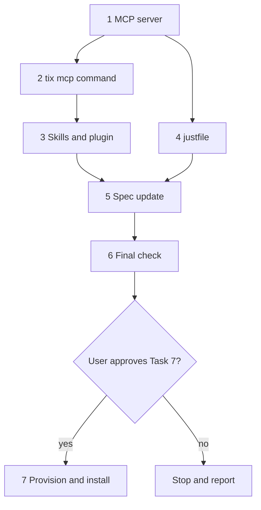
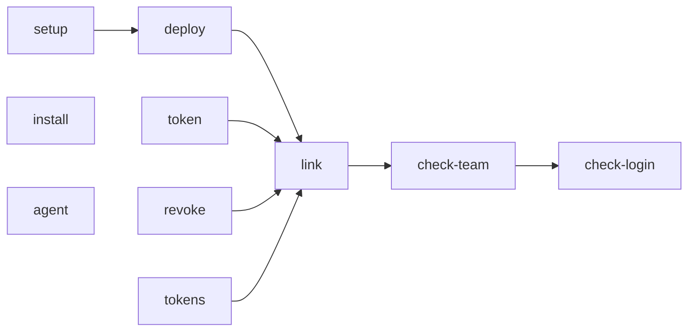

# tix MCP, Skills, and Machine Setup Implementation Plan

> **For agentic workers:** REQUIRED SUB-SKILL: Use superpowers:subagent-driven-development (recommended) or superpowers:executing-plans to implement this plan task-by-task. Steps use checkbox (`- [ ]`) syntax for tracking.

**Goal:** Add the `tix mcp` stdio server, the `tix` and `tix-plan` agent skills in a Claude Code plugin, and a justfile that provisions the Convex backend and installs tix on each machine.

**Architecture:** `src/mcp/server.ts` registers 5 tools on an `McpServer`. The tools use the same `TixClient`, `Git`, and project detection as the CLI. `tix mcp` connects the server to stdio. The plugin in `plugins/tix/` holds the 2 skills and an `.mcp.json` that starts `tix mcp`. The justfile checks the Convex login and team `your-team`, links the project, deploys, makes tokens, links the `tix` command into `~/.local/bin`, and installs the plugin.

**Tech Stack:** Node 24, TypeScript, pnpm, `@modelcontextprotocol/sdk` 1.32, `zod` 4, vitest, just 1.40, Convex CLI 1.48, Claude Code CLI.

**Spec:** `docs/specs/2026-10-29-tix-design.md`

---

## Plan Series

1. **Plan 1 (done):** the Convex backend.
2. **Plan 2 (done):** the CLI.
3. **This plan:** the MCP server, the agent skills, and the machine setup.

## Deviations From the Spec

- The MCP server has 5 tools, not 4. `show_task` is new. `list_tasks` leaves out descriptions, so an agent needs `show_task` to read a description.
- Only `create_task` and `list_tasks` accept `project`. The other tools take short IDs, and short IDs are unique in all projects.
- The `commit` argument of `update_task` is a git ref. The server reads the SHA, branch, and message from git in its working directory, as `tix done --commit` does.
- The plugin includes `plugins/tix/.mcp.json`. One plugin install gives the agent the skills and the MCP server.
- The repository root has `.claude-plugin/marketplace.json`, so Claude Code can install the plugin from the local checkout.
- `just install` links `src/index.ts` into `~/.local/bin/tix`. It replaces `pnpm link`.
- `just link` changes `.env.local` from the anonymous local deployment to a cloud dev deployment in team `your-team`. The tests use `convex-test`, so they do not change.

## Rules For The Implementer

- Work in a git worktree on the branch `tix-mcp`. Do not push.
- Use pnpm. Never use yarn.
- Never use `any`.
- Imports in `src/` must use explicit `.ts` or `.js` extensions.
- Run `pnpm typecheck` and `pnpm test` before each commit.
- Tasks 1 to 6 must not change anything outside the repository.
- Task 7 changes your Convex account, `~/.local/bin`, and the Claude Code configuration. Stop before Task 7 and ask the user to approve it.

## File Structure

```
.claude-plugin/marketplace.json     # Local marketplace with the tix plugin
justfile                            # Backend and machine setup
plugins/tix/
├── .claude-plugin/plugin.json
├── .mcp.json                       # Starts `tix mcp`
└── skills/
    ├── tix/SKILL.md
    └── tix-plan/SKILL.md
src/
├── mcp/
│   ├── server.ts                   # createMcpServer: 5 tools
│   └── server.test.ts
├── cli/
│   ├── mcp.ts                      # `tix mcp`: connects the server to stdio
│   └── commands.ts                 # Modify: add mcp
└── index.test.ts                   # Modify: stdio smoke test
```



## MCP Tools

| Tool | Arguments | Client call |
|---|---|---|
| `create_task` | `name`, `description?`, `priority?`, `parent?`, `project?` | `createTask` |
| `list_tasks` | `filter?` (`open`, `closed`, `all`, `ready`), `all_projects?`, `project?` | `listTasks` |
| `show_task` | `id` | `getTask` |
| `update_task` | `action` (`edit`, `start`, `complete`, `reopen`, `delete`), `id`, `name?`, `description?`, `priority?`, `parent?` (string or null), `result?`, `commit?` | `updateTask`, `startTask`, `completeTask`, `reopenTask`, `removeTask` |
| `manage_blockers` | `action` (`add`, `remove`), `id`, `blocker` | `addBlocker`, `removeBlocker` |

- A tool returns its data as pretty JSON text.
- A failure returns `isError: true` with the error message. The server keeps running.
- `update_task` rejects fields that do not belong to the action. `edit` accepts `name`, `description`, `priority`, and `parent`. `complete` accepts `result` and `commit`.

---

### Task 1: MCP server

**Files:**
- Modify: `package.json`, `pnpm-lock.yaml`
- Create: `src/mcp/server.ts`, `src/mcp/server.test.ts`

- [ ] **Step 1: Add the dependencies**

Run:

```bash
pnpm add @modelcontextprotocol/sdk@^1.32.2 zod@^4.6.7
```

- [ ] **Step 2: Write the failing test**

The test connects a real MCP `Client` to the server through `InMemoryTransport`. The server gets `fakeClient` from `src/test.setup.ts` and a fake `Git`.

`src/mcp/server.test.ts`:

```ts
import { Client } from "@modelcontextprotocol/sdk/client/index.js";
import { InMemoryTransport } from "@modelcontextprotocol/sdk/inMemory.js";
import { afterEach, describe, expect, it, vi } from "vitest";
import type { Commit, TixClient } from "../client.ts";
import { TixError } from "../errors.ts";
import type { Git } from "../git.ts";
import { PROJECT, fakeClient, listItem, taskDetail, taskView } from "../test.setup.ts";
import { createMcpServer } from "./server.ts";

const COMMIT: Commit = { sha: "abc1234", branch: "main", message: "fix: parser" };

let close: () => Promise<void> = async () => {};

afterEach(() => close());

/** Connects an MCP client to a server that uses the fakes. */
async function connect(client: TixClient, git: Partial<Git> = {}) {
  const server = createMcpServer({
    cwd: "/work/api",
    git: { remoteUrl: async () => "git@github.com:acme/api.git", commit: async () => null, ...git },
    client: async () => client,
  });
  const [clientTransport, serverTransport] = InMemoryTransport.createLinkedPair();
  await server.connect(serverTransport);
  const mcp = new Client({ name: "test", version: "1.0.0" });
  await mcp.connect(clientTransport);
  close = async () => {
    await mcp.close();
    await server.close();
  };

  const call = async (name: string, args: Record<string, unknown>) => {
    const result = await mcp.callTool({ name, arguments: args });
    const content = result.content as { type: string; text: string }[];
    return { isError: result.isError === true, text: content[0].text };
  };
  return { mcp, call };
}

describe("tix MCP server", () => {
  it("lists the tools", async () => {
    const { mcp } = await connect(fakeClient());
    const { tools } = await mcp.listTools();
    expect(tools.map((tool) => tool.name)).toEqual([
      "create_task",
      "list_tasks",
      "show_task",
      "update_task",
      "manage_blockers",
    ]);
  });

  it("creates a task in the project of the git remote", async () => {
    const createTask = vi.fn<TixClient["createTask"]>(async () => taskView({ shortId: "new11111" }));
    const { call } = await connect(fakeClient({ createTask }));
    const result = await call("create_task", { name: "Fix", description: "Details", priority: 2 });
    expect(result.isError).toBe(false);
    expect(JSON.parse(result.text)).toEqual(taskView({ shortId: "new11111" }));
    expect(createTask).toHaveBeenCalledWith({
      projectKey: PROJECT,
      name: "Fix",
      description: "Details",
      priority: 2,
      parent: undefined,
    });
  });

  it("uses the project argument before the git remote", async () => {
    const createTask = vi.fn<TixClient["createTask"]>(async () => taskView());
    const remoteUrl = vi.fn(async () => null);
    const { call } = await connect(fakeClient({ createTask }), { remoteUrl });
    await call("create_task", { name: "Fix", project: "github.com/acme/web" });
    expect(createTask).toHaveBeenCalledWith(expect.objectContaining({ projectKey: "github.com/acme/web" }));
    expect(remoteUrl).not.toHaveBeenCalled();
  });

  it("returns an error result when there is no project, and keeps running", async () => {
    const listTasks = vi.fn<TixClient["listTasks"]>(async () => []);
    const { call } = await connect(fakeClient({ listTasks }), { remoteUrl: async () => null });
    const failed = await call("list_tasks", {});
    expect(failed).toEqual({
      isError: true,
      text: "No git remote origin in this directory. Use --project <key>",
    });
    expect(await call("list_tasks", { all_projects: true })).toEqual({ isError: false, text: "[]" });
  });

  it("lists tasks with the open filter by default", async () => {
    const items = [listItem({ shortId: "a1" })];
    const listTasks = vi.fn<TixClient["listTasks"]>(async () => items);
    const { call } = await connect(fakeClient({ listTasks }));
    expect(JSON.parse((await call("list_tasks", {})).text)).toEqual(items);
    await call("list_tasks", { filter: "ready" });
    expect(listTasks).toHaveBeenNthCalledWith(1, { filter: "open", projectKey: PROJECT, allProjects: false });
    expect(listTasks).toHaveBeenNthCalledWith(2, { filter: "ready", projectKey: PROJECT, allProjects: false });
  });

  it("shows a task", async () => {
    const getTask = vi.fn<TixClient["getTask"]>(async () => taskDetail({ shortId: "a1" }));
    const { call } = await connect(fakeClient({ getTask }));
    expect(JSON.parse((await call("show_task", { id: "a1" })).text)).toEqual(taskDetail({ shortId: "a1" }));
    expect(getTask).toHaveBeenCalledWith({ id: "a1" });
  });

  it("edits a task and sends parent null to make a root task", async () => {
    const updateTask = vi.fn<TixClient["updateTask"]>(async () => taskView());
    const { call } = await connect(fakeClient({ updateTask }));
    await call("update_task", { action: "edit", id: "a1", name: "New", parent: null });
    expect(updateTask).toHaveBeenCalledWith({
      id: "a1",
      name: "New",
      description: undefined,
      priority: undefined,
      parent: null,
    });
  });

  it("rejects an edit with no fields", async () => {
    const { call } = await connect(fakeClient());
    expect(await call("update_task", { action: "edit", id: "a1" })).toEqual({ isError: true, text: "Nothing to change" });
  });

  it("rejects fields that do not belong to the action", async () => {
    const { call } = await connect(fakeClient());
    expect(await call("update_task", { action: "start", id: "a1", name: "New", result: "x" })).toEqual({
      isError: true,
      text: "name, result cannot be used with action start",
    });
  });

  it.each([
    ["start", "startTask"],
    ["reopen", "reopenTask"],
  ] as const)("runs %s", async (action, method) => {
    const run = vi.fn(async () => taskView({ shortId: "a1" }));
    const { call } = await connect(fakeClient({ [method]: run }));
    expect((await call("update_task", { action, id: "a1" })).isError).toBe(false);
    expect(run).toHaveBeenCalledWith({ id: "a1" });
  });

  it("completes a task with the commit from git", async () => {
    const completeTask = vi.fn<TixClient["completeTask"]>(async () => taskView({ completed: true }));
    const commit = vi.fn(async () => COMMIT);
    const { call } = await connect(fakeClient({ completeTask }), { commit });
    await call("update_task", { action: "complete", id: "a1", result: "Fixed", commit: "HEAD" });
    expect(commit).toHaveBeenCalledWith("/work/api", "HEAD");
    expect(completeTask).toHaveBeenCalledWith({ id: "a1", result: "Fixed", commit: COMMIT });
  });

  it("rejects a ref that is not a commit", async () => {
    const { call } = await connect(fakeClient());
    expect(await call("update_task", { action: "complete", id: "a1", commit: "nope" })).toEqual({
      isError: true,
      text: "nope is not a commit in /work/api",
    });
  });

  it("deletes a task and returns the deleted IDs", async () => {
    const removeTask = vi.fn<TixClient["removeTask"]>(async () => ["a1", "c1"]);
    const { call } = await connect(fakeClient({ removeTask }));
    expect(JSON.parse((await call("update_task", { action: "delete", id: "a1" })).text)).toEqual({
      deleted: ["a1", "c1"],
    });
  });

  it("adds and removes blockers", async () => {
    const addBlocker = vi.fn<TixClient["addBlocker"]>(async () => taskView({ blockedBy: ["b1"] }));
    const removeBlocker = vi.fn<TixClient["removeBlocker"]>(async () => taskView());
    const { call } = await connect(fakeClient({ addBlocker, removeBlocker }));
    await call("manage_blockers", { action: "add", id: "a1", blocker: "b1" });
    await call("manage_blockers", { action: "remove", id: "a1", blocker: "b1" });
    expect(addBlocker).toHaveBeenCalledWith({ blocked: "a1", blocker: "b1" });
    expect(removeBlocker).toHaveBeenCalledWith({ blocked: "a1", blocker: "b1" });
  });

  it("returns server errors as error results", async () => {
    const getTask = vi.fn(async () => {
      throw new TixError("NOT_FOUND", "Task zz not found");
    });
    const { call } = await connect(fakeClient({ getTask }));
    expect(await call("show_task", { id: "zz" })).toEqual({ isError: true, text: "Task zz not found" });
  });

  it("returns invalid arguments as error results", async () => {
    const { call } = await connect(fakeClient());
    const result = await call("update_task", { action: "archive", id: "a1" });
    expect(result.isError).toBe(true);
  });
});
```

- [ ] **Step 3: Run the test to make sure it fails**

Run: `pnpm exec vitest run src/mcp/server.test.ts`
Expected: FAIL. The import of `./server.ts` cannot be resolved.

- [ ] **Step 4: Write `src/mcp/server.ts`**

`McpContext` is a subset of the CLI `Context`, so `tix mcp` can pass its context directly.

```ts
import { McpServer } from "@modelcontextprotocol/sdk/server/mcp.js";
import * as z from "zod";
import type { TixClient } from "../client.ts";
import { TixError } from "../errors.ts";
import type { Git } from "../git.ts";
import { resolveProject } from "../project.ts";

/** What the server needs. The CLI `Context` has these fields, so `tix mcp` passes its context. */
export type McpContext = {
  cwd: string;
  git: Git;
  client: () => Promise<TixClient>;
};

type ToolResult = { content: { type: "text"; text: string }[]; isError?: boolean };

/** Runs a tool. A failure becomes an `isError` result, so the server keeps running. */
async function respond(work: () => Promise<unknown>): Promise<ToolResult> {
  try {
    return { content: [{ type: "text", text: JSON.stringify(await work(), null, 2) }] };
  } catch (error) {
    return { content: [{ type: "text", text: error instanceof Error ? error.message : String(error) }], isError: true };
  }
}

const project = z
  .string()
  .min(1)
  .optional()
  .describe("Project key, for example github.com/acme/api. The default comes from the git remote origin.");
const priority = z.number().int().min(0).max(100).describe("Lower is more important. The default is 1.");

const updateFields = {
  edit: ["name", "description", "priority", "parent"],
  start: [],
  complete: ["result", "commit"],
  reopen: [],
  delete: [],
} as const;

export function createMcpServer(ctx: McpContext): McpServer {
  const server = new McpServer({ name: "tix", version: "0.1.0" });
  const projectKey = (flag: string | undefined) => resolveProject(flag, () => ctx.git.remoteUrl(ctx.cwd));

  server.registerTool(
    "create_task",
    {
      description:
        "Create a task. Write the description like an issue body: what to do, why, the approach, and how to verify it.",
      inputSchema: {
        name: z.string().min(1).describe("One-line summary"),
        description: z.string().optional(),
        priority: priority.optional(),
        parent: z.string().min(1).optional().describe("Short ID of the parent task"),
        project,
      },
    },
    (args) =>
      respond(async () => {
        const key = await projectKey(args.project);
        return (await ctx.client()).createTask({
          projectKey: key,
          name: args.name,
          description: args.description,
          priority: args.priority,
          parent: args.parent,
        });
      }),
  );

  server.registerTool(
    "list_tasks",
    {
      description: "List tasks without descriptions. Each task has parentShortId and blockedBy, so you can build the tree.",
      inputSchema: {
        filter: z
          .enum(["open", "closed", "all", "ready"])
          .optional()
          .describe("The default is open. ready means open and not blocked by an open task."),
        all_projects: z.boolean().optional().describe("List the tasks of all projects"),
        project,
      },
    },
    (args) =>
      respond(async () => {
        const allProjects = args.all_projects === true;
        const key = allProjects ? undefined : await projectKey(args.project);
        return (await ctx.client()).listTasks({ filter: args.filter ?? "open", projectKey: key, allProjects });
      }),
  );

  server.registerTool(
    "show_task",
    {
      description: "Show one task with its description, subtasks, blockers, and the tasks it blocks.",
      inputSchema: { id: z.string().min(1).describe("Short ID") },
    },
    (args) => respond(async () => (await ctx.client()).getTask({ id: args.id })),
  );

  server.registerTool(
    "update_task",
    {
      description: [
        "Change a task. The action selects the change:",
        "edit: change name, description, priority, or parent (null makes a root task).",
        "start: record the start time.",
        "complete: close the task with result and an optional commit. A task with open subtasks cannot close.",
        "reopen: open a closed task.",
        "delete: delete the task and all its subtasks.",
      ].join("\n"),
      inputSchema: {
        action: z.enum(["edit", "start", "complete", "reopen", "delete"]),
        id: z.string().min(1).describe("Short ID"),
        name: z.string().min(1).optional(),
        description: z.string().optional(),
        priority: priority.optional(),
        parent: z.string().min(1).nullable().optional(),
        result: z.string().optional().describe("What was done, like a pull request description"),
        commit: z.string().min(1).optional().describe("A git ref. tix reads the SHA, branch, and message from git"),
      },
    },
    (args) =>
      respond(async () => {
        const { action, id, ...fields } = args;
        const allowed: readonly string[] = updateFields[action];
        const extra = Object.keys(fields).filter((field) => !allowed.includes(field));
        if (extra.length > 0) throw new TixError("USAGE", `${extra.join(", ")} cannot be used with action ${action}`);

        const client = await ctx.client();
        switch (action) {
          case "edit":
            if (Object.keys(fields).length === 0) throw new TixError("USAGE", "Nothing to change");
            return client.updateTask({
              id,
              name: fields.name,
              description: fields.description,
              priority: fields.priority,
              parent: fields.parent,
            });
          case "start":
            return client.startTask({ id });
          case "complete": {
            const commit = fields.commit === undefined ? undefined : await ctx.git.commit(ctx.cwd, fields.commit);
            if (commit === null) throw new TixError("USAGE", `${fields.commit} is not a commit in ${ctx.cwd}`);
            return client.completeTask({ id, result: fields.result, commit });
          }
          case "reopen":
            return client.reopenTask({ id });
          case "delete":
            return { deleted: await client.removeTask({ id }) };
        }
      }),
  );

  server.registerTool(
    "manage_blockers",
    {
      description: "Add or remove a blocker. A blocked task is not ready until its blocker closes.",
      inputSchema: {
        action: z.enum(["add", "remove"]),
        id: z.string().min(1).describe("Short ID of the blocked task"),
        blocker: z.string().min(1).describe("Short ID of the task that must close first"),
      },
    },
    (args) =>
      respond(async () => {
        const client = await ctx.client();
        const ids = { blocked: args.id, blocker: args.blocker };
        return args.action === "add" ? client.addBlocker(ids) : client.removeBlocker(ids);
      }),
  );

  return server;
}
```

- [ ] **Step 5: Run the test to make sure it passes**

Run: `pnpm exec vitest run src/mcp/server.test.ts && pnpm typecheck`
Expected: PASS, 17 tests.

- [ ] **Step 6: Commit**

```bash
git add package.json pnpm-lock.yaml src/mcp
git commit -m "feat: add the tix MCP server"
```

---

### Task 2: `tix mcp`

**Files:**
- Create: `src/cli/mcp.ts`
- Modify: `src/cli/commands.ts`, `src/index.test.ts`

The smoke test starts `node src/index.ts mcp`, sends `initialize` and `tools/list` as JSON lines on stdin, and reads the answer from stdout. It needs no configuration, because `tools/list` does not call Convex.

- [ ] **Step 1: Write the failing test**

Replace `src/index.test.ts`:

```ts
import { execFile, spawn } from "node:child_process";
import { createInterface } from "node:readline";
import { fileURLToPath } from "node:url";
import { promisify } from "node:util";
import { describe, expect, it } from "vitest";

const run = promisify(execFile);
const entry = fileURLToPath(new URL("./index.ts", import.meta.url));

describe("src/index.ts", () => {
  it("runs under Node with no build step", async () => {
    const { stdout, stderr } = await run(process.execPath, [entry, "help"]);
    expect(stdout).toContain("Usage: tix <command>");
    expect(stderr).toBe("");
  });

  it("exits with code 2 when there is no configuration", async () => {
    const env = { PATH: process.env.PATH, TIX_CONFIG: "/nonexistent/tix/config.toml" };
    const error = await run(process.execPath, [entry, "list", "--project", "x"], { env }).catch((e: unknown) => e);
    expect(error).toMatchObject({ code: 2, stderr: expect.stringContaining("No Convex URL or token") });
  });
});

describe("tix mcp", () => {
  it("answers tools/list over stdio", async () => {
    const child = spawn(process.execPath, [entry, "mcp"], { stdio: ["pipe", "pipe", "inherit"] });
    const lines = createInterface({ input: child.stdout });
    const send = (message: object) => child.stdin.write(`${JSON.stringify(message)}\n`);
    send({
      jsonrpc: "2.0",
      id: 1,
      method: "initialize",
      params: { protocolVersion: "2025-06-18", capabilities: {}, clientInfo: { name: "test", version: "1.0.0" } },
    });
    send({ jsonrpc: "2.0", method: "notifications/initialized" });
    send({ jsonrpc: "2.0", id: 2, method: "tools/list" });
    try {
      for await (const line of lines) {
        const message = JSON.parse(line);
        if (message.id !== 2) continue;
        expect(message.result.tools).toHaveLength(5);
        return;
      }
      expect.unreachable("The server closed stdout before it answered tools/list");
    } finally {
      child.kill();
    }
  });
});
```

- [ ] **Step 2: Run the test to make sure it fails**

Run: `pnpm exec vitest run src/index.test.ts`
Expected: FAIL in "answers tools/list over stdio". The process prints `Error: Unknown command mcp. Run tix help` and closes stdout.

- [ ] **Step 3: Write `src/cli/mcp.ts`**

The command must not write to stdout. Stdout carries the MCP protocol.

```ts
import { StdioServerTransport } from "@modelcontextprotocol/sdk/server/stdio.js";
import { createMcpServer } from "../mcp/server.ts";
import { noPositionals } from "./command.ts";
import type { Command } from "./command.ts";

export const mcp: Command = {
  name: "mcp",
  usage: "mcp",
  summary: "Start the MCP server on stdio.",
  notes: ["", "The server finds the project from its working directory. The create_task and list_tasks tools also accept a project argument."],
  async run(ctx, input) {
    noPositionals(input);
    // The open stdin keeps the process running after run returns.
    await createMcpServer(ctx).connect(new StdioServerTransport());
  },
};
```

- [ ] **Step 4: Add `mcp` to `src/cli/commands.ts`**

Replace the file:

```ts
import { TixError } from "../errors.ts";
import type { Command } from "./command.ts";
import { helpLines } from "./help.ts";
import { block } from "./block.ts";
import { create } from "./create.ts";
import { remove } from "./delete.ts";
import { done } from "./done.ts";
import { edit } from "./edit.ts";
import { list } from "./list.ts";
import { login } from "./login.ts";
import { mcp } from "./mcp.ts";
import { plan } from "./plan.ts";
import { projects } from "./projects.ts";
import { reopen } from "./reopen.ts";
import { show } from "./show.ts";
import { start } from "./start.ts";
import { unblock } from "./unblock.ts";

const help: Command = {
  name: "help",
  usage: "help [command]",
  summary: "Show help.",
  async run(ctx, input) {
    if (input.positionals.length > 1) throw new TixError("USAGE", "Expected at most one command name");
    for (const line of helpLines(commands, input.positionals[0])) ctx.out(line);
  },
};

/** All commands, in the order that `tix help` shows them. */
export const commands: Command[] = [
  list,
  create,
  show,
  edit,
  start,
  done,
  reopen,
  remove,
  block,
  unblock,
  plan,
  projects,
  login,
  mcp,
  help,
];
```

- [ ] **Step 5: Run the tests to make sure they pass**

Run: `pnpm test && pnpm typecheck && node src/index.ts help mcp`
Expected: PASS. The help shows `Usage: tix mcp`.

- [ ] **Step 6: Commit**

```bash
git add src/cli/mcp.ts src/cli/commands.ts src/index.test.ts
git commit -m "feat: add tix mcp"
```

---

### Task 3: Agent skills and plugin

**Files:**
- Create: `.claude-plugin/marketplace.json`, `plugins/tix/.claude-plugin/plugin.json`, `plugins/tix/.mcp.json`, `plugins/tix/skills/tix/SKILL.md`, `plugins/tix/skills/tix-plan/SKILL.md`

The skills use `tix` commands only.

- [ ] **Step 1: Write `.claude-plugin/marketplace.json`**

```json
{
  "$schema": "https://anthropic.com/claude-code/marketplace.schema.json",
  "name": "tix",
  "description": "Private code task tracking on Convex",
  "owner": { "name": "Gavin Stark" },
  "plugins": [
    {
      "name": "tix",
      "description": "tix skills and the tix MCP server",
      "source": "./plugins/tix",
      "category": "productivity"
    }
  ]
}
```

- [ ] **Step 2: Write `plugins/tix/.claude-plugin/plugin.json`**

```json
{
  "name": "tix",
  "version": "0.1.0",
  "description": "tix skills and the tix MCP server",
  "author": { "name": "Gavin Stark" }
}
```

- [ ] **Step 3: Write `plugins/tix/.mcp.json`**

```json
{
  "mcpServers": {
    "tix": { "command": "tix", "args": ["mcp"] }
  }
}
```

- [ ] **Step 4: Write `plugins/tix/skills/tix/SKILL.md`**

````markdown
---
name: tix
description: Track code tasks with the tix CLI. Use to break down complex work, track implementation items, or keep context across sessions and machines.
---

# Track Code Tasks with tix

`tix` stores private code tasks in Convex. Every machine sees the same tasks. `tix` finds the project from the `origin` remote of the current directory.

## Tasks Are Tickets

A task has three text fields:

- **Name**: a one-line summary, like an issue title.
- **Description**: what to do, why, the approach, and how to verify it, like an issue body.
- **Result**: what you did, your decisions, and the verification evidence, like a pull request description.

Another agent must understand the what, why, and how from the task alone.

Do not put tix IDs in commits, pull requests, or documents. The IDs mean nothing outside tix. Describe the work instead.

## When to Use tix

Use tix when:

- You break complex work into subtasks.
- The work continues in another session or on another machine.
- You must keep context for a handoff.
- You must record decisions.

Do not use tix when:

- The work is one small action.
- The work fits in this session and has no follow-up.

The built-in task tools of your agent last for one session only. Use them for steps inside this session. Use tix for work that must persist.

## Commands

```bash
tix                                  # Open tasks of this project, as a tree
tix list --ready                     # Open tasks that no open task blocks
tix list --closed                    # Closed tasks
tix list --all-projects              # Tasks of all projects
tix show <id>                        # All fields, subtasks, and blockers
tix create "<name>" -d "<description>" [-p <priority>] [--parent <id>]
tix edit <id> [--name <n>] [-d <desc>] [-p <prio>] [--parent <id> | --no-parent]
tix start <id>                       # Record the start time
tix done <id> -r "<result>" [--commit <ref>]
tix reopen <id>
tix delete <id>                      # Also deletes all subtasks
tix block <id> --by <blocker-id>
tix unblock <id> --by <blocker-id>
tix projects                         # Projects with open task counts
tix help <command>
```

Every command accepts `--json` and `--project <key>`. Use `--project` when the current directory has no git remote.

Priority is a number from 0 to 100. A lower number is more important. The default is 1.

## Before You Start a Task

Read the full context:

```bash
tix show <id>              # The task
tix show <parent-id>       # The parent, if the task has one
tix show <blocker-id>      # What a closed blocker did
```

Make sure that you can answer these questions:

- **What** must you do?
- **Why** is it necessary?
- **How** must you do it?
- **When** is it done?

If an answer is not clear, read the parent and the blockers. If it is still not clear, suggest plan mode before you start.

Then run `tix start <id>`.

## Hierarchies

A tree has 3 levels at most: epic, task, and subtask.

- A small change in 1 or 2 files: one task.
- A feature with 3 to 7 steps: a task with subtasks.
- A large initiative with 5 or more tasks: an epic with tasks.

Give each parent 3 to 7 children. Each task must fit in one focused session.

```bash
tix create "Add token verification" --parent <id> -d "..."
```

A task with open subtasks cannot close. Close the subtasks first.

## Blockers

Use a blocker when one task must close before another can start. `tix list --ready` leaves out blocked tasks.

```bash
tix block <id> --by <blocker-id>
```

## Close a Task

Close a task immediately after you implement and verify it:

```bash
tix done <id> -r "<result>" --commit HEAD
```

- `--commit` takes a git ref. tix reads the SHA, branch, and message from git.
- Leave out `--commit` for work with no code change, such as a plan or an investigation.

The result must include verification evidence:

- The test command and the pass count.
- The typecheck or lint result.
- What you tested by hand, and what you saw.

Also record decisions, deviations from the plan, and follow-up work. Create a new task for each follow-up.

A good result:

```
Added JWT verification middleware in src/auth/middleware.ts.
Tokens with an expired exp claim return 401. The secret comes from JWT_SECRET.
Decision: verify in middleware, not in each route, so new routes are safe by default.
Verification: pnpm test: 48 passed. pnpm typecheck: no errors.
Manual: curl with an expired token returned 401.
Follow-up: created task for token refresh.
```

A bad result: "Done. Added auth."

## MCP Tools

The tix plugin also starts `tix mcp`. Its tools are `create_task`, `list_tasks`, `show_task`, `update_task`, and `manage_blockers`. They do the same as the CLI. Use the tools or the CLI, whichever is available.
````

- [ ] **Step 5: Write `plugins/tix/skills/tix-plan/SKILL.md`**

````markdown
---
name: tix-plan
description: Create a tix task from a markdown plan, spec, design document, or roadmap, and break it into subtasks when that helps.
---

# Convert a Markdown Plan to tix Tasks

Use `/tix-plan <file.md>` to turn a planning document into a tix task.

## When to Use

- After you finish a plan in plan mode (`~/.claude/plans/*.md`).
- For a spec, a design document, a roadmap, or an RFC that is ready for implementation.

Do not use it when:

- The document is a draft or exploratory notes.
- The file is not saved to disk.
- The content is not actionable.

## Step 1: Create the Main Task

```bash
tix plan <file.md>
```

- The name is the first `# ` heading. Without a heading, the name is the file name without `.md`.
- tix removes a `Plan: ` prefix from the name.
- The description is the full file content.
- The command prints the short ID of the new task. Keep it.

Use `--project <key>` when the current directory has no git remote.

## Step 2: Decide on a Breakdown

Read the plan. Make subtasks when the plan has one of these:

- 3 to 7 separate work items: numbered steps, sections, or phases.
- Work in different files, modules, or layers.
- Steps that must happen in order.

Make tasks under an epic, not subtasks, when the plan has 5 or more large areas, or phases that have their own steps.

Keep one task when:

- The plan has only 1 or 2 steps.
- The plan is one fix or one small change.
- The plan is research or investigation.
- The items are tightly coupled.
- The plan has fewer than 10 lines of real content.

A tree has 3 levels at most: epic, task, and subtask.

## Step 3: Create the Subtasks

For each work item:

1. Name: the step or heading text, with no number or bullet. Use 1 to 10 words. Start with a verb: Add, Create, Update, Fix.
2. Description: the full section for that item, with code, file paths, and requirements. Add "Part of: <main task name>".
3. Create it:

```bash
tix create "<name>" --parent <main-id> -d "<description>"
```

When a step must wait for another step, add a blocker:

```bash
tix block <later-id> --by <earlier-id>
```

## Step 4: Report

With subtasks:

```
Created task <id> from <file.md>.
Found <N> separate steps. Created <N> subtasks:
- <id>: <name>
- <id>: <name>
See the tree: tix
```

Without subtasks:

```
Created task <id> from <file.md>.
The plan is one cohesive task. I did not make subtasks.
See the task: tix show <id>
```
````

- [ ] **Step 6: Validate the plugin**

Run:

```bash
claude plugin validate .
claude plugin validate plugins/tix
claude --plugin-dir ./plugins/tix plugin details tix
```

Expected:
- Both validations print `✔ Validation passed`. A warning about a missing icon is acceptable.
- `details` shows `Skills (2)  tix, tix-plan` and `MCP servers (1)  tix`.

- [ ] **Step 7: Commit**

```bash
git add .claude-plugin plugins
git commit -m "feat: add the tix skills and plugin"
```

---

### Task 4: justfile

**Files:**
- Create: `justfile`

How the recipes depend on each other:



Rules:
- `convex login status` exits with 0 even when you are not logged in, so the recipes read its text.
- A recipe stores command output in a variable before it runs `grep -q`. With `pipefail`, `cmd | grep -q` fails when grep exits early and `cmd` gets SIGPIPE.
- `link` reads the `team: <team>, project: <project>` comment that Convex writes after `CONVEX_DEPLOYMENT` in `.env.local`. The Convex CLI has no command that lists projects.
- Each recipe changes only what is wrong, so you can run `just setup` again safely.

- [ ] **Step 1: Write `justfile`**

```just
# tix setup. Run `just` to list the recipes.

team := "your-team"
project := "tix"
convex := "pnpm exec convex"

# List the recipes
default:
    @just --list

# Backend, once: log in, link, and deploy to production
setup: check-login check-team link deploy

# Stop if the Convex CLI is not logged in
check-login:
    #!/usr/bin/env bash
    set -euo pipefail
    status=$({{convex}} login status 2>&1)
    if ! grep -q '^Status: Logged in' <<<"$status"; then
      echo "Not logged in to Convex. Run: {{convex}} login" >&2
      exit 1
    fi

# Stop if the Convex login cannot reach the tix team
check-team: check-login
    #!/usr/bin/env bash
    set -euo pipefail
    status=$({{convex}} login status 2>&1)
    if ! grep -qF '({{team}})' <<<"$status"; then
      echo "This Convex login cannot reach team {{team}}." >&2
      echo "Run {{convex}} logout, then {{convex}} login with the account that owns {{team}}." >&2
      exit 1
    fi

# Link this directory to the tix project. Creates the project if it does not exist
link: check-team
    #!/usr/bin/env bash
    set -euo pipefail
    if grep -qF 'team: {{team}}, project: {{project}}' .env.local 2>/dev/null; then
      echo "Already linked to {{team}}/{{project}}"
      exit 0
    fi
    configure() {
      {{convex}} dev --once --configure existing --team {{team}} --project {{project}} --dev-deployment cloud
    }
    if ! configure; then
      {{convex}} project create {{project}} --team {{team}}
      configure
    fi

# Deploy the backend to production and print the production URL
deploy: link
    {{convex}} deploy --yes --cmd 'echo "Production URL: $TIX_URL"' --cmd-url-env-var-name TIX_URL

# Make a token for one machine. Convex shows the token once
token NAME: link
    {{convex}} run --prod tokens:create '{"name":"{{NAME}}"}'

# Revoke the token of one machine
revoke NAME: link
    {{convex}} run --prod tokens:revoke '{"name":"{{NAME}}"}'

# List the machine tokens
tokens: link
    {{convex}} run --prod tokens:list

# Each machine: put tix on the PATH
install:
    pnpm install --frozen-lockfile
    /bin/mkdir -p ~/.local/bin
    /bin/ln -sfn {{justfile_directory()}}/src/index.ts ~/.local/bin/tix
    @echo "Installed ~/.local/bin/tix. Next: tix login --url <url> --token <token>"

# Each machine: install the tix skills and MCP server in Claude Code
agent:
    #!/usr/bin/env bash
    set -euo pipefail
    marketplaces=$(claude plugin marketplace list --json)
    if ! grep -q '"name": "tix"' <<<"$marketplaces"; then
      claude plugin marketplace add {{justfile_directory()}}
    fi
    plugins=$(claude plugin list --json)
    if ! grep -q '"tix@tix"' <<<"$plugins"; then
      claude plugin install tix@tix --scope user
    fi
```

- [ ] **Step 2: Check the read-only recipes**

Run:

```bash
just --list
just check-team; echo "exit=$?"
just team=nobody-1 check-team; echo "exit=$?"
just --dry-run deploy
```

Expected:
- `--list` shows `agent`, `check-login`, `check-team`, `default`, `deploy`, `install`, `link`, `revoke NAME`, `setup`, `token NAME`, and `tokens`.
- `check-team` gives exit 0 when the Convex login can reach `your-team`. If the machine is not logged in, it prints `Not logged in to Convex` and gives exit 1.
- `team=nobody-1` prints `This Convex login cannot reach team nobody-1.` and gives exit 1.
- `--dry-run deploy` prints the commands and runs nothing that changes the account.

Do not run `link`, `deploy`, `token`, `revoke`, `tokens`, `install`, or `agent` in this task.

- [ ] **Step 3: Commit**

```bash
git add justfile
git commit -m "feat: add the setup justfile"
```

---

### Task 5: Update the spec

**Files:**
- Modify: `docs/specs/2026-10-29-tix-design.md`

- [ ] **Step 1: Replace the MCP Server section**

Replace everything from `## MCP Server` to the line before `## Agent Skills` with:

```markdown
## MCP Server

`tix mcp` starts a stdio server with `@modelcontextprotocol/sdk`. It finds the project from its working directory.

| Tool | Purpose |
|---|---|
| `create_task` | Create a task. Accepts an optional `project`. |
| `list_tasks` | List tasks without descriptions. It has the same filters as `tix list`, and an optional `project`. |
| `show_task` | Show one task with its description, subtasks, and blockers. |
| `update_task` | Edit, start, complete, reopen, or delete a task through an `action` field. |
| `manage_blockers` | Add or remove a blocker through an `action` field. |

- The `commit` argument of `update_task` is a git ref. The server reads the SHA, branch, and message from git.
- `update_task` rejects fields that do not belong to the action.
- Tool errors must return `isError: true` with the message.
- An error must not stop the server process.

```

- [ ] **Step 2: Replace the Agent Skills section**

Replace everything from `## Agent Skills` to the line before `## Project Layout` with:

```markdown
## Agent Skills

- The Claude Code plugin is in `plugins/tix/`. `.claude-plugin/marketplace.json` lists it, so Claude Code can install it from the checkout.
- `plugins/tix/skills/tix/SKILL.md` teaches the agent to track work with tix.
- `plugins/tix/skills/tix-plan/SKILL.md` teaches the agent to turn a plan document into tasks.
- `plugins/tix/.mcp.json` starts `tix mcp`.
- Both skills must use `tix` commands only.

```

- [ ] **Step 3: Change the Project Layout section**

In the layout tree:

1. Replace `│   └── mcp/server.ts` with `│   └── mcp/server.ts    # 5 MCP tools`.
2. Add `│   │   ├── mcp.ts       # tix mcp` under `src/cli/`, before `│   │   └── <command>.ts`.
3. Replace the `plugins/tix/skills/` block with:

```
├── .claude-plugin/marketplace.json
├── plugins/tix/
│   ├── .claude-plugin/plugin.json
│   ├── .mcp.json        # Starts tix mcp
│   └── skills/
│       ├── tix/SKILL.md
│       └── tix-plan/SKILL.md
├── justfile             # Backend and machine setup
```

- [ ] **Step 4: Replace the Machine Setup section**

Replace everything from `## Machine Setup` to the end of the file with:

```markdown
## Machine Setup

The Convex project `tix` belongs to the team `your-team`.

Backend, once:

1. Log in to Convex with the account that owns `your-team`: `pnpm exec convex login`.
2. Run `just setup`. It checks the login and the team, links the project, deploys, and prints the production URL.

Each machine:

1. Clone the repository.
2. Run `just install`. It links `src/index.ts` into `~/.local/bin/tix`.
3. On a machine with Convex access, run `just token <machine>`. Convex shows the token once.
4. Run `tix login --url <production URL> --token <token>`.
5. Run `just agent`. It installs the plugin with the skills and the MCP server in Claude Code.

Run `just` to list all recipes.
```

- [ ] **Step 5: Commit**

```bash
git add docs/specs/2026-10-29-tix-design.md
git commit -m "docs: describe the MCP tools, the plugin, and the justfile setup"
```

---

### Task 6: Final check

**Files:** none.

- [ ] **Step 1: Run all checks**

Run: `pnpm test && pnpm typecheck`
Expected: 199 tests pass in the `convex` and `cli` projects, and tsc exits with 0.

- [ ] **Step 2: Report and ask**

Report the results. Then ask the user to approve Task 7. Do not start Task 7 without approval.

---

### Task 7: Provision and install (needs user approval)

**Files:** `.env.local` (changed by Convex, not committed).

This task creates a Convex project and a production deployment in team `your-team`. It also changes `~/.local/bin` and the Claude Code configuration. Run it from the main checkout after the merge, not from the worktree.

- [ ] **Step 1: Provision the backend**

Run: `just setup`
Expected: the recipe prints `Production URL: https://<name>.convex.cloud`. Write down the URL.

`deploy` uses `--yes`, because the recipe always deploys to production.

- [ ] **Step 2: Install tix on this machine**

Run:

```bash
just install
just token "$(hostname)"
tix login --url <production URL> --token <token>
```

Expected: `command -v tix` prints `/home/dev/.local/bin/tix`. `tix login` prints `Saved the configuration to /home/dev/.config/tix/config.toml`.

- [ ] **Step 3: Run the CLI against production**

```bash
cd /home/dev/dev/tix
id=$(tix create "E2E check" -d "From plan 3")
tix
tix show "$id"
tix done "$id" -r "Checked" --commit HEAD
tix list --closed
tix delete "$id"
tix projects
```

Expected:
- `create` prints an 8-character short ID.
- `tix` shows `[ ] <id>: E2E check` under the project `github.com/...` of this repository. If the repository has no `origin` remote, add `--project e2e/check` to each command.
- `done` shows `[x] <id>: E2E check`.
- `delete` prints `Deleted 1 task(s): <id>`.

- [ ] **Step 4: Install the plugin**

Run: `just agent`
Expected: `claude plugin list` shows `tix@tix`. `claude mcp list` shows `tix` as connected.

- [ ] **Step 5: Update the setup memory**

The memory file `/home/dev/.claude/projects/-home-dev-dev-tix/memory/tix-convex-setup-justfile.md` says that plan 3 must add the justfile. Change it to say that the justfile exists, and record the production URL.

- [ ] **Step 6: Report**

Report the production URL, the end-to-end result, and the plugin status. Do not push.
